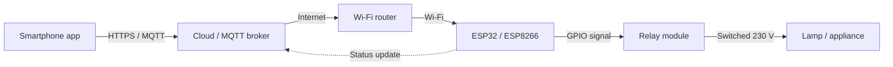

# :LiBook: Lesson 11: Internet of Things & Embedded Systems

> [!ABSTRACT] Syllabus Scope (NIE Teacher's Guide 11.1–11.2)
> - **11.1** Embedded systems; microcontroller-based development systems vs microprocessor-based systems; board features; USB and IDE; simple applications (LED, LDR, temperature/fan, reed switch).
> - **11.2** IoT definition, needs, applications, enabling technologies; remote switch application; social and security consequences.

---

## 1. Embedded Systems (11.1)

### 1.1 What is an embedded system?
An **embedded system** is a computer system built into a larger device to perform a **dedicated function**. It combines hardware and software and usually works in real time.

| Feature | Meaning |
| :--- | :--- |
| **Dedicated** | Designed for one task or a small set of related tasks, not general-purpose computing. |
| **Input–Process–Output (IPO)** | Sensors provide input, the processor follows a program, and actuators produce output. |
| **Constrained** | Limited memory, processing power, energy and cost; often no keyboard or screen. |
| **Firmware** | The program is stored in ROM/Flash and starts automatically when power is applied. |
| **Real-time** | It must respond within a required time; a late answer can be as bad as a wrong answer. |

| General-purpose computer | Embedded system |
| :--- | :--- |
| Runs many different applications. | Runs a dedicated control program. |
| Large OS, keyboard, display, storage. | Small firmware, limited I/O, often headless. |
| Optimised for flexibility and performance. | Optimised for cost, power, size and reliability. |

**Examples:** washing machine controller, microwave oven, car engine control unit (ECU), digital camera, smart watch, Arduino weather station, IoT sensor node.

> [!NOTE] Embedded ≠ necessarily IoT
> An embedded system can work completely offline inside one device. An **IoT device** is normally an embedded system with **network connectivity** and data exchange added.

### 1.2 Microcontroller vs microprocessor
A **microcontroller (MCU)** is a complete small computer on one chip: CPU + memory + I/O peripherals. A **microprocessor (MPU)** is mainly the CPU; RAM, ROM and I/O are external.

| Aspect | Microcontroller (e.g. ATmega328P, ESP32) | Microprocessor (e.g. Intel Core, AMD Ryzen) |
| :--- | :--- | :--- |
| **Purpose** | Specific control tasks in embedded systems | General-purpose computing |
| **Integration** | CPU, memory and I/O on one chip | CPU separate from memory and peripherals |
| **Memory** | Built-in Flash/ROM and RAM | Needs external memory |
| **I/O peripherals** | Built-in I/O ports, ADC, timers, serial ports | Needs external chips for I/O |
| **Power** | Low power consumption | Higher power consumption |
| **Cost** | Low cost | Higher cost |
| **Complexity** | Simple and task-specific | Complex and powerful |
| **Examples** | ATmega328P, ESP32, PIC, ARM Cortex-M | Intel Core, AMD Ryzen |

> [!IMPORTANT] Exam wording
> A **microcontroller is a computer on a chip**; a **microprocessor is only the CPU** and needs external support chips. This is why microcontrollers are used in small, low-power embedded and IoT devices.

In a **microprocessor-based development system**, the MPU is mounted on a board with separate RAM, ROM and I/O circuits. In a **microcontroller-based development system**, those parts are integrated into the microcontroller, so the board is smaller, cheaper and more suitable for dedicated control.

**Supporting note:** Raspberry Pi is a single-board computer (SBC), not a microcontroller. It is useful for heavier embedded projects but has a full operating system and different hardware design.

### 1.3 Microcontroller-based development systems
A **microcontroller-based development system** is the combination of:

- **Hardware:** development board, microcontroller, USB cable, sensors, actuators, power supply.
- **Software:** IDE, code editor, compiler, uploader/programmer, libraries and drivers.

A **development board** is the hardware platform itself. It contains the microcontroller plus the support circuits needed to program and test it.

> [!NOTE] Supporting examples
> The TG requires Arduino and similar microcontroller-based development systems. The extra board examples below are useful comparisons, not a mandatory list.

| Development board | Microcontroller / features | Typical use |
| :--- | :--- | :--- |
| **Arduino Uno** | ATmega328P, 8-bit AVR, USB, 14 digital pins, 6 analog inputs | Learning, prototyping, simple control |
| **Arduino Nano** | ATmega328, smaller form factor | Space-limited projects |
| **Arduino Mega** | ATmega2560, many I/O pins | Projects needing many sensors/motors |
| **Arduino Due** | ARM Cortex-M3, more processing power | Advanced robotics and complex projects |
| **ESP8266 / ESP32** | Microcontroller with built-in Wi-Fi | IoT and remote-control projects |
| **micro:bit** | Educational board with sensors and LED matrix | School projects and learning |
| **MagicBit** | Sri Lankan development board | Arduino/MicroPython educational projects |

> [!NOTE] Development system vs development board
> The **development system** includes both hardware and software tools. The **development board** is mainly the hardware platform used to build and test circuits.

**Why Arduino is popular:** open-source platform, simple C/C++-based language, large library collection, easy USB programming and a large community.

---

## 2. Arduino Board Features & Workflow (11.1)

### 2.1 Features of a microcontroller-based development system
The NIE TG expects you to identify the microcontroller, analog input, digital input, digital output, receiver/transmitter pins, communication port and power supply. PWM, reset and oscillator are supporting board features.

| Feature | Arduino Uno example | Purpose |
| :--- | :--- | :--- |
| **Microcontroller** | ATmega328P | Executes the program and controls the board |
| **Digital input** | Pins 0–13 can read HIGH/LOW | Read buttons, digital sensors, switches |
| **Digital output** | Pins 0–13 can output HIGH/LOW | Drive LEDs, buzzers, relays, motor drivers |
| **Analog input** | Pins A0–A5, 10-bit ADC | Read variable sensors such as LDR and LM35 |
| **Digital output / PWM** | Pins marked `~` support `analogWrite()` | LED brightness, motor speed |
| **Receiver and transmitter pins** | RX (pin 0) and TX (pin 1) | Serial communication with other devices |
| **Communication port** | USB socket via USB-to-serial chip | Programming, serial monitor, power |
| **Power supply** | USB, DC barrel jack (about 7–12 V), VIN; 5 V, 3.3 V and GND pins | Power the board and external components |
| **Reset button** | Restarts the microcontroller | Restart the uploaded program |
| **Oscillator** | Provides the clock signal | Keeps instruction timing stable |

**Supporting details:** `IOREF` gives the board's operating voltage reference; `AREF` supplies an external reference voltage for the ADC.

### 2.2 Connecting the board to a computer
1. Connect the board with a **USB cable**.
2. The computer recognises the **USB-to-serial converter** and creates a serial port.
3. Select the correct **board type** and **port** in the IDE.
4. Write the program, compile it and upload it through USB.

The USB connection supplies power during programming and also carries serial data for the Serial Monitor.

### 2.3 Arduino IDE workflow
The **Arduino IDE** is the software used to write, compile and upload programs to the board.

| Step | What happens |
| :--- | :--- |
| **1. Write** | Type the program in the code editor. |
| **2. Verify / compile** | The compiler checks the code and converts it into machine code for the microcontroller. |
| **3. Upload** | The compiled binary (for AVR boards such as the Uno, a `.hex` file) is sent to the board through USB. |
| **4. Run** | The board executes the uploaded program. |

- The IDE includes a **code editor**, **compiler**, **uploader/programmer**, error messages and a **Serial Monitor**.
- Download the IDE from the official Arduino website (`arduino.cc`).
- **Tinkercad** is a useful simulator if you do not have a physical board.

### 2.4 Arduino program structure
Arduino programs are based on C/C++ and have two required functions:

```cpp
const int LED_PIN = 13;

void setup() {
    pinMode(LED_PIN, OUTPUT);   // runs once at power-up/reset
}

void loop() {
    digitalWrite(LED_PIN, HIGH); // runs repeatedly
    delay(1000);
    digitalWrite(LED_PIN, LOW);
    delay(1000);
}
```

| Function | Purpose |
| :--- | :--- |
| `pinMode(pin, MODE)` | Sets a digital pin as `INPUT` or `OUTPUT`. |
| `digitalWrite(pin, HIGH/LOW)` | Outputs logic HIGH (5 V on a 5 V board) or LOW (0 V). |
| `digitalRead(pin)` | Reads a digital input as `HIGH` or `LOW`. |
| `analogRead(pin)` | Reads an analog input on A0–A5; returns 0–1023. |
| `analogWrite(pin, value)` | Produces PWM on a `~` pin; value 0–255. |
| `Serial.begin(9600)` | Starts serial communication for debugging. |
| `Serial.print()` / `Serial.println()` | Sends text/values to the Serial Monitor. |
| `delay(ms)` | Pauses the program for the given milliseconds. |

> [!INFO] Deep Dive Note
> For full wiring notes, pin details and code examples for LED, LDR, LM35 and reed-switch applications, read: [[Subtopics/IoT Microcontrollers & Sensor Interfacing|IoT Microcontrollers & Sensor Interfacing Guide]].

---

## 3. Sensors, Actuators & Interfacing (11.1)

### 3.1 Sensor vs actuator
- **Sensor:** converts a physical quantity (light, temperature, motion, distance) into an electrical signal. It is an **input** device.
- **Actuator:** converts an electrical control signal into a physical action (light, sound, movement, switching). It is an **output** device.

> [!NOTE] Supporting examples
> The TG's simple applications use an LED, an LDR, a temperature sensor and a reed switch. The other sensor types below are useful exam examples but are not a mandatory list.

| Sensor | Measures | Typical output | Example use |
| :--- | :--- | :--- | :--- |
| **LDR** | Light intensity | Analog resistance/voltage | Automatic street light |
| **LM35** | Temperature | Analog voltage (10 mV/°C) | Fan control, temperature logger |
| **Reed switch** | Magnetic field / door position | Digital open/closed | Door/window alarm |
| **PIR** | Infrared motion | Digital HIGH/LOW | Security light |
| **Ultrasonic HC-SR04** | Distance | Digital pulse timing | Obstacle avoidance |
| **IR sensor** | Reflection/proximity | Digital or analog | Line-following robot |
| **Gas sensor** | Gas concentration | Analog or digital | Gas leak alarm |
| **Soil moisture sensor** | Soil water content | Analog | Automatic irrigation |
| **Flame sensor** | Infrared flame | Digital or analog | Fire alarm |

### 3.2 Analog vs digital
- **Analog sensor:** output changes continuously over a range, e.g. LDR or LM35. It needs an **ADC** to convert the voltage into a number.
- **Digital sensor:** output is a discrete HIGH/LOW or a pulse train, e.g. PIR or ultrasonic distance sensor.

Arduino Uno has a **10-bit ADC**, so an analog input is converted to an integer from **0 to 1023**.

$$V_{\text{measured}} \approx \frac{\text{ADC reading}}{1023} \times 5\text{ V}$$

For LM35: \(V_{\text{measured}} \times 100 \approx\) temperature in °C, because the output is 10 mV per °C.

### 3.3 Actuators
| Actuator | Function | Note |
| :--- | :--- | :--- |
| **LED** | Light output | Use a current-limiting resistor. |
| **Buzzer** | Sound output | Can be active or passive. |
| **Relay** | Electrically operated switch | Allows a low-voltage MCU to control a high-voltage appliance safely. |
| **DC motor** | Continuous rotation | Needs a motor driver; do not connect directly to an Arduino pin. |
| **Servo motor** | Precise angular movement | Controlled by a PWM signal. |

### 3.4 Interfacing rules
- **Never drive a motor or mains appliance directly from an Arduino pin.** Use a transistor, motor driver or relay.
- **LED:** connect a resistor in series to limit current.
- **LDR:** use a voltage divider with a fixed resistor so the Arduino can read a voltage.
- **Switch:** use a pull-up or pull-down resistor so the input is not left floating; Arduino also has `INPUT_PULLUP`.
- **Relay:** use a relay module with isolation and a flyback diode; check whether it is active-HIGH or active-LOW.
- **PWM:** `analogWrite()` is not a true analog voltage; it switches rapidly and changes the average power.

---

## 4. Simple Embedded Applications (11.1)

These applications use the same basic pattern: **get an input or condition → process it → drive an output**. LED blink is output-only; the other applications read a sensor.

| Application | Input | Processing | Output | Key functions |
| :--- | :--- | :--- | :--- | :--- |
| **LED blink / on-off** | None (timed) or push button | Set HIGH/LOW with a delay, or check button state | LED | `pinMode`, `digitalWrite`, `delay`, `digitalRead` |
| **LDR light control** | LDR on A0 | If light level is below threshold, turn on LED | LED | `analogRead`, `digitalWrite` |
| **Temperature-controlled fan** | LM35 on A0 | Convert reading to °C; if temperature ≥ threshold, turn on fan | Fan through relay/motor driver | `analogRead`, `digitalWrite` |
| **Door open/close detection** | Reed switch on a digital pin | Check whether the door is open or closed | LED/buzzer/alarm | `pinMode`, `digitalRead`, `digitalWrite` |

**Generic control pattern:**

```cpp
const int LED_PIN = 13;

int sensorValue = analogRead(A0);   // read input
if (sensorValue < 300) {            // compare with threshold
    digitalWrite(LED_PIN, HIGH);    // drive output
} else {
    digitalWrite(LED_PIN, LOW);
}
```

**Design checklist:** choose the correct sensor, set a suitable threshold, use the correct pin mode, protect the board with resistors/drivers, calibrate the sensor and test fail-safe behaviour.

---

## 5. IoT Fundamentals (11.2)

### 5.1 Definition
**Internet of Things (IoT)** is a system of interconnected devices that communicate and exchange data over the Internet.

Key points:
- Devices connect through Wi-Fi, Bluetooth or other networks.
- Different devices and systems can work together and exchange data.
- Sensors collect data from the physical world.
- Data is processed locally or in the cloud.
- Actuators can respond automatically or be controlled remotely.
- Apps and voice commands provide user control.

| Concept | Main idea |
| :--- | :--- |
| **Internet** | Connects people and general-purpose computers. |
| **Embedded system** | A dedicated computer inside a device; it may be offline. |
| **IoT** | Networked embedded devices that sense, share data and often act remotely. |

### 5.2 Why IoT? Needs
IoT is used to make daily life and industry **smart**:

- **Convenience and automation:** devices adjust themselves without manual action.
- **Remote monitoring and control:** check or control a device from another place.
- **Efficiency and resource saving:** reduce energy, water and waste.
- **Safety and security:** detect fire, gas, intrusion or abnormal conditions.
- **Data-driven decisions:** collect real data and analyse patterns.
- **Better quality of life:** healthcare monitoring, smart homes, smart agriculture.
- **New services and business models:** predictive maintenance, usage-based services.

### 5.3 Enabling technologies
| Technology | Role in IoT |
| :--- | :--- |
| **Sensors and actuators** | Collect physical data and perform actions. |
| **Embedded processing** | Microcontrollers process data and control hardware. |
| **Wireless connectivity** | Wi-Fi, Bluetooth/BLE, Zigbee/Z-Wave, LoRa/LoRaWAN, NB-IoT, 4G/5G. |
| **Cloud computing** | Stores, processes and analyses large amounts of IoT data. |
| **Edge computing** | Processes data near the device to reduce latency and bandwidth use. |
| **Data analytics and AI/ML** | Finds patterns, predicts failures and supports automation. |
| **Security and privacy** | Encryption, authentication and access control protect devices and data. |
| **Power management** | Batteries, low-power chips and energy harvesting keep devices running. |

### 5.4 IoT architecture (supporting)
A common **4-layer model**:

| Layer | Function | Examples |
| :--- | :--- | :--- |
| **1. Sensing / Perception** | Collect data and interact with the physical world | Sensors, actuators, microcontrollers |
| **2. Network / Gateway** | Transmit data between devices and the network | Wi-Fi router, gateway, cellular modem |
| **3. Service / Cloud** | Store, process and analyse data | Cloud database, MQTT broker, analytics |
| **4. Application** | Provide a user-facing service | Mobile app, dashboard, alert system |

> [!NOTE] Supporting model
> The NIE TG names the IoT concepts but does not prescribe this exact layer model. It is a useful way to organise answers.

### 5.5 Connectivity and messaging protocols (supporting)
| Technology / protocol | Key property | Typical use |
| :--- | :--- | :--- |
| **Wi-Fi** | Short range, higher power, high data rate | Home and office IoT devices |
| **Bluetooth / BLE** | Very short range, low power | Wearables, phone accessories |
| **Zigbee / Z-Wave** | Short range, low power, mesh | Smart home automation |
| **LoRa / LoRaWAN** | Long range, very low power, low data rate | Agriculture, remote sensors |
| **NB-IoT** | Cellular, long range, low power | Meters, tracking, smart city |
| **MQTT** | Lightweight publish/subscribe protocol | Device-to-cloud messaging |
| **HTTP / REST** | Request/response over the web | Simple cloud APIs and dashboards |

---

## 6. IoT Applications (11.2)

| Domain | IoT use |
| :--- | :--- |
| **Smart home** | Smart thermostats, lighting, door locks, security cameras, voice control. |
| **Healthcare** | Remote patient monitoring, wearable heart-rate and activity trackers, medication reminders. |
| **Smart cities** | Traffic management, smart streetlights, waste management, environmental monitoring. |
| **Agriculture** | Soil-moisture monitoring, automated irrigation, crop monitoring, livestock tracking. |
| **Industrial IoT (IIoT / Industry 4.0)** | Predictive maintenance, asset tracking, real-time monitoring of machines and production lines. |
| **Retail** | Smart shelves, inventory tracking, personalised offers, cashier-less checkout. |
| **Transport and logistics** | Vehicle tracking, route optimisation, fleet management, predictive maintenance. |
| **Energy management** | Smart meters, energy monitoring, grid optimisation, demand control. |

---

## 7. Remote Switch IoT Application (11.2)

### 7.1 What it does
A **remote switch** lets a user turn a device on or off from a smartphone or computer through the Internet. The TG example is switching a light/LED on and off.

### 7.2 Architecture


### 7.3 Components
| Component | Role |
| :--- | :--- |
| **ESP32 / ESP8266** | Wi-Fi microcontroller that connects to the cloud and controls the relay. |
| **Relay module** | Electrically operated switch; isolates the low-voltage board from the high-voltage lamp. |
| **Lamp/appliance** | The load being switched. |
| **Wi-Fi router** | Provides Internet connectivity to the microcontroller. |
| **Cloud / MQTT broker** | Receives commands from the app and forwards them to the device. |
| **Smartphone app / dashboard** | User interface with ON and OFF controls. |

### 7.4 Operation
1. The ESP32 connects to Wi-Fi and authenticates with the cloud/MQTT broker.
2. The user presses **ON** or **OFF** in the app.
3. The command travels through the Internet to the cloud/broker.
4. The broker forwards the command to the correct device.
5. The ESP32 changes a GPIO pin HIGH or LOW.
6. The relay switches the lamp on or off.
7. The device sends its new status back to the app.

### 7.5 Control logic
```cpp
const int RELAY_PIN = 5;

if (command == "ON") {
    digitalWrite(RELAY_PIN, HIGH);   // or LOW if the relay is active-LOW
} else if (command == "OFF") {
    digitalWrite(RELAY_PIN, LOW);
}
```

> [!WARNING] Relay polarity
> Many relay modules are **active-LOW**: `LOW` turns the relay on. Always check the module or datasheet before connecting a mains appliance.

### 7.6 Why use a relay?
- A microcontroller pin cannot safely switch 230 V mains power.
- The relay provides **electrical isolation** between the low-voltage control circuit and the high-voltage load.
- It can control lamps, fans, pumps and other appliances.
- Use a properly rated relay, enclosure and fuse; mains wiring should be done by a qualified person.

### 7.7 Security requirements
- Use a **unique device ID and strong password/token**; never leave the default password.
- Use **TLS/HTTPS** or an encrypted MQTT connection.
- Authenticate the user and the device; restrict who can send commands.
- Do not expose the relay directly to the public Internet without protection.
- Use a **fail-safe** state: switch off on disconnect or error.
- Keep firmware updated and monitor abnormal commands.

---

## 8. IoT Challenges & Consequences (11.2)

### 8.1 Technical challenges
| Challenge | Explanation |
| :--- | :--- |
| **Privacy and sensitive data** | IoT devices collect personal, health and location data. |
| **Weak security** | Default passwords, unencrypted traffic and outdated firmware invite attacks. |
| **Massive data** | Millions of devices generate large volumes of data that must be stored and analysed. |
| **Connectivity** | Devices depend on reliable Internet; poor coverage causes failures. |
| **Scalability and management** | Managing thousands of devices, updates and security policies is complex. |
| **Faulty sensors / calibration** | Bad readings lead to wrong automatic decisions. |
| **Cost** | Devices, sensors, gateways and software have a high initial cost. |
| **Interoperability** | Different vendors and protocols may not work together. |
| **Power** | Battery-powered devices need low-power design or energy harvesting. |

### 8.2 Security consequences
- Unauthorised users may control doors, lights, cameras or industrial equipment.
- Data breaches can expose personal, health or business information.
- Infected devices can be recruited into **botnets** and used to attack other systems.
- Weak devices can be used to spy, disrupt services or cause physical harm.
- Mitigation: encryption, authentication, access control, network segmentation, timely updates, secure defaults and auditing.

### 8.3 Social and ethical consequences
- **Privacy and surveillance:** always-on sensors can monitor people without clear consent.
- **Dependence:** services may fail when the network or cloud is unavailable.
- **Digital divide:** expensive smart technology may benefit only some communities.
- **E-waste:** short device lifetimes and disposable sensors create electronic waste.
- **Employment change:** automation changes jobs and may require new skills.
- **Safety:** faulty automation can affect homes, vehicles, hospitals and factories.
- **Data ownership:** users may not know who owns or sells the data collected about them.
- Mitigation: informed consent, transparency, privacy-by-design, regulation, secure disposal/recycling and human override.

---

## 9. Exam Traps

| Confusion | Correct idea |
| :--- | :--- |
| Microcontroller vs microprocessor | MCU = CPU + memory + I/O on one chip; MPU = CPU only. |
| Sensor vs actuator | Sensor = input; actuator = output. |
| Analog vs digital sensor | Analog gives a continuous voltage; digital gives HIGH/LOW or pulses. |
| Embedded vs IoT | Embedded may be offline; IoT adds network connectivity and data exchange. |
| `digitalRead` vs `analogRead` | `digitalRead` returns HIGH/LOW; `analogRead` returns 0–1023. |
| Relay vs transistor | Both can switch loads; a relay gives mechanical isolation and can switch mains. |
| Cloud vs edge | Cloud is centralised; edge processes data near the device. |

---

## :LiRocket: Flashcards (Spaced Repetition)

#flashcards

What is an Embedded System? :: A specialized computer system designed to perform dedicated control functions within a larger mechanical or electrical system.
<!--SR:!2026-10-29,2,230-->

What is the main structural difference between a Microprocessor and a Microcontroller? :: A microprocessor is mainly the CPU and needs external RAM/ROM/I/O; a microcontroller integrates the CPU, RAM, ROM/Flash, timers and I/O ports on one chip.
<!--SR:!2026-11-12,16,290-->

What is the difference between a Sensor and an Actuator? :: A Sensor converts physical parameters into electrical signals (input); an Actuator converts electrical signals into physical actions (output).
<!--SR:!2026-10-30,3,250-->

Name 2 Analog Sensors and 2 Digital Sensors used in IoT. :: Analog: LDR (Light Dependent Resistor), LM35 (Temperature); Digital: PIR (Motion Sensor), Ultrasonic (HC-SR04).
<!--SR:!2026-12-07,41,290-->

List the 4 layers of the common IoT architecture model. :: 1. Sensing/Perception Layer, 2. Network/Gateway Layer, 3. Service/Cloud Layer, 4. Application Layer.
<!--SR:!2026-11-21,25,270-->

What is the IPO model in an embedded system? :: Input from sensors, processing by the controller, and output through actuators.

What is the difference between an embedded system and a general-purpose computer? :: An embedded system runs a dedicated control program with limited resources; a general-purpose computer runs many applications with a full OS and user interface.

What is a microcontroller-based development system? :: Hardware plus software tools used to design, program and test microcontroller applications.

What is the difference between a development system and a development board? :: A development system includes the board and software tools; a development board is the hardware platform with the microcontroller and support circuits.

What are the RX and TX pins used for? :: Serial communication: RX receives data and TX transmits data one bit at a time.

What is the purpose of the USB port on an Arduino? :: It provides programming, serial communication and power through the USB-to-serial connection.

What is the Arduino IDE used for? :: Writing, compiling and uploading programs to an Arduino-compatible board.

What is an LDR? :: A light-dependent resistor whose resistance changes with light intensity; it is used as an analog light sensor.

What is an LM35? :: An analog temperature sensor whose output changes by about 10 mV per °C.

What is a reed switch? :: A magnetic switch that opens or closes in the presence of a magnetic field; it is used for door/window detection.

What is a relay? :: An electrically operated switch that lets a low-voltage controller safely switch a high-voltage load.

What is the common control pattern for a simple embedded application? :: Read the sensor, compare or process the value, then drive an actuator.

Name the four simple microcontroller applications required by the TG. :: LED blink/on-off, LDR light control, temperature-controlled fan, and reed-switch door detection.

What is IoT (Internet of Things)? :: A system of interconnected devices that communicate and exchange data over the Internet.

What is the difference between IoT and an embedded system? :: An embedded system may work offline; IoT adds network connectivity, data exchange and often cloud services.

Why is IoT useful in daily life? :: It provides convenience, automation, remote monitoring, efficiency, safety and data-driven decisions.

What are the enabling technologies of IoT? :: Sensors/actuators, embedded processing, wireless connectivity, cloud/edge computing, data analytics/AI, security and power management.

What is the difference between Wi-Fi and LoRa? :: Wi-Fi gives higher data rates over short range with higher power; LoRa gives long range and low power with a low data rate.

What is MQTT? :: A lightweight publish/subscribe messaging protocol used by IoT devices and a broker.

Describe the architecture of a remote switch IoT application. :: Smartphone app → cloud/MQTT broker → Wi-Fi router → ESP32/ESP8266 → relay → lamp, with status sent back to the app.

Why is a relay used in a remote switch? :: It isolates the low-voltage microcontroller from the high-voltage appliance and safely switches the load.

What are the main security risks of IoT? :: Weak passwords, unencrypted data, unauthorised control, data breaches, botnets and physical safety risks.

What are the social consequences of IoT? :: Privacy and surveillance concerns, dependence on networks, digital divide, e-waste, job changes and safety issues.

What are the main technical challenges of IoT? :: Sensitive data, weak security, massive data volumes, unreliable connectivity, scalability, faulty sensors, cost and interoperability.

How can IoT security be improved? :: Use encryption, authentication, access control, updates, network segmentation, secure defaults and auditing.
