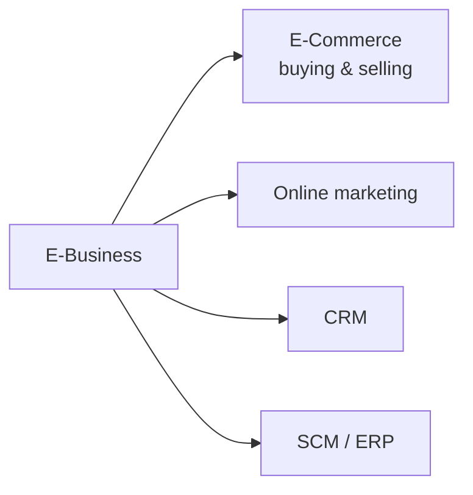
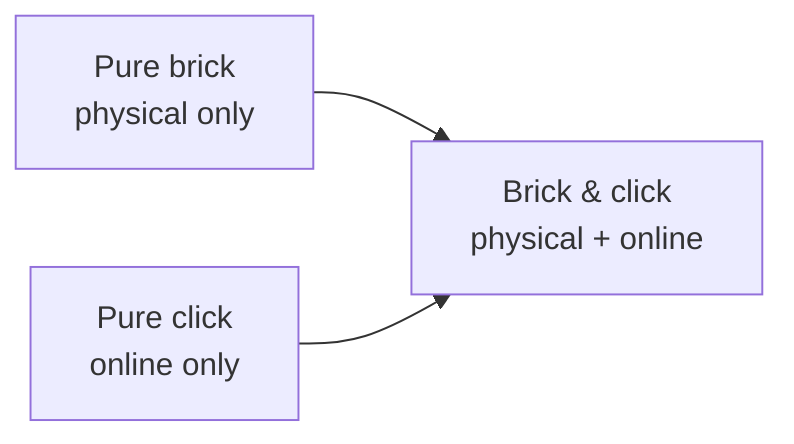
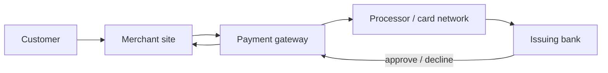

# :LiBook: Lesson 12: E-Commerce & Business Applications

> [!ABSTRACT] Syllabus Scope (NIE TG 12.1–12.3)
> - **12.1** Digital economy, new business methods, pure brick/click, ICT in business functions, secure payments, threats/opportunities
> - **12.2** E-commerce vs e-business, transaction types, e-business models, advantages/disadvantages
> - **12.3** E-marketing, databases/AI in marketing, competitive advantage, mobile marketing
> - **Supporting:** enterprise systems (ERP, SCM, CRM, KMS) and modern work concepts

---

## 1. E-Business vs E-Commerce

- **E-Business (Electronic Business)**: Any business activity that uses the Internet and electronic tools. It includes internal processes (HR, finance, production) as well as external activities (selling, marketing, supply chain).
- **E-Commerce (Electronic Commerce)**: A **subset** of e-business focused on **buying and selling goods/services online**.

| Aspect | E-Commerce | E-Business |
|---|---|---|
| **Scope** | Online transactions | All digitally enabled business activities |
| **Includes** | Online stores, marketplaces, payments, order fulfilment | E-commerce + online marketing, CRM, SCM/ERP, online learning, collaboration |
| **Focus** | Buying and selling | Running the whole business electronically |

> [!NOTE] Integrated e-business
> In an integrated e-business, sales, production, finance and warehouse modules often share a **common database**, so data can be shared in real time.

---

## 2. Digital Economy & New Business Methods (12.1)

### 2.1 Digital economy

The **digital economy** is economic activity based mainly on **digital technologies**, especially the Internet. Companies such as Amazon, eBay, Facebook, Apple and Google have shaped it, and the growth of the Internet and Web 2.0 enabled **globalisation** by connecting people, businesses and smart devices worldwide.

### 2.2 New business methods

| Method | What it is | Benefit / example |
|---|---|---|
| **Reverse auction** | The buyer posts a requirement; sellers compete by **bidding down** the price, and the lowest bid usually wins. | Lower purchase cost for the buyer. |
| **Group purchasing** | Several buyers combine their orders into one large order. | Volume discount and better terms from suppliers. |
| **E-marketplace** | A virtual space on the Internet where buyers and sellers meet. | Wider reach; examples: Amazon, eBay, Etsy, Alibaba. |

**Forward auction vs reverse auction:**

| Feature | Forward auction | Reverse auction |
|---|---|---|
| **Direction** | Buyers bid **up** | Sellers bid **down** |
| **Winner** | Highest bidder | Lowest bidder |
| **Price trend** | Rises during bidding | Falls during bidding |
| **Typical user** | Seller selling an item | Buyer procuring an item |

### 2.3 Pure brick, pure click and brick & click

| Type | Physical store? | Online store? | Key feature |
|---|---|---|---|
| **Pure brick** | Yes | No | Only physical shops; local/regional reach; no online convenience. |
| **Pure click** | No | Yes | Only online; global reach; no physical inspection. |
| **Brick & click** | Yes | Yes | Both channels; combines online reach with physical presence. |

> [!CAUTION] Exam trap
> **Brick & click** is not the same as **pure click**. Brick & click has **both** a physical store and an online store; pure click has **only** an online channel.

---

## 3. ICT in Business Functions (12.1)

| Business function | How ICT helps | Examples |
|---|---|---|
| **Accounting** | Automates transactions, invoices, financial statements and payroll; improves accuracy and speed. | QuickBooks, Xero |
| **Human resource** | Centralises employee data; automates recruitment, onboarding, training and payroll links. | HRIS, applicant-tracking systems |
| **Production** | Supports design, simulation, production planning, inventory and real-time monitoring. | CAD/CAM, MES, IoT sensors |
| **Marketing & sales** | Manages customer data, tracks interactions, automates sales and measures campaigns. | CRM, HubSpot, Google Analytics |
| **Supply chain** | Forecasts demand, manages inventory/logistics and links trading partners. | SCM software, EDI, RFID/barcode, blockchain |
| **Business communication** | Integrates voice, video, email and messaging; supports remote collaboration. | Microsoft 365, Google Workspace, Zoom, Teams |
| **Secure payments** | Connects merchants to banks/card networks and protects payment data. | Payment gateways, secure cards, third-party systems |

> [!NOTE] Where the details are
> Secure payment mechanisms are expanded in **§7**, and e-marketing is expanded in **§9**.

---

## 4. E-Commerce Transaction Types (12.2)

| Type | Full name | What happens | Examples |
|---|---|---|---|
| **B2B** | Business-to-Business | One business sells to another (manufacturer → wholesaler → retailer). | Alibaba |
| **B2C** | Business-to-Consumer | A business sells directly to individual consumers. | Amazon, Daraz |
| **C2C** | Consumer-to-Consumer | One consumer sells directly to another, usually through a platform. | eBay, ikman.lk |
| **C2B** | Consumer-to-Business | An individual sells products/services to a business. | Upwork, Fiverr |
| **B2E** | Business-to-Employee | A business provides products/services to its employees to improve productivity and satisfaction. | HR self-service portal, payroll, training |
| **G2C** | Government-to-Citizen | Government provides digital services to citizens. | gov.lk, e-Revenue portal |

> [!NOTE] M-commerce
> **M-commerce** is not a separate participant type. It means e-commerce conducted through **mobile devices** (smartphones/tablets), often using apps or mobile-optimised websites.

> [!CAUTION] Commonly forgotten
> **B2E** is in the TG list. Do not stop at B2B, B2C, C2C, C2B and G2C.

---

## 5. E-Business Models (12.2)

| Model | What it is | Examples |
|---|---|---|
| **Virtual storefront** | A single business's own website that sells goods/services directly to consumers; includes product listings, cart, payment, search and reviews. | Nike, Warby Parker |
| **Information broker** | A business/individual that collects, organises and sells information from public sources. | Market-research firms, data aggregators |
| **Online marketplace** | A platform where **many sellers** offer products/services to buyers. | eBay, Amazon Marketplace, Alibaba, Etsy |
| **Content provider** | Creates and distributes content online (text, video, audio, social, multimedia or educational). | BBC, YouTube, Spotify, Khan Academy |
| **Online service provider (OSP)** | Delivers services over the Internet. | ISPs, cloud storage, email, web hosting |
| **Portal** | A website that acts as a gateway to information, resources and services. | Enterprise portal (SharePoint), e-commerce/customer/supplier portals |
| **Virtual community** | A group of people who interact online around shared interests, goals or backgrounds. | Reddit, Facebook Groups, gaming/professional networks |

> [!IMPORTANT] Virtual storefront vs online marketplace
> A **virtual storefront** is **one business** selling through its own site. An **online marketplace** hosts **many independent sellers**; the marketplace operator may not own the inventory.

> [!NOTE] E-marketplace vs online marketplace
> TG 12.1 uses **e-marketplace** as the broad idea of a virtual buyer–seller space. TG 12.2 uses **online marketplace** as a platform business model. They overlap; the second is the more specific model.

---

## 6. Advantages & Disadvantages of E-Business (12.2)

| Criterion | Advantage | Disadvantage |
|---|---|---|
| **Reach** | Global audience, 24/7 selling | Limited personal relationships |
| **Cost** | Lower overhead than physical stores | Investment in website development and marketing |
| **Convenience** | Shop anytime, anywhere | Customers cannot physically inspect goods |
| **Selection** | Wider variety of products/services | Information overload for some customers |
| **Efficiency** | Streamlined and automated transactions | Dependence on technology and Internet connectivity |
| **Information** | Easy access to product details and reviews | Security risks: data breaches and online scams |
| **Personalization** | Tailored shopping experience | Privacy concerns about data collection |
| **Marketing** | Targeted campaigns reach specific segments | Intense competition in the online marketplace |

---

## 7. E-Payment Systems (12.1)

### 7.1 EFT and cards

- **Electronic Funds Transfer (EFT)**: Electronic transfer of money from one bank account to another.
- **Credit/debit cards**: Cards carry card data on a magnetic strip, chip or contactless element; online payments use **HTTPS/TLS**, **3D Secure/OTP**, encryption and **tokenisation**.
- A secure system should **not store plain card data**; a token replaces the card number for later use.

### 7.2 Payment gateway

A **payment gateway** is software/service that securely connects a merchant to banks and card networks, authorises the payment and returns the result.

- The gateway **encrypts** payment data and passes the authorisation request through the processor/card network to the issuing bank.
- **Settlement** (actual transfer of funds) usually happens later, not at the moment of approval.
- Examples: Stripe, PayHere, WebXPay; PayPal also provides payment services.

### 7.3 Third-party systems and mobile wallets

- **Third-party payment systems**: Independent providers such as **PayPal, Apple Pay, Google Pay**. The customer links a card/bank account, and the buyer and seller do **not** need to share bank details directly.
- **Mobile wallets**: Contactless payment apps on phones/watches; often use tokenisation.

> [!NOTE] Gateway vs third-party system
> A **payment gateway** is the technical connection between merchant, bank and card network. A **third-party payment system** is an independent payment provider/wallet. Some companies provide both.

### 7.4 Encryption and cryptocurrency

- Payment data must be encrypted **in transit** (HTTPS/TLS) and protected **at rest**. See [[Lesson 06 - Data Communication & Networking|Lesson 06]] for encryption and digital signatures.
- The TG lists **“micro credit payments”** with **Bitcoin** as the example. At exam level, treat this as a **cryptocurrency/micro-payment**: a fully digital currency recorded on a **blockchain**, not issued or controlled by a central bank.
- Risks: high price volatility, limited acceptance, regulatory uncertainty and irreversible transactions.

---

## 8. Threats & Opportunities in E-Commerce (12.1)

| Area | Threats | Opportunities |
|---|---|---|
| **Privacy** | Data breaches, identity theft, data misuse, weak regulatory compliance | Stronger data protection, transparency and consent, personalisation, privacy by design |
| **Product commercialisation** | Intellectual-property theft, counterfeiting, price wars, overreliance on platforms | E-commerce platforms, strategic partnerships, diversification, data-driven product development |
| **Related: security** | Cyberattacks, insider threats, IoT vulnerabilities, supply-chain risks | Cybersecurity investment, employee training, advanced authentication, threat monitoring |

> [!NOTE] TG focus
> TG 12.1 highlights **privacy** and **product commercialisation**. Security is a related cross-topic; its technical details are in [[Lesson 06 - Data Communication & Networking|Lesson 06]].

> [!IMPORTANT] Privacy vs personalisation
> E-commerce collects customer data to personalise recommendations and marketing. This must be balanced with **consent, data protection and privacy rules**; otherwise personalisation becomes a privacy threat.

---

## 9. E-Marketing (12.3)

**E-marketing (electronic marketing)** is the use of **digital channels and technologies** to promote products or services to potential customers.

### 9.1 Marketing vs e-marketing

| Aspect | Traditional marketing | E-marketing |
|---|---|---|
| **Channels** | Print, TV, radio, direct mail | Websites, email, social media, search engines, online ads |
| **Reach** | Often local/regional | Global potential |
| **Interaction** | Mostly one-way | Two-way: clicks, likes, shares, comments |
| **Measurement** | Limited ROI tracking | Analytics and detailed ROI tracking |
| **Adaptability** | Slower to change | Real-time response to trends |
| **Cost** | Often higher for advertising space/printing | Often lower, with precise budget control |

> [!NOTE] The 4 Ps
> Marketing is built around the **4 Ps**: **Product, Price, Place, Promotion**.

### 9.2 Core digital channels

| Channel | What it is |
|---|---|
| **SEO** | Optimising website content/structure to rank higher in **organic** search results. |
| **Content marketing** | Creating valuable, relevant content to attract and retain an audience. |
| **Social media marketing** | Engaging audiences and building brands on social platforms. |
| **Email marketing** | Sending targeted/personalised messages to subscribers. |
| **PPC advertising** | Pay-per-click ads; the advertiser pays when the ad is clicked. |
| **Affiliate marketing** | Paying a commission for referrals/sales. |
| **Influencer marketing** | Using social-media personalities to promote products. |
| **Web advertising** | Display/banner, search, social and other online ads. |

### 9.3 Databases in marketing

Databases store customer data such as purchase history, preferences and interactions. They are used for:

- **Segmentation** — grouping customers by behaviour or needs.
- **Personalisation** — tailored messages and recommendations.
- **Campaign measurement** — tracking engagement, conversions and ROI.
- **Better targeting** — reaching the right audience with less waste.

> [!WARNING] Privacy
> Customer databases must be handled lawfully: obtain consent, protect the data and avoid misuse.

### 9.4 AI in marketing

- **Predictive analytics** — forecast customer behaviour, demand and sales.
- **Recommendation engines** — suggest relevant products/content.
- **Chatbots and virtual assistants** — answer queries and support transactions.
- **NLP** — analyse reviews, surveys and social media for customer sentiment.
- **Dynamic content** — personalise web pages, emails and ads.
- **Optimisation/automation** — improve ad targeting, campaigns and A/B testing.

### 9.5 Competitive advantage through ICT

ICT can give a business an edge through:

- **Global reach** and 24/7 availability.
- **Lower operating costs** and automated processes.
- **Personalisation** and better customer experience.
- **Data-driven decisions** and faster response to trends.
- **Better customer insights** and targeted marketing.

### 9.6 Mobile marketing

- Make websites, emails, ads and content **mobile-friendly/responsive**.
- Use **mobile apps**, **push notifications**, **location-based marketing**, **SMS** and mobile ads.
- Mobile marketing supports **M-commerce** — buying/selling through mobile devices.

---

## 10. Supporting: Enterprise Information Systems

> [!NOTE] Scope
> These are supporting systems. TG 12.1 lists **SCM** and **CRM** within business functions; **ERP** and **KMS** are covered in other lessons but are useful here.

| System | Purpose |
|---|---|
| **ERP (Enterprise Resource Planning)** | Integrated software managing core processes (finance, HR, manufacturing, sales, inventory) on a common database. |
| **SCM (Supply Chain Management)** | Plans and manages the flow from supplier to customer: demand forecasting, inventory, logistics; may use EDI, RFID/barcode and blockchain. |
| **CRM (Customer Relationship Management)** | Manages customer data, interactions, sales and support to improve retention. |
| **KMS (Knowledge Management System)** | Captures and shares organisational knowledge, procedures and expertise. |

---

## 11. Supporting: Modern Work Concepts

> [!NOTE] Scope
> Virtual organisations and teleworking are useful modern-work concepts, but they are **not** part of the main TG 12.1–12.3 list.

| Concept | Definition | Benefits | Challenges |
|---|---|---|---|
| **Virtual organisation** | A network of independent companies/freelancers linked by ICT, without a traditional physical headquarters. | Flexibility, global talent, shared costs. | Coordination, trust, security. |
| **Teleworking** | Performing work outside a central office using ICT. | Less commuting, flexibility, lower office cost. | Isolation, connectivity, security. |

---

## :LiRocket: Flashcards (Spaced Repetition)

#flashcards

What is the difference between E-Business and E-Commerce? :: E-Business includes all electronically conducted internal and external business activities; E-Commerce is specifically the buying and selling of goods/services online over the internet.
<!--SR:!2026-10-29,2,230-->

Give an example of a C2C E-Commerce platform. :: eBay or ikman.lk.
<!--SR:!2026-12-10,44,290-->

What is a Payment Gateway? :: An e-commerce application service provider that authorizes and securely processes credit card or digital payments for online merchants.
<!--SR:!2026-10-29,2,230-->

What is an ERP (Enterprise Resource Planning) system? :: An integrated software system that manages core business functions (Finance, HR, Inventory, Sales) across an entire organization in a single centralized database.

What is the role of a Customer Relationship Management (CRM) system? :: To track and manage all interactions with current and potential customers to improve business relationships and customer retention.

What is Teleworking? :: Performing job responsibilities remotely outside of a central office using ICT tools and internet connectivity.

What is the digital economy? :: Economic activity based mainly on digital technologies, especially the Internet; examples include Amazon, eBay and Google.

What is a reverse auction? :: The buyer posts a requirement and sellers compete by bidding down the price; the lowest bid usually wins.

What is group purchasing? :: Several buyers combine their orders into one large order to obtain a volume discount or better terms.

Pure brick vs pure click vs brick & click? :: Pure brick = physical stores only; pure click = online only; brick & click = both physical and online channels.

What is B2E? :: Business-to-Employee: a business provides products or services to its employees, such as payroll, training or an HR portal.

Virtual storefront vs online marketplace? :: A virtual storefront is one business selling through its own website; an online marketplace hosts many independent sellers.

What is an information broker? :: A business or individual that collects, organises and sells information from public sources.

Content provider vs online service provider? :: A content provider creates/distributes content; an online service provider delivers services over the Internet (ISP, cloud storage, email, hosting).

What is a portal? :: A website that acts as a gateway to information, resources and services, such as an enterprise or customer portal.

What is a virtual community? :: A group of people who interact online around shared interests, goals or backgrounds.

Give one advantage and one disadvantage of e-business. :: Advantage: global reach/lower costs/convenience; disadvantage: less personal contact, security/privacy risks, Internet dependence or no physical inspection.

What are the main privacy threats in e-commerce? :: Data breaches, identity theft, data misuse and weak regulatory compliance; protect with consent, security and privacy by design.

What are the main product-commercialisation threats in e-commerce? :: Intellectual-property theft, counterfeiting, price wars and overreliance on platforms.

What is e-marketing? :: The use of digital channels and technologies to promote products or services to potential customers.

What is SEO? :: Optimising a website's content and structure to rank higher in organic search results.

How are databases used in marketing? :: To segment customers, personalise messages, measure campaigns and improve targeting.

How is AI used in marketing? :: Predictive analytics, recommendation engines, chatbots/NLP, dynamic content and campaign optimisation.

What is mobile marketing? :: Optimising marketing for mobile devices using mobile-friendly sites/ads, apps, push notifications, location-based marketing and SMS.

How can ICT create competitive advantage? :: Through global reach, lower costs, personalisation, data-driven decisions, faster response and 24/7 availability.

What is the TG example of a cryptocurrency/micro-payment? :: Bitcoin — a digital currency recorded on a blockchain, not issued by a central bank.

How does a payment gateway process an online card payment? :: Customer → merchant → gateway → processor/card network → issuing bank → approval/decline → merchant; settlement happens later.

What is a third-party payment system? :: An independent provider such as PayPal, Apple Pay or Google Pay that links a customer's card/bank and lets buyer and seller transact without sharing bank details.

What are secure credit-card payment practices? :: Use HTTPS/TLS, 3D Secure/OTP, encryption and tokenisation; do not store plain card data.

Give an example of ICT in a business function. :: Accounting software automates transactions; HRIS manages employee data; CAD/CAM supports production; EDI links supply-chain partners; unified communications supports collaboration.
