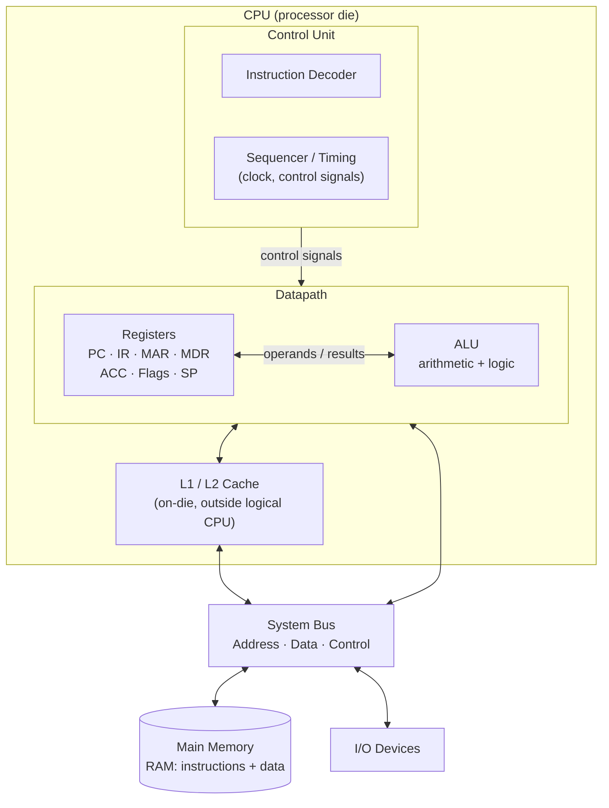
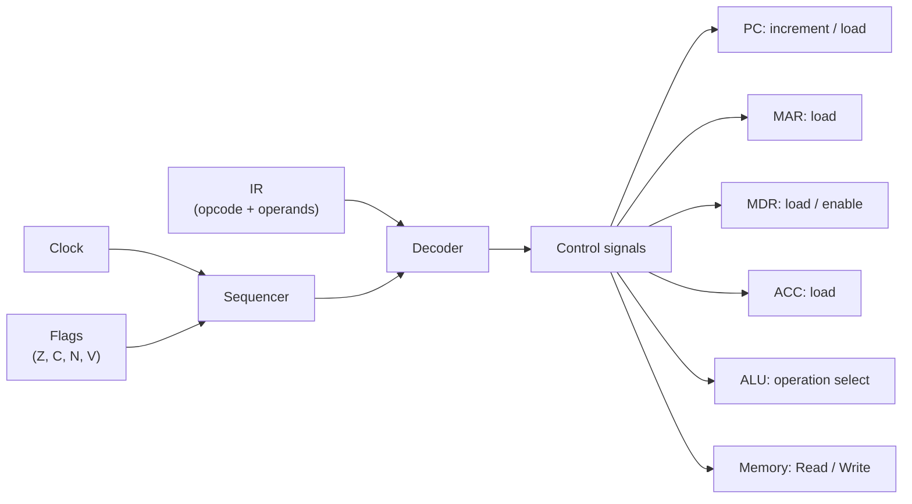
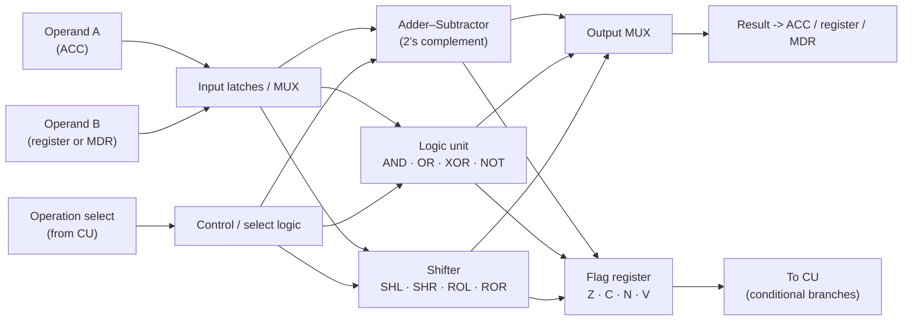
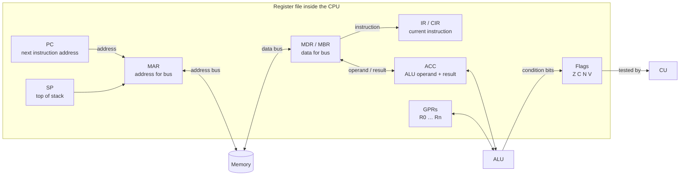
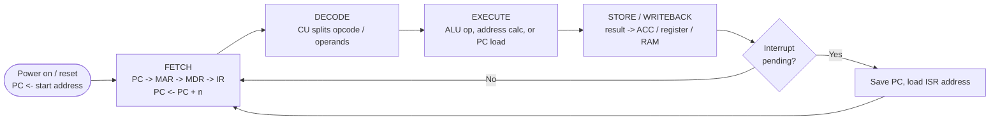
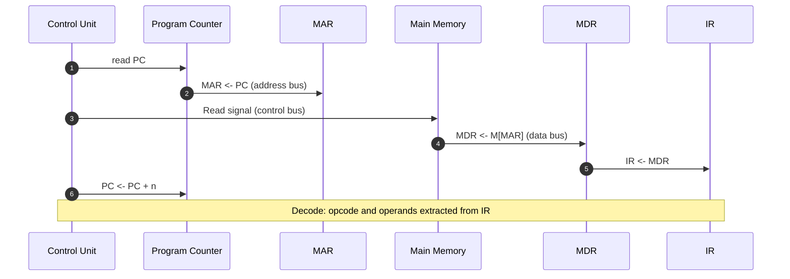

# :LiCpu: Subtopic: CPU Architecture, Registers, ALU & the Instruction Cycle

> [!ABSTRACT] Core Focus
> Everything inside the **Central Processing Unit**: the Control Unit, the Arithmetic Logic Unit, every register (PC, IR, MAR, MDR, ACC, Flags, SP), instruction formats, the full **fetch–decode–execute–store** cycle in register-transfer notation, control signals, CPU performance maths, and the exam traps that separate CU, ALU and the registers.
>
> Companion note: [[Von Neumann Architecture]] (stored-program concept, buses, bottleneck). This note goes **inside** the CPU.

---

## 1. What the CPU Is

The **CPU (Central Processing Unit)** is the part of the computer that **fetches instructions, decodes them, and executes them**. It is the *processor*; memory only stores, I/O only moves data.

The CPU performs exactly four jobs:

1. **Fetch** the next instruction from memory.
2. **Decode** it to find out what operation is required.
3. **Execute** it (compute, move data, or change the flow of control).
4. **Write back / store** the result.

> [!IMPORTANT] Precise definition
> The CPU is hardware built from **three functional blocks**: the **Control Unit (CU)**, the **Arithmetic Logic Unit (ALU)**, and **registers**. Cache (L1/L2/L3) is physically on the same die in modern CPUs but is *not* part of the CPU's logical definition.

| CPU responsibility | Performed by |
|---|---|
| Fetching instructions, decoding, sequencing, timing | **Control Unit** |
| Arithmetic, logic, comparison, shift operations | **ALU** |
| Holding the current instruction, addresses, operands, results | **Registers** |
| Moving data between blocks | Internal datapath + system bus |

---

## 2. CPU Block Diagram



> [!TIP] The one-line mental model
> **CU = the conductor. ALU = the calculator. Registers = the conductor's desk. Buses = the corridors. Memory = the warehouse.**
> The conductor never does arithmetic; the calculator never decides what to calculate.

---

## 3. The Control Unit (CU)

The CU **directs and coordinates** every other part. It contains no arithmetic circuitry — it is a sequencer plus a decoder.

### 3.1 Jobs of the CU

1. **Fetch control** — copy `PC` to `MAR`, issue a **Read** signal, latch the returned word into `MDR`, move it to `IR`, increment the PC.
2. **Decode** — split the instruction in `IR` into **opcode** and **operands**; determine which registers, ALU function and addressing mode are needed.
3. **Sequence** — generate the correct **control signals** in the correct clock cycle (register load enables, ALU operation select, memory Read/Write, bus enables).
4. **Control flow** — increment the PC normally, or **load a new address into PC** for a jump/branch/call.
5. **Handle interrupts** — save the current PC, load the interrupt service routine address.



### 3.2 Two ways to build a CU

| | **Hardwired CU** | **Microprogrammed CU** |
|---|---|---|
| Construction | Fixed combinational logic (gates, PLA) | Control memory holding **microinstructions**; µPC + µIR |
| Speed | **Faster** (no fetch of microinstructions) | Slower (extra control-memory access) |
| Flexibility | Fixed at manufacture; new instruction = redesign | Change the microprogram (**firmware**) to add/fix instructions |
| Used in | **RISC** CPUs, simple embedded cores | **CISC** CPUs (classic x86), complex instruction sets |
| Cost/complexity | Simple for small instruction sets, grows messy for large ones | Regular structure, easier for large instruction sets |

> [!NOTE] Micro-operation
> A **micro-operation** is one primitive step done in one clock tick, e.g. `MAR ← PC`. A **microinstruction** is the set of control signals that performs one or more micro-operations. An **instruction** (macro-instruction) is executed by a **sequence** of micro-operations.

---

## 4. The Arithmetic Logic Unit (ALU)

The ALU is a **combinational circuit** that performs the actual data processing. It has **no memory of its own** and **no connection to the address bus** — it only receives operands and an operation code, and produces a result plus status flags.

### 4.1 Inputs and outputs

| Port | Carries |
|---|---|
| **A input** | First operand — usually the **ACC** (or a register) |
| **B input** | Second operand — a register, or `MDR` for a memory operand |
| **Operation select** | Control lines from the **CU** saying *which* function to perform |
| **Result** | The computed value, written to **ACC** / destination register / `MDR` |
| **Flags** | `Z`, `C`, `N`, `V` status bits sent to the **flag register** |

### 4.2 What the ALU can do

| Category | Operations |
|---|---|
| **Arithmetic** | ADD, SUBTRACT, INCREMENT, DECREMENT, NEGATE, COMPARE |
| **Logical** | AND, OR, XOR, NOT |
| **Shift / rotate** | Logical/arithmetic shift left–right, rotate left–right |
| **Pass-through** | Forward an operand unchanged (used for LOAD/MOVE) |

> [!TIP] Subtraction is addition
> The ALU usually has **no separate subtractor**. It computes `A − B` as `A + (~B) + 1` using **two's complement** — the same adder hardware. This is why two's complement dominates hardware design. See [[Lesson 03 - Data Representation & Arithmetic]].

### 4.3 Internal structure



### 4.4 Flags (status register)

Flags are single bits set by the ALU after an operation and **tested by the CU** to make decisions.

| Flag | Name | Set to 1 when | Used by |
|---|---|---|---|
| **Z** | Zero | Result is all zeros | `JZ` / `JE` (branch if equal) |
| **C** | Carry | Carry out of the MSB (unsigned overflow) | `JC`, multi-word arithmetic |
| **N / S** | Negative / Sign | MSB of result is 1 (negative in two's complement) | `JN` / `JS` |
| **V** | Overflow | Signed overflow: carry **into** MSB ≠ carry **out of** MSB | `JO` (branch on overflow) |

> [!WARNING] Carry ≠ Overflow
> **Carry** is about *unsigned* range; **overflow** is about *signed* range. Adding two negatives can set `V` with no `C`; adding two large unsigned numbers can set `C` with no `V`. They are separate bits.

### 4.5 ALU and the accumulator

In an **accumulator machine**, one ALU operand and the destination are *implicitly* the ACC:
`ADD X` means `ACC ← ACC + M[X]` — only one address is needed, hence **single-address instructions**. Modern CPUs replace this with a **general-purpose register file**, but the ACC concept survives in the A/L syllabus and in accumulator-based microcontrollers.

---

## 5. Registers

A **register** is a small, extremely fast storage location **inside the CPU**, made of flip-flops, holding one **word** (e.g. 8/16/32/64 bits). Registers are **not addressable in main memory** — they are named in the instruction, not located by an address.

### 5.1 Complete register table

| Register | Full name | Typically holds | Written by | Read by |
|---|---|---|---|---|
| **PC** | Program Counter (Instruction Pointer) | **Address** of the **next** instruction | CU (increment / branch) | MAR, CU |
| **IR / CIR** | Instruction Register / Current Instruction Register | The **instruction** being decoded/executed | CU (from MDR) | Decoder (CU) |
| **MAR** | Memory Address Register | **Address** currently on the address bus | CU / datapath | Address bus, memory |
| **MDR / MBR** | Memory Data Register / Memory Buffer Register | **Data/instruction** on the data bus | Memory (on read) / CPU (on write) | IR, ALU, memory |
| **ACC** | Accumulator | Operand and **result** of ALU operations | ALU | ALU, MDR, memory |
| **Flags / PSW** | Status / Program Status Word | `Z C N V`, interrupt mask, mode bits | ALU (condition bits), CU | CU (branch logic) |
| **SP** | Stack Pointer | Address of the **top of the stack** in RAM | CU (push/pop) | MAR |
| **GPRs** | General-Purpose Registers | Operands, results, pointers (R0…Rn) | Instructions | ALU, MAR, etc. |



### 5.2 PC — Program Counter

- Holds an **address**, never the instruction itself. This is the single most common confusion.
- Incremented during **fetch**, by the **length of the instruction** (`PC ← PC + n`; A/L texts often simplify to `PC ← PC + 1`).
- A **jump/branch/call** overwrites it: `PC ← target`.
- Because it is incremented *before* execute, during the execute stage the PC already points to the **next** instruction.
- Also called the **Instruction Pointer (IP)** on x86.

### 5.3 IR — Instruction Register

- Receives the fetched word from **MDR**, holds it while the **CU decoder** splits **opcode** and operands.
- Width equals the **instruction word length**.
- Some designs split it into an *opcode register* and *operand register*; the generic name **CIR (Current Instruction Register)** is a synonym.
- The IR is **read-only from the programmer's point of view** — programs cannot address it.

### 5.4 ACC — Accumulator

- Holds one **ALU operand** and receives the **ALU result**; therefore it is the implicit destination of most arithmetic.
- Sets the pattern for **single-address instruction sets**.
- In modern CPUs, any GPR can play this role, so "the accumulator" is really *a designated register*, not a separate kind of hardware.

### 5.5 MAR and MDR — the bus doorway

| | MAR | MDR |
|---|---|---|
| Drives | **Address bus** (outward) | **Data bus** (both directions) |
| Width equals | Address bus width → determines addressable memory (`2^k` locations) | Data bus width → usually the **word size** |
| Holds | *Where* to read/write | *What* was read / is to be written |
| General purpose? | **No** — bus interface only | **No** — bus interface only |

> [!IMPORTANT] The fetch chain
> `PC → MAR → (address bus) → Memory → (data bus) → MDR → IR`
> PC and IR **never touch the bus directly**; MAR and MDR are the only registers connected to it. This is why "which register is on the address bus?" is always **MAR**.

### 5.6 SP — Stack Pointer

- Points to the **top of the stack** (a LIFO area in RAM).
- **CALL**: `SP ← SP − 1`, `M[SP] ← PC`, `PC ← target`.
- **RET**: `PC ← M[SP]`, `SP ← SP + 1`.
- Enables **subroutines** and **interrupt return**; the saved PC is the **return address**.

> [!NOTE] Why the OS cares about these registers
> A **context switch** saves the running process's PC, PSW/flags, SP and general-purpose registers into its **PCB (Process Control Block)** in memory, then restores another process's set. Because the PC and SP are saved, the suspended program resumes at exactly the right instruction on the right stack. See [[OS Process & Memory Management]].

### 5.7 Registers vs cache vs RAM

| Level | Location | Speed | Size | Addressed by program? |
|---|---|---|---|---|
| Registers | Inside CPU | Fastest (1 clock) | Bytes–hundreds of bytes | No (named in instructions) |
| Cache L1/L2/L3 | On/near CPU die | Very fast | KB–MB | No (transparent) |
| Main memory (RAM) | Off-chip | Fast | GB | Yes (address) |
| Secondary storage | Disk/SSD | Slow | TB | Yes (file system) |

---

## 6. Instruction Format & Instruction Sets

An instruction is a binary word divided into fields:

```text
+----------------+---------------------------+
|    OPCODE      |        OPERAND(S)         |
| what to do     | what to do it to          |
+----------------+---------------------------+
```

- **Opcode** — the operation (ADD, LOAD, JMP…). *n* opcode bits allow up to **2ⁿ distinct operations**.
- **Operand field** — a register number, a memory address, or an immediate value.
- **Addressing mode bits** — tell the CPU how to interpret the operand field.

| Addressing mode | Operand field means | Example |
|---|---|---|
| Immediate | The value itself | `ADD #5` |
| Direct | Memory address of the value | `ADD 1000` |
| Indirect | Address of the address | `ADD @1000` |
| Register | A register holds the value | `ADD R1` |
| Register indirect | A register holds the address | `ADD (R1)` |
| Indexed | Base register + displacement | `ADD 100(R1)` |

### 6.1 Instruction formats by operand count

| Format | Example | Notes |
|---|---|---|
| **0-address** | `PUSH A; PUSH B; ADD` | Stack machine; operands implicit on stack |
| **1-address** | `ADD X` → `ACC ← ACC + X` | **Accumulator machine** (classic A/L model) |
| **2-address** | `ADD R1, R2` → `R1 ← R1 + R2` | Destroys one operand |
| **3-address** | `ADD R1, R2, R3` → `R1 ← R2 + R3` | Most flexible, longer instructions |

Fewer addresses → shorter instructions but more instructions per program. More addresses → fewer instructions but longer encoding.

### 6.2 RISC vs CISC

| | **RISC** | **CISC** |
|---|---|---|
| Instruction set | Small, simple, fixed length | Large, complex, variable length |
| Typical CPI | ~1 (pipelined) | > 1 |
| Addressing modes | Few | Many |
| Memory access | Only LOAD/STORE | Many instructions can access memory |
| Control unit | Usually hardwired | Often microprogrammed |
| Examples | ARM, RISC-V, MIPS | x86, classic 68000 |

---

## 7. The Instruction Cycle

The **instruction cycle** (fetch–decode–execute cycle) repeats forever from power-on to shutdown.



### 7.1 Micro-operations per stage

| Stage | Boss | Micro-operations |
|---|---|---|
| **Fetch** | CU | `MAR ← PC`; `MDR ← M[MAR]` (Read); `IR ← MDR`; `PC ← PC + n` |
| **Decode** | CU | Decode opcode in `IR`; identify operands and addressing mode; select datapath |
| **Execute** | ALU (directed by CU) | Perform ALU operation, or calculate an effective address, or load `PC` for a jump |
| **Store** | CU | Write result to `ACC` / register, or `MDR ← ACC; M[MAR] ← MDR` (Write) |

> [!TIP] Exam-safe ordering
> `PC` is incremented **during fetch**, right after its value is copied to `MAR`. By the time execute begins, `PC` already points to the **next** instruction. A branch works by **loading PC** with a new value instead of letting the increment stand.

### 7.2 Fetch, step by step (sequence diagram)



### 7.3 Execute (example: `ADD X`)

```mermaid
sequenceDiagram
    autonumber
    participant CU as Control Unit
    participant IR as IR
    participant MAR as MAR
    participant MEM as Memory
    participant MDR as MDR
    participant ALU as ALU
    participant ACC as ACC
    participant FL as Flags

    CU->>IR: opcode = ADD, operand = X
    CU->>MAR: MAR <- X
    CU->>MEM: Read
    MEM->>MDR: MDR <- M[MAR]
    CU->>ALU: A = ACC, B = MDR, op = ADD
    ALU->>ACC: ACC <- ACC + MDR
    ALU->>FL: update Z, C, N, V
    Note over CU,FL: Store stage complete; next fetch begins
```

### 7.4 Clock, machine cycle and instruction cycle

| Term | Meaning |
|---|---|
| **Clock cycle (T-state)** | One tick of the clock; the smallest unit of CPU timing |
| **Machine cycle** | In A/L usage: Fetch + Decode + Execute (+ Store). In computer-organization texts: one bus transaction (memory read or write) |
| **Instruction cycle** | Complete execution of one instruction = one or more machine cycles |
| **CPI** | Average **clock cycles per instruction** |

$$ \text{CPU time} = \frac{\text{Instruction count} \times CPI}{f} \qquad \text{MIPS} = \frac{f}{CPI \times 10^6} $$

where *f* is the clock frequency in Hz. Higher clock ≠ automatically faster: a high-CPI CPU can lose to a lower-clock, lower-CPI design.

---

## 8. Worked Register-Transfer Traces

Register-transfer notation: `DEST ← SRC` means *copy the contents of SRC into DEST* (SRC is unchanged).

| Instruction | Meaning | Micro-operation sequence |
|---|---|---|
| `LOAD X` | `ACC ← M[X]` | `MAR ← X`; `MDR ← M[MAR]`; `ACC ← MDR` |
| `STORE X` | `M[X] ← ACC` | `MAR ← X`; `MDR ← ACC`; `M[MAR] ← MDR` (Write) |
| `ADD X` | `ACC ← ACC + M[X]` | `MAR ← X`; `MDR ← M[MAR]`; `ACC ← ACC + MDR`; flags updated |
| `SUB X` | `ACC ← ACC − M[X]` | `MAR ← X`; `MDR ← M[MAR]`; `ACC ← ACC + ~MDR + 1`; flags updated |
| `AND X` | `ACC ← ACC AND M[X]` | `MAR ← X`; `MDR ← M[MAR]`; `ACC ← ACC AND MDR`; flags updated |
| `JUMP X` | `PC ← X` | `PC ← X` (no ALU, no memory read) |
| `JZ X` | branch if zero | `if Z = 1 then PC ← X` (else PC already incremented) |
| `CALL X` | subroutine | `SP ← SP − 1`; `M[SP] ← PC`; `PC ← X` |
| `RET` | return | `PC ← M[SP]`; `SP ← SP + 1` |
| `IN` / `OUT` | I/O | `ACC ← port` / `port ← ACC` (via MDR and I/O controller) |

> [!EXAMPLE] Trace: `LOAD 500` then `ADD 501` (ACC starts at 0, PC starts at 100, instruction length 1)
> 1. Fetch @100: `MAR←100`, `MDR←M[100]` (=LOAD 500), `IR←MDR`, `PC←101`.
> 2. Decode: opcode LOAD, operand 500.
> 3. Execute: `MAR←500`, `MDR←M[500]` (=7), `ACC←7`. Store: ACC already written.
> 4. Fetch @101: `MAR←101`, `MDR←M[101]` (=ADD 501), `IR←MDR`, `PC←102`.
> 5. Decode: opcode ADD, operand 501.
> 6. Execute: `MAR←501`, `MDR←M[501]` (=5), `ACC←7+5=12`, flags `Z=0,C=0,N=0,V=0`.
> 7. Fetch @102: next instruction. ACC = **12**.

---

## 9. Control Signals and the Datapath

Every micro-operation is caused by a control signal asserted by the CU for one clock tick:

| Signal | Effect |
|---|---|
| `PCout`, `MARin` | `MAR ← PC` |
| `PCinc` / `PCin` | Increment PC / load PC from the bus |
| `MEMread`, `MEMwrite` | Memory Read / Write |
| `MDRout`, `IRin` | `IR ← MDR` |
| `ACCin`, `ACCout` | Load ACC / place ACC on the internal bus |
| `ALUop[3:0]` | Select ADD / SUB / AND / OR / XOR / shift… |
| `FLAGSload` | Latch ALU flags |
| `SPdec`, `SPinc` | Push / pop the stack |

Two ideas make this concrete:

- **Single internal bus design**: one shared internal bus; only one source may drive it per tick, so a transfer needs *two* ticks (`Xout, Yin`). This is why micro-operation counts matter for CPI.
- **Datapath vs control**: the **datapath** (registers + ALU + buses) can *do* things; the **control unit** decides *when*. A datapath without control does nothing; control without a datapath has nothing to control.

---

## 10. CPU vs CU vs ALU vs Registers (exam comparison)

| Question | Answer |
|---|---|
| Which unit fetches instructions? | **Control Unit** |
| Which unit decodes instructions? | **Control Unit** (instruction decoder) |
| Which unit performs arithmetic/logic? | **ALU** |
| Which unit sequences and times everything? | **Control Unit** |
| Which unit sets the flags? | **ALU** |
| Which unit tests the flags? | **Control Unit** |
| Which unit writes back results? | Control Unit drives it; result lands in **ACC/register/RAM** |
| Which register holds the next instruction's address? | **PC** |
| Which register holds the current instruction? | **IR / CIR** |
| Which register holds the ALU result? | **ACC** |
| Which register is on the address bus? | **MAR** |
| Which register is on the data bus? | **MDR / MBR** |
| Can the ALU access memory directly? | **No** — operands arrive via registers/MDR |
| Does the CU ever compute? | **No** — but it does increment PC and generate all control signals |

> [!TIP] If the exam says "the CU adds 1 to the PC" — is that arithmetic?
> It is an **increment of an address**, performed by dedicated PC logic under CU control, not a data computation. ALU arithmetic is for **program data**. Keep the wording: CU *updates* the PC; ALU *computes* results.

---

## 11. Performance Factors

| Factor | Effect |
|---|---|
| **Clock speed (f)** | More cycles per second → faster, if CPI unchanged |
| **CPI** | Fewer cycles per instruction → faster at the same clock |
| **Instruction count** | Better ISA/compiler → fewer instructions |
| **Word size** | Wider data bus/registers → more bits per operation |
| **Address bus width** | `k` bits → `2^k` addressable locations |
| **Cache size/hit rate** | Fewer slow memory stalls |
| **Pipelining** | Overlaps stages; ideal CPI → 1; hazards limit it |
| **Cores** | More parallel work, not faster single-thread speed |
| **RISC vs CISC** | Simple instructions pipeline better; complex ones reduce instruction count |

> [!NOTE] Speed is not one number
> A 4 GHz CPU with CPI 4 executes ~1,000 MIPS; a 2 GHz CPU with CPI 1 executes ~2,000 MIPS. Compare `f / CPI`, never the GHz figure alone.

---

## 12. How This Fits Von Neumann & Harvard

- **Von Neumann**: one memory, one bus for instructions *and* data → the **Von Neumann bottleneck** (cannot fetch an instruction and read/write data in the same bus cycle). Details in [[Von Neumann Architecture]].
- **Harvard**: separate instruction and data memories/buses → no structural conflict, used in microcontrollers and in L1I/L1D caches.
- **Pipelining** hides the bottleneck by overlapping the fetch of instruction *N+1* with the execute of *N*.

---

## 13. Common Exam Traps

| Wrong statement | Correct statement |
|---|---|
| "The PC holds the current instruction." | PC holds the **address** of the **next** instruction; the **IR** holds the current one. |
| "The IR holds the address of the instruction." | IR holds the **instruction word** itself. |
| "MAR holds data." | **MAR holds an address**; **MDR holds data**. |
| "The ALU fetches operands from RAM." | The **CU/datapath** fetches; the ALU only computes on whatever is placed on its inputs. |
| "The CU performs addition to increment the PC." | PC update is dedicated address logic, not ALU data arithmetic. |
| "ACC is main memory." | ACC is a **register inside the CPU**. |
| "PC is incremented after execute." | Incremented **during fetch**; this is why execute sees PC pointing ahead. |
| "Flags are set by the CU." | Flags are set by the **ALU**; the CU **reads** them. |
| "Cache is part of the CPU." | Logically the CPU is CU + ALU + registers; cache is a separate (on-die) memory level. |
| "`PC ← PC + 1` always." | `+ n` where *n* is instruction length; A/L texts simplify to `+1`. |
| "MDR and MAR are general-purpose registers." | They are the **bus interface** only. |
| "Subtraction needs a separate circuit." | Done by **adder + two's complement**. |

---

## 14. Rapid-Fire Self Test

> [!QUESTION]- 1. Which register is loaded first during fetch, and with what?
> **MAR**, with the contents of **PC** (the address of the next instruction).

> [!QUESTION]- 2. A branch instruction is executing. What happens to PC, and who does it?
> The **CU** **loads** PC with the target address, replacing the incremented value. No ALU arithmetic is required (except computing the target in some addressing modes).

> [!QUESTION]- 3. Why can the ALU be purely combinational while the CPU is sequential?
> The ALU computes a function of its current inputs; **registers + clock** provide the sequential state. The ALU itself stores nothing.

> [!QUESTION]- 4. Distinguish IR and MDR in one line.
> MDR is the **bus buffer** for any data/instruction entering or leaving the CPU; IR is the **instruction-specific** register that holds the fetched instruction for decoding.

> [!QUESTION]- 5. Which flags would a signed comparison use, and which for unsigned?
> Signed: **N, V, Z** (and S). Unsigned: **C, Z**.

> [!QUESTION]- 6. Why does a CALL need a stack?
> The return address (current PC) must be saved; nested calls require LIFO order, which a stack provides via SP.

---

## :LiRocket: Flashcards (Spaced Repetition)

#flashcards

What are the three functional parts of a CPU? :: Control Unit (CU), Arithmetic Logic Unit (ALU), and registers.

What is the job of the Control Unit? :: Fetch and decode instructions, generate control signals, sequence the datapath, update/load the PC, and handle interrupts — it does not compute data.

What is the job of the ALU? :: Perform arithmetic (add, subtract, compare, inc/dec), logic (AND, OR, XOR, NOT) and shift/rotate operations, and set the status flags.

What does the Program Counter hold? :: The memory address of the next instruction to be fetched.

When is the PC incremented, and by how much? :: During the fetch stage, by the length of the instruction (n bytes/words); A/L texts simplify this to PC + 1.

What does the Instruction Register hold? :: The current instruction (opcode and operands) while the CU decodes it; also called the Current Instruction Register (CIR).

What does the Accumulator hold? :: The ALU operand and the ALU result; it is the implicit source/destination in accumulator (single-address) machines.

What does MAR hold, and which bus does it drive? :: The address currently being read or written; it drives the address bus.

What does MDR hold, and which bus is it on? :: The data or instruction being transferred; it sits on the bidirectional data bus.

Which registers never touch the system bus directly? :: PC, IR and ACC — only MAR (address) and MDR (data) interface with the bus.

State the four fetch micro-operations. :: MAR <- PC; MDR <- M[MAR] (Read); IR <- MDR; PC <- PC + n.

What happens during the decode stage? :: The CU decodes the opcode in IR, identifies operands and addressing mode, and selects the datapath and control signals.

What happens during the execute stage? :: The ALU performs the operation on its operands (or the CU computes an address / loads the PC for a branch).

What happens during the store/writeback stage? :: The result is written to ACC or a register, or via MDR to memory (MAR <- dest, MDR <- result, Write).

What are the four ALU status flags? :: Z (zero), C (carry), N/S (negative/sign), V (overflow).

Who sets the flags and who uses them? :: The ALU sets them; the Control Unit tests them for conditional branches.

Difference between carry and overflow? :: Carry = unsigned overflow (carry out of MSB); overflow = signed overflow (carry into MSB differs from carry out).

How does the ALU subtract without a subtractor? :: It adds the two's complement: A - B = A + (~B) + 1.

Does the ALU access main memory? :: No. The CU/datapath fetches operands into registers/MDR; the ALU only computes.

What are the micro-operations of STORE X? :: MAR <- X; MDR <- ACC; M[MAR] <- MDR with a Write signal.

What are the micro-operations of a JUMP X? :: PC <- X (no ALU operation and no memory read).

What does CALL do to the stack? :: SP <- SP - 1; M[SP] <- PC (return address); PC <- target.

What does RET do? :: PC <- M[SP]; SP <- SP + 1.

Hardwired vs microprogrammed control unit? :: Hardwired = fixed logic, fast, inflexible (RISC); microprogrammed = microinstructions in control memory, flexible, slower (CISC).

What is CPI, and how is CPU time computed? :: Cycles per instruction; CPU time = (instruction count x CPI) / clock frequency.

Why is the PC incremented before execute? :: So it already points to the next instruction; a branch then simply overwrites it with the target address.

What is the difference between an instruction and a micro-operation? :: An instruction is one program-level operation; a micro-operation is one primitive hardware step (e.g. MAR <- PC) performed in one clock tick.

What is the Von Neumann bottleneck? :: Instructions and data share one memory bus, so the CPU cannot fetch an instruction and access data simultaneously; bus bandwidth limits speed.

---

## :LiBooks: See Also

- [[Von Neumann Architecture]] — stored-program concept, buses, bottleneck, Harvard comparison
- [[Lesson 02 - Evolution of Computing Devices]] — CPU overview and generations
- [[Lesson 03 - Data Representation & Arithmetic]] — two's complement, overflow, why subtraction is addition
- [[Lesson 04 - Digital Logic Gates & Circuits]] — gates, adders and flip-flops that build the ALU and registers
- [[OS Process & Memory Management]] — PC and registers in the PCB and context switching
- [[IoT Microcontrollers & Sensor Interfacing]] — microprocessor vs microcontroller
