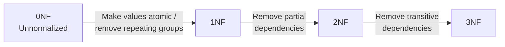

# Subtopic: Database Normalization Guide (0NF–3NF)

> [!ABSTRACT] Core Focus
> Why normalization is needed, how redundancy causes insert/update/delete anomalies, the three types of functional dependency, and a step-by-step method for normalizing a relation from 0NF (UNF) to 3NF.

> [!INFO] Syllabus Scope (TG 8.7)
> - **Need for normalization** and the problems it solves
> - **Redundancy and anomalies** — insert, update and delete
> - **Functional dependencies** — full, partial and transitive
> - **Levels of normalization** — 0NF, 1NF, 2NF and 3NF, including the conditions for each and the abnormalities each one reduces

> [!INFO] Parent Lesson
> This deep dive supports [[Lesson 08 - Database Management Systems#6. Normalization (8.7)|Lesson 08 §6: Normalization]].

---

## 1. Why Normalize?

**Normalization** is the process of organizing the attributes and tables of a database so that:

- each fact is stored in **one place**,
- **data redundancy** is reduced,
- **insert, update and delete anomalies** are avoided,
- **data integrity** and consistency are protected,
- the schema is easier to maintain and extend.

A poorly designed table usually stores **several different facts in one relation**. For example, a student table may also store course and instructor details. When those facts repeat, changing one fact means changing many rows — and missing one row creates an inconsistency.

> [!NOTE] What normalization does not do
> Normalization does not change the meaning of the data and does not delete information. It changes **how the data is grouped into tables** so that each fact has exactly one home.

> [!WARNING] Normalization is not free
> Splitting a table usually **increases the number of tables** and therefore the number of **joins** needed to answer a query. The aim is a correct design first, then performance tuning if needed (see §7, Denormalization).

---

## 2. Redundancy and Anomalies

- **Redundancy** — the same piece of data is stored in more than one place.
  - **Row-level duplication** — identical rows are repeated.
  - **Column-level duplication** — the same value repeats across rows (e.g., a course name repeated for every student taking that course).
- **Anomaly** — a problem that occurs during insert, update or delete because of redundancy in a poorly designed table.

### 2.1 Example of a badly designed table

`StudentCourse(SID, SName, CID, CName, Instructor, Office)`

| SID | SName | CID | CName | Instructor | Office |
|---|---|---|---|---|---|
| 101 | Akon | C1 | S.Eng | Dr. Perera | A-101 |
| 102 | Bkon | C2 | CS | Dr. Silva | B-202 |
| 103 | Ckon | C1 | S.Eng | Dr. Perera | A-101 |
| 104 | Dkon | C1 | S.Eng | Dr. Perera | A-101 |

`CName`, `Instructor` and `Office` repeat for every student in the same course. The table mixes **student facts**, **course facts** and **instructor facts** in one relation.

### 2.2 The three anomalies

| Anomaly | What goes wrong | Example with the table above |
|---|---|---|
| **Insert anomaly** | A new fact cannot be inserted without also inserting unrelated data | A new course cannot be added until at least one student enrolls in it |
| **Update anomaly** | The same fact is stored in several rows; updating one row but not all causes inconsistency | Moving Dr. Perera to office `A-205` requires updating every row for C1; miss one and the table contradicts itself |
| **Delete anomaly** | Deleting one fact accidentally removes other unrelated facts | Deleting student 102 (the only C2 student) also deletes the only record of course C2 and Dr. Silva |

> [!IMPORTANT] Root cause
> All three anomalies come from **functional dependencies between attributes that do not belong in the same relation**. Normalization removes those dependencies by splitting the relation at the right boundaries.

---

## 3. Functional Dependencies (FD)

A **functional dependency** $X \rightarrow Y$ means: for each value of $X$, there is **exactly one** corresponding value of $Y$. Knowing $X$ is enough to determine $Y$.

- `X` is the **determinant**.
- `Y` is **functionally dependent** on `X`.
- Example: `StudentID → StudentName` — one student ID determines exactly one name.

> [!NOTE] Reading an FD from data
> An FD is a rule about the **meaning** of the data, not a coincidence in one sample table. `SID → SName` holds because a student has one name, not merely because the current rows happen to agree.

### 3.1 Prime and non-prime attributes

| Term | Meaning | Example |
|---|---|---|
| **Prime attribute** | An attribute that is part of **any candidate key** | `SID`, `CID` in `StudentCourse` |
| **Non-prime attribute** | An attribute that is **not** part of any candidate key | `SName`, `CName`, `Instructor`, `Office` |

Partial and transitive dependencies are defined in terms of **non-prime** attributes.

### 3.2 Types of functional dependency

| Type | Definition | Violates | Fix |
|---|---|---|---|
| **Full functional dependency** | A non-prime attribute depends on the **whole** primary key (or candidate key) | — (required) | Keep as is |
| **Partial dependency** | A non-prime attribute depends on only **part** of a **composite** primary key | **2NF** | Move the attribute and its determinant to a new table |
| **Transitive dependency** | A non-prime attribute depends on another **non-prime** attribute: `X → Y` and `Y → Z`, so `X → Z` | **3NF** | Move `Y` and `Z` to a new table |

### 3.3 Worked FD analysis

For `StudentCourse(SID, SName, CID, CName, Instructor, Office)` with primary key `(SID, CID)`:

| FD | Type | Why |
|---|---|---|
| `SID → SName` | **Partial** | `SName` depends on only part of the composite key `(SID, CID)` |
| `CID → CName, Instructor, Office` | **Partial** | These attributes depend on only `CID` |
| `Instructor → Office` | **Transitive** | `CID → Instructor` and `Instructor → Office`, so `CID → Office` |
| `(SID, CID) → SName, CName, Instructor, Office` | **Full** | The whole key determines every non-prime attribute |

> [!TIP] Spotting the type quickly
> 1. Is the primary key **composite**? If yes, look for attributes determined by only one part → **partial dependency**.
> 2. Is there a **non-prime attribute that determines another non-prime attribute**? If yes → **transitive dependency**.
> 3. If every non-prime attribute needs the whole key → **full dependency** (the relation is already 2NF-ready).

---

## 4. Levels of Normalization

| Form | Condition | What it removes |
|---|---|---|
| **0NF / UNF** | No normalization rules applied; repeating groups or multivalued fields may exist | — |
| **1NF** | Atomic values, no repeating groups, unique rows, consistent data types, primary key defined | Multivalued / repeating groups |
| **2NF** | 1NF **and** no partial dependency (every non-prime attribute depends on the whole key) | Partial dependencies |
| **3NF** | 2NF **and** no transitive dependency (no non-prime attribute depends on another non-prime attribute) | Transitive dependencies |

### 4.1 0NF — Zero Normal Form (Unnormalized Form)

- Data may be stored in one large table.
- Cells may contain **repeating groups**, lists or nested values.
- No primary key may be defined yet.

| SID | Name | Subjects |
|---|---|---|
| 101 | Akon | Maths |
| 102 | Bkon | Maths, ICT |
| 103 | Ckon | Physics, BIO |

`Subjects` holds multiple values in one cell, so the table is **0NF**. It cannot be queried reliably: `WHERE Subjects = 'ICT'` will not match `'Maths, ICT'`.

### 4.2 1NF — First Normal Form

Conditions:

1. **Atomic values** — each cell holds one indivisible value.
2. **No repeating groups** — no lists, sets or nested tables.
3. **Unique rows** — no duplicate rows.
4. **Single-valued columns** — one value of the same type per row.
5. **Consistent data types** — each column has one data type.
6. **Primary key defined** — each row can be identified.

Converting 0NF to 1NF:

| Method | How | Trade-off |
|---|---|---|
| **Flatten into rows** | Repeat the other columns for each value | Correct but introduces redundancy |
| **Add columns** | `Subject1`, `Subject2`, … | Simple, but creates NULLs and a fixed limit |
| **Separate table** | `Student(SID, Name)` + `StudentSubject(SID, Subject)` | Usually the best design |

**1NF result (flattened):**

| SID | Name | Subject |
|---|---|---|
| 101 | Akon | Maths |
| 102 | Bkon | Maths |
| 102 | Bkon | ICT |
| 103 | Ckon | Physics |
| 103 | Ckon | BIO |

Primary key = `(SID, Subject)`. The table is now 1NF, but `Name` repeats → the next problem is a **partial dependency**.

> [!IMPORTANT] What 1NF fixes
> 1NF removes **multivalued attributes and repeating groups**. It does **not** remove redundancy or partial/transitive dependencies; those are handled by 2NF and 3NF.

### 4.3 2NF — Second Normal Form

Conditions:

1. The relation is already in **1NF**.
2. There is **no partial dependency**.
3. Every non-prime attribute depends on the **entire** primary key, not just part of it.

> [!NOTE] 2NF only matters for composite keys
> If the primary key is a **single attribute**, a partial dependency is impossible, so a 1NF relation with a one-attribute key is automatically in 2NF.

**Example 1NF relation**

| SID | CID | SName | CName | Grade |
|---|---|---|---|---|
| 101 | 1 | Akon | S.Eng | A |
| 102 | 2 | Bkon | CS | A |
| 102 | 3 | Bkon | AIDS | C |
| 103 | 4 | Dkon | Archt. | B |

Primary key = `(SID, CID)`. Partial dependencies:

- `SID → SName`
- `CID → CName`

**Convert to 2NF:**

- `Student(SID, SName)` — PK `SID`
- `Course(CID, CName)` — PK `CID`
- `StudentCourse(SID, CID, Grade)` — PK `(SID, CID)`

> [!IMPORTANT] What 2NF fixes
> 2NF removes **partial dependencies** and the insert/update/delete anomalies they cause (for example, a course name repeating for every enrollment).

### 4.4 3NF — Third Normal Form

Conditions:

1. The relation is already in **2NF**.
2. There is **no transitive dependency**.
3. No non-prime attribute depends on another non-prime attribute.

**Example 2NF relation with a transitive dependency**

| SID | SName | FacID | FacName |
|---|---|---|---|
| 101 | Akon | 1 | Engineering |
| 102 | Bkon | 3 | Computing |
| 103 | Ckon | 3 | Computing |
| 104 | Dkon | 3 | Computing |

Primary key = `SID`. Here `SID → FacID` and `FacID → FacName`, so `SID → FacName` is **transitive**.

**Convert to 3NF:**

- `Student(SID, SName, FacID)` — PK `SID`; FK `FacID → Faculty.FacID`
- `Faculty(FacID, FacName)` — PK `FacID`

> [!IMPORTANT] What 3NF fixes
> 3NF removes **transitive dependencies**, so a fact such as a faculty name is stored once rather than repeated for every student.

---

## 5. Full Worked Example (UNF → 3NF)

**Given unnormalized relation**

`StudentCourse(StudentID, StudentName, {CourseID, CourseName, InstructorID, InstructorName, InstructorOffice})`

The braces `{…}` mark the repeating group.

### Step 0 — 0NF

The course details repeat for every student, and several values are packed into one repeating group.

### Step 1 — Convert to 1NF

Flatten the repeating group and define a primary key:

`StudentCourse_1NF(StudentID, StudentName, CourseID, CourseName, InstructorID, InstructorName, InstructorOffice)`

Primary key = `(StudentID, CourseID)`.

### Step 2 — Convert to 2NF

Partial dependencies:

- `StudentID → StudentName`
- `CourseID → CourseName, InstructorID, InstructorName, InstructorOffice`

Split on those determinants:

- `Student(StudentID, StudentName)` — PK `StudentID`
- `Course(CourseID, CourseName, InstructorID, InstructorName, InstructorOffice)` — PK `CourseID`
- `StudentCourse(StudentID, CourseID)` — PK `(StudentID, CourseID)`; FKs to `Student` and `Course`

### Step 3 — Convert to 3NF

Transitive dependency in `Course`:

- `CourseID → InstructorID`
- `InstructorID → InstructorName, InstructorOffice`
- Therefore `CourseID → InstructorName, InstructorOffice` is transitive.

Split again:

- `Student(StudentID, StudentName)` — PK `StudentID`
- `Course(CourseID, CourseName, InstructorID)` — PK `CourseID`; FK `InstructorID → Instructor.InstructorID`
- `Instructor(InstructorID, InstructorName, InstructorOffice)` — PK `InstructorID`
- `StudentCourse(StudentID, CourseID)` — PK `(StudentID, CourseID)`; FKs to `Student` and `Course`

### Result

| Relation | Primary key | Foreign key(s) | Fact stored |
|---|---|---|---|
| `Student` | `StudentID` | — | One name per student |
| `Course` | `CourseID` | `InstructorID` | One name per course |
| `Instructor` | `InstructorID` | — | One name/office per instructor |
| `StudentCourse` | `(StudentID, CourseID)` | `StudentID`, `CourseID` | Which student takes which course |

Every fact is now stored once, and the three anomalies are eliminated.

---

## 6. Exam Method & Traps

**Method for a normalization question**

1. Write the relation and underline the **primary key**.
2. List all **functional dependencies**.
3. Check **1NF**: atomic values, no repeating groups, key defined.
4. Check **2NF**: only if the key is composite — remove partial dependencies.
5. Check **3NF**: remove transitive dependencies between non-prime attributes.
6. Show each new relation with its **PK and FKs**.
7. State which **anomaly** each split removes.

> [!WARNING] High-frequency mistakes
> 1. **1NF is not about redundancy.** It only requires atomic values, no repeating groups and a key.
> 2. **2NF can only be violated by a composite key.** With a single-attribute key, the relation is automatically in 2NF.
> 3. **A single-attribute key does not guarantee 3NF.** Transitive dependencies can still exist.
> 4. **3NF is not "everything depends on the primary key".** Non-prime attributes may depend on any candidate key; what is forbidden is a non-prime attribute depending on another **non-prime** attribute.
> 5. **Do not delete the junction table.** In an M:N relationship it is required to preserve the relationship.
> 6. **Normalization does not always improve speed.** More tables mean more joins; the syllabus phrase "improve performance" refers to integrity and maintenance, not raw query speed.
> 7. **A relation with no non-prime attributes is already in 3NF**, because no forbidden dependency can exist.

---

## 7. Denormalization (Extension)

**Denormalization** intentionally reintroduces redundancy — for example, duplicating a column or storing a calculated total — to avoid expensive joins and speed up reads.

| Benefit | Cost |
|---|---|
| Fewer joins, faster reads | More storage |
| Simpler queries | Update anomalies return |
| Useful for reporting / data warehouses | Integrity must be enforced by the application |

> Normalize to 3NF first. Denormalize only with a measured performance reason and a plan to keep the copies consistent.

---

## :LiRocket: Flashcards (Spaced Repetition)

#flashcards

What is normalization? :: Organizing data into related tables so that each fact is stored once, reducing redundancy and insert/update/delete anomalies.

Why is normalization needed? :: To remove redundancy and the insert, update and delete anomalies caused by storing several facts in one relation.

What is data redundancy? :: The same piece of data being stored in more than one place.

What is an insert anomaly? :: A new fact cannot be inserted without also inserting unrelated data, because the table mixes different facts.

What is an update anomaly? :: The same fact is stored in several rows, so updating one row but not all causes inconsistency.

What is a delete anomaly? :: Deleting one fact accidentally removes other unrelated facts that should have been kept.

What is a functional dependency $X \rightarrow Y$? :: Each value of $X$ determines exactly one value of $Y$.

What is a full functional dependency? :: A non-prime attribute depends on the whole primary key (or candidate key), not just part of it.

What is a partial dependency? :: A non-prime attribute depends on only part of a composite primary key.

What is a transitive dependency? :: A non-prime attribute depends on another non-prime attribute: $X \rightarrow Y$ and $Y \rightarrow Z$, so $X \rightarrow Z$.

What is a prime attribute? :: An attribute that is part of any candidate key.

What is a non-prime attribute? :: An attribute that is not part of any candidate key.

What is 0NF (UNF)? :: An unnormalized relation that may contain repeating groups, multivalued fields or nested data, with no normalization rules applied.

What does 1NF require? :: Atomic values, no repeating groups, unique rows, consistent data types and a primary key.

What abnormality does 1NF remove? :: Multivalued attributes and repeating groups.

What does 2NF require? :: 1NF plus no partial dependencies; every non-prime attribute must depend on the whole primary key.

What abnormality does 2NF remove? :: Partial dependencies and the anomalies they cause.

When is a relation automatically in 2NF? :: When it is in 1NF and its primary key is a single attribute, because a partial dependency is impossible.

What does 3NF require? :: 2NF plus no transitive dependencies; no non-prime attribute may depend on another non-prime attribute.

What abnormality does 3NF remove? :: Transitive dependencies and the anomalies they cause.

How do you convert UNF to 1NF? :: Flatten repeating groups into atomic values and assign a primary key.

How do you convert 1NF to 2NF? :: Remove partial dependencies by splitting attributes into separate tables, keeping a junction table if needed.

How do you convert 2NF to 3NF? :: Remove transitive dependencies by moving the dependent non-prime attributes into a new table.

What is a composite primary key? :: A primary key made of two or more attributes, such as `(StudentID, CourseID)`.

Which partial dependencies are removed in the worked example? :: `StudentID → StudentName` and `CourseID → CourseName, InstructorID, InstructorName, InstructorOffice`.

Which transitive dependency is removed in the 3NF step? :: `InstructorID → InstructorName, InstructorOffice`.

Why is `StudentCourse` a junction table? :: It links Student and Course in a many-to-many relationship using both foreign keys.

Does normalization usually increase the number of tables? :: Yes; it reduces redundancy but may require more joins.

What is denormalization? :: Intentionally reintroducing redundancy to improve read performance, at the cost of storage and possible anomalies.

When should you denormalize? :: Only after normalizing to 3NF, and only with a measured performance reason and a plan to keep duplicated data consistent.
