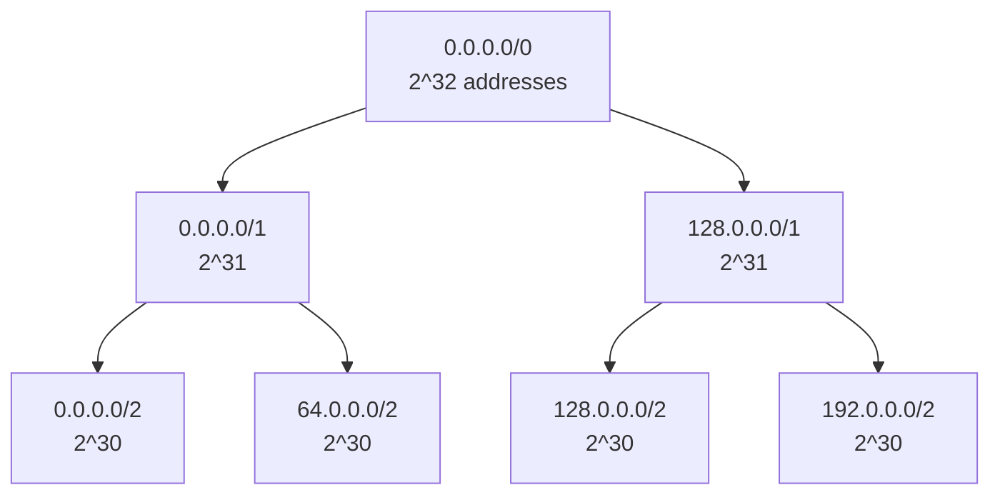

# :LiGlobe2: Subtopic: IPv4 Addressing & Subnetting Guide

> [!ABSTRACT] Core Focus
> A complete beginner-to-advanced guide on how IP addresses work, the difference between Network and Host IDs, IP Classes, Private vs. Public IPs, and step-by-step subnetting (CIDR, FLSM, VLSM). Includes **top-down division of the whole IPv4 space**, prefix↔mask↔subnet-count tables, reverse design from host requirements, a VLSM allocation example, special prefixes (/30, /31, /32), and the classic exam traps.

---

## 1. What is an IPv4 Address?

Think of a network like a city. To send a letter to a specific house, you need an address. In networking, every device needs an **IP (Internet Protocol) address** to communicate.

An IPv4 address is a **32-bit** binary number. For humans to read it easily, we break it into four 8-bit groups (called octets) and write it in **Dotted Decimal Notation**.

Example: `192.168.10.35` 
In binary: `11000000 . 10101000 . 00001010 . 00100011`

Every IP address is split into two logical parts:
1. **Network ID**: Identifies the specific network (like the Street Name).
2. **Host ID**: Identifies the specific device on that network (like the House Number).

How do we know which part is the Network and which is the Host? That is determined by the **Subnet Mask**.

---

## 2. Classful IP Addressing

In the early days of the internet, IP addresses were divided into strict "Classes". The class is determined by looking at the **very first bits** of the first octet.

| Class | First Bits | 1st Octet Range | Default Subnet Mask | Network / Host Structure | Max Hosts per Network | Use Case |
| :--- | :--- | :--- | :--- | :--- | :--- | :--- |
| **A** | `0` | 0 - 127 | 255.0.0.0 | **N**.H.H.H | $2^{24} - 2$ ($\approx 16.7$ Million) | Massive networks |
| **B** | `10` | 128 - 191 | 255.255.0.0 | **N.N**.H.H | $2^{16} - 2$ (65,534) | Medium to large |
| **C** | `110` | 192 - 223 | 255.255.255.0 | **N.N.N**.H | $2^8 - 2$ (254) | Small networks (Homes/Offices) |
| **D** | `1110` | 224 - 239 | N/A | N/A | N/A | Multicast (sending to a group) |
| **E** | `1111` | 240 - 255 | N/A | N/A | N/A | Experimental / Research |

> [!WARNING] The "- 2" Rule
> Why do we subtract 2 when calculating maximum hosts? Because in every network:
> 1. The **first IP** (all host bits are `0`) is the **Network Address** (identifies the network itself).
> 2. The **last IP** (all host bits are `1`) is the **Broadcast Address** (sends a message to everyone on that network).
> These two can **never** be assigned to a computer!

### Special & Private IP Addresses

To save IP addresses from running out, certain ranges were made **Private**. Private IPs can be used by anyone inside their local network (LAN) but are **not allowed on the public internet**. A router uses **NAT (Network Address Translation)** to translate your private IP into a single public IP to browse the web.

- **Class A Private**: `10.0.0.0` to `10.255.255.255`
- **Class B Private**: `172.16.0.0` to `172.31.255.255`
- **Class C Private**: `192.168.0.0` to `192.168.255.255`

**Loopback Address (`127.0.0.1`)**: Used by your computer to send a message to itself for testing purposes.

### Reserved & Special Ranges (CIDR view)

| Block | Purpose | Notes |
| :--- | :--- | :--- |
| `0.0.0.0/0` | Default route / "any address" | A host uses `0.0.0.0` as its own address before configuration |
| `10.0.0.0/8` | Private (Class A) | Not routable on the public internet |
| `172.16.0.0/12` | Private (Class B) | Covers `172.16.0.0` – `172.31.255.255` |
| `192.168.0.0/16` | Private (Class C) | Home/office LANs |
| `127.0.0.0/8` | Loopback | `127.0.0.1` = this host |
| `169.254.0.0/16` | Link-local / **APIPA** | Self-assigned when DHCP fails |
| `224.0.0.0/4` | Multicast | Class D |
| `240.0.0.0/4` | Reserved / experimental | Class E |
| `255.255.255.255` | Limited broadcast | "Everyone on this local network" |

---

## 3. Subnetting & CIDR (Classless Inter-Domain Routing)

Strict classes wasted millions of IP addresses. If a company needed 300 IPs, a Class C (254) was too small, so they had to buy a Class B (65,534) and waste over 65,000 IPs!

To fix this, **Subnetting** was introduced. Subnetting allows you to borrow bits from the Host portion to create smaller "sub-networks". 

Instead of default masks, we use **CIDR notation**, written as a slash followed by the number of Network bits.
Example: `192.168.1.0 /26` means the first 26 bits are Network bits, leaving $32 - 26 = 6$ bits for Hosts.

### Subnetting Formulas
For a given prefix `/N`:
1. **Host Bits ($h$)** = $32 - N$
2. **Total Addresses per Subnet** = $2^h$
3. **Usable Hosts per Subnet** = $2^h - 2$
4. **Block Size (Magic Number)** = $2^h$ (or $256 - \text{last non-zero octet of mask}$)

### 3.1 Dividing the Entire Address Space (Top-Down)

The subnetting above is **bottom-up**: you are given a network and cut it into smaller pieces. Exam questions also ask the **top-down** version: *"which mask divides the entire IPv4 address space into 4 equal subnets?"*

The entire IPv4 space is **`/0`** — 0 network bits, 32 host bits, $2^{32}$ addresses. "Equally dividing" it means **borrowing bits from the left**, and each borrowed bit **doubles** the number of blocks.

$$ \text{number of equal blocks} = 2^{\,n}, \qquad n = \text{new prefix} - \text{starting prefix} $$

**Answering "4 equal subnets from the whole space":**

1. $4 = 2^2$ → borrow **2 bits**.
2. Starting prefix is `/0`, so new prefix = 0 + 2 = **`/2`**.
3. Mask = two 1s then thirty 0s = `11000000.00000000.00000000.00000000` = **`192.0.0.0`**.
4. Each block holds $2^{30} = 1{,}073{,}741{,}824$ addresses.



| Prefix | Mask | Equal blocks in the whole space | Addresses per block |
| :---: | :--- | :---: | :---: |
| `/0` | `0.0.0.0` | 1 | $2^{32}$ = 4,294,967,296 |
| `/1` | `128.0.0.0` | 2 | $2^{31}$ = 2,147,483,648 |
| **`/2`** | **`192.0.0.0`** | **4** | $2^{30}$ = 1,073,741,824 |
| `/3` | `224.0.0.0` | 8 | $2^{29}$ = 536,870,912 |
| `/4` | `240.0.0.0` | 16 | $2^{28}$ = 268,435,456 |
| `/8` | `255.0.0.0` | 256 | $2^{24}$ = 16,777,216 |
| `/16` | `255.255.0.0` | 65,536 | $2^{16}$ = 65,536 |
| `/24` | `255.255.255.0` | 16,777,216 | $2^8$ = 256 |

> [!WARNING] The classic trap: "4 subnets" ≠ "4 bits"
> To get **4** subnets you need **2** bits ($2^2 = 4$), giving **`/2`** — not `/4`. A `/4` mask ($2^4$) creates **16** subnets. Always convert the required *count* into a power of two first.

> [!NOTE] Same rule inside an allocated block
> Splitting `192.168.1.0/24` into 4 equal subnets: prefix $= 24 + 2 = 26$ → **`/26`** → `.0`, `.64`, `.128`, `.192`. The starting prefix changes, the logic does not.

### 3.2 Prefix ↔ Mask ↔ Subnet Count (Relative to a `/24`)

| New prefix | Mask | Subnets created from a `/24` | Addresses per subnet | Usable hosts |
| :---: | :--- | :---: | :---: | :---: |
| `/25` | `255.255.255.128` | 2 | 128 | 126 |
| `/26` | `255.255.255.192` | 4 | 64 | 62 |
| `/27` | `255.255.255.224` | 8 | 32 | 30 |
| `/28` | `255.255.255.240` | 16 | 16 | 14 |
| `/29` | `255.255.255.248` | 32 | 8 | 6 |
| `/30` | `255.255.255.252` | 64 | 4 | 2 |
| `/31` | `255.255.255.254` | 128 | 2 | 2 (point-to-point, RFC 3021) |
| `/32` | `255.255.255.255` | 256 | 1 | 1 (host route) |

### 3.3 The Two Formulas Side by Side

| Quantity | Formula | Depends on |
| :--- | :--- | :--- |
| Number of subnets | $2^{\,n}$ where $n$ = borrowed bits | How many bits you **added** to the prefix |
| Addresses per subnet | $2^{\,h}$ where $h = 32 - N$ | How many host bits **remain** |
| Usable hosts per subnet | $2^{\,h} - 2$ | Network + broadcast addresses removed |
| Block size | $2^{\,h}$ | Same as addresses per subnet |

> [!IMPORTANT] Do **not** subtract 2 from the subnet count
> The "− 2" applies only to **host addresses** in each subnet (network ID and broadcast ID). The number of subnets is exactly $2^n$ — all of them are usable.

---

## 4. Step-by-Step Subnetting Worked Example

Let's do a classic exam problem.

> [!EXAMPLE] Problem
> You are given the IP `192.168.1.130/26`. Find:
> 1. The Subnet Mask
> 2. The Network ID of the subnet this IP belongs to
> 3. The Broadcast ID
> 4. The Usable Host Range

### Step 1: Find the Subnet Mask
The CIDR is `/26`. This means 26 ones, followed by zeros:
`11111111 . 11111111 . 11111111 . 11000000`
Convert to decimal: `255.255.255.192`.

### Step 2: Find the Block Size (Subnet increments)
Host bits $h = 32 - 26 = 6$.
Block size = $2^6 = 64$. (Alternatively: $256 - 192 = 64$).
This means our subnets count up by 64 in the 4th octet!
- Subnet 0: `192.168.1.0`
- Subnet 1: `192.168.1.64`
- Subnet 2: `192.168.1.128`
- Subnet 3: `192.168.1.192`

### Step 3: Locate the IP
Our IP is `192.168.1.130`. Looking at our list, 130 falls between 128 and 191.
Therefore, it belongs to Subnet 2.
- **Network ID**: `192.168.1.128`

### Step 4: Find the Broadcast ID
The Broadcast ID is always **one number less** than the *next* Network ID.
The next network is `192.168.1.192`. 
- **Broadcast ID**: `192.168.1.191`

### Step 5: Find the Usable Host Range
The usable hosts sit right between the Network ID and the Broadcast ID.
- **First Usable**: Network ID + 1 $\rightarrow$ `192.168.1.129`
- **Last Usable**: Broadcast ID - 1 $\rightarrow$ `192.168.1.190`
- **Total Usable Hosts**: $2^6 - 2 = 62$ hosts.

### 4.1 Alternative Method: Bitwise AND

The network address is always `IP AND Mask`. This never fails, even when the block size is awkward.

```text
IP    192.168.1.130   11000000.10101000.00000001.10000010
Mask  255.255.255.192 11111111.11111111.11111111.11000000
AND                   11000000.10101000.00000001.10000000
=     192.168.1.128   -> Network ID
```

Broadcast = network address **with all host bits set to 1** = `192.168.1.191`.

### 4.2 Reverse Design: Choosing the Prefix from Host Requirements

Exam questions often give the requirement, not the prefix:

1. Find the smallest host-bit count $h$ such that $2^h - 2 \ge$ required hosts.
2. Prefix $N = 32 - h$.
3. Allocate the block and record network / first usable / last usable / broadcast.

| Hosts needed | Smallest $h$ | Prefix | Usable | Waste |
| :---: | :---: | :---: | :---: | :---: |
| 2 | 2 | `/30` | 2 | 0 (or `/31` on a point-to-point link) |
| 25 | 5 | `/27` | 30 | 2 |
| 50 | 6 | `/26` | 62 | 10 |
| 100 | 7 | `/25` | 126 | 26 |
| 500 | 9 | `/23` | 510 | 10 |

> [!TIP] Choose the **smallest** block that fits
> Overshooting wastes addresses and may break a later VLSM allocation. Always work from $2^h - 2$, not from a "nice-looking" mask.

---

## 5. FLSM vs VLSM

- **FLSM (Fixed Length Subnet Mask)**: You divide a network into subnets that are all the **exact same size**. (E.g., cutting a pizza into 8 equal slices). If one department needs 50 IPs and another needs 2, FLSM gives them both 64, wasting IPs.
- **VLSM (Variable Length Subnet Mask)**: You divide a network into subnets of **different sizes** based on actual need. (E.g., giving the big department a `/26` with 62 hosts, and a router link a `/30` with just 2 hosts). This maximizes IP efficiency.

### 5.1 VLSM Worked Example

**Given:** `192.168.10.0/24` must serve Dept A (100 hosts), Dept B (50), Dept C (25) and one router-to-router WAN link (2).

**Rule: allocate the largest requirement first**, so each block stays correctly aligned.

| Order | Requirement | Prefix | Block size | Network | Usable range | Broadcast |
| :---: | :--- | :---: | :---: | :--- | :--- | :--- |
| 1 | A — 100 | `/25` | 128 | `192.168.10.0` | `.1 – .126` | `.127` |
| 2 | B — 50 | `/26` | 64 | `192.168.10.128` | `.129 – .190` | `.191` |
| 3 | C — 25 | `/27` | 32 | `192.168.10.192` | `.193 – .222` | `.223` |
| 4 | WAN — 2 | `/30` | 4 | `192.168.10.224` | `.225 – .226` | `.227` |

- After the four allocations, `.228 – .255` (**28 addresses**) remain free for growth.
- Check: $128 + 64 + 32 + 4 = 228$ addresses used out of 256.
- With **FLSM**, every subnet must be the same size, so all four would need `/25`s: four × 128 = 512 addresses, which does not fit in a `/24`. The small departments would also waste most of their 126 usable addresses.

> [!WARNING] Address overlap
> A VLSM block's broadcast must stop **before** the next block's network address. Overlapping ranges are the most common VLSM mistake — always continue from the previous block's end, not from the octet boundary.

---

## 6. A Note on IPv6

Even with subnetting and NAT, we ran out of IPv4 addresses (there are only $\approx 4.3$ billion). 

**IPv6** was created to solve this. 
- It uses **128 bits** (instead of 32).
- Written in **Hexadecimal** (not decimal).
- Separated by **colons** (not dots).
- Example: `2001:0db8:85a3:0000:0000:8a2e:0370:7334`
- It provides enough addresses for every atom on Earth!

---

## 7. Special Prefix Cases

| Prefix | Name | Usable hosts | Typical use |
| :---: | :--- | :---: | :--- |
| `/0` | Default route | — | "Any destination" in a routing table |
| `/30` | Point-to-point (classic) | 2 | Router-to-router WAN link |
| `/31` | Point-to-point (RFC 3021) | **2** | Modern WAN link — no network/broadcast reservation, saves 2 addresses per link |
| `/32` | Host route | 1 | A single server address, loopback route |

> [!NOTE] `/31` is the exception to "− 2"
> Two hosts on a serial link do not need a network or broadcast address, so `/31` gives **2 usable addresses**. Older textbooks still say `/30`; both appear in exams — state the assumption if asked.

---

## 8. Common Exam Traps

| Wrong idea                                  | Correct idea                                                                        |
| :------------------------------------------ | :---------------------------------------------------------------------------------- |
| "4 subnets means `/4`."                     | 4 = $2^2$ → **`/2`**. `/4` gives **16** subnets.                                    |
| "Number of subnets = $2^{h}$ (host bits)."  | Subnets = $2^{n}$ (**borrowed** bits); hosts = $2^{h} - 2$.                         |
| "Subtract 2 from the number of subnets."    | The −2 applies only to **hosts per subnet**.                                        |
| "A `/26` provides 26 hosts."                | A `/26` provides $2^{6} - 2$ = **62** hosts.                                        |
| "Block size = number of subnets."           | Block size = **addresses per subnet** = $2^{h}$.                                    |
| "The network address is the given IP."      | Network address = `IP AND Mask`; the given IP is usually a host.                    |
| "The first address in the block is usable." | The first is the **network ID**; usable range starts at network + 1.                |
| "Broadcast = next network + 1."             | Broadcast = **next network address − 1**.                                           |
| "Masks can be `255.0.255.0`."               | Mask bits must be **contiguous 1s from the left**.                                  |
| "The class fixes the mask."                 | With **CIDR**, any prefix is legal; class only matters for the default/legacy mask. |

---

## 9. Quick Reference Tables

### 9.1 Powers of Two

| $2^0$ | $2^1$ | $2^2$ | $2^3$ | $2^4$ | $2^5$ | $2^6$ | $2^7$ | $2^8$ |
| :---: | :---: | :---: | :---: | :---: | :---: | :---: | :---: | :---: |
| 1 | 2 | 4 | 8 | 16 | 32 | 64 | 128 | 256 |

| $2^{10}$ | $2^{12}$ | $2^{16}$ | $2^{20}$ | $2^{24}$ | $2^{30}$ | $2^{32}$ |
| :---: | :---: | :---: | :---: | :---: | :---: | :---: |
| 1,024 | 4,096 | 65,536 | 1,048,576 | 16,777,216 | 1,073,741,824 | 4,294,967,296 |

### 9.2 Mask Octets by Bit Count

| Bits in octet | 1 | 2 | 3 | 4 | 5 | 6 | 7 | 8 |
| :---: | :---: | :---: | :---: | :---: | :---: | :---: | :---: | :---: |
| Decimal | 128 | 192 | 224 | 240 | 248 | 252 | 254 | 255 |
| CIDR | `/25` | `/26` | `/27` | `/28` | `/29` | `/30` | `/31` | `/32` |

> [!TIP] Fast mental conversion
> `/26` → `256 − 64 = 192`; `/27` → `256 − 32 = 224`; `/28` → `256 − 16 = 240`. The last mask octet is always **256 minus the block size**.

---

## :LiRocket: Flashcards (Spaced Repetition)

#flashcards

What does the `/N` in CIDR notation mean? :: The number of leading 1 bits in the mask (network/prefix bits); host bits = 32 − N.

How many equal subnets does borrowing *n* bits create? :: 2^n subnets.

How do you calculate the number of subnets after changing the prefix? :: 2^(new prefix − original prefix).

Which mask divides the entire IPv4 address space into 4 equal subnets? :: /2 → 192.0.0.0. Because 4 = 2^2, so 2 bits are borrowed from /0.

Why is /4 the wrong answer for "4 subnets"? :: /4 borrows 4 bits and creates 2^4 = 16 subnets; 4 subnets need only 2 bits (/2).

How many addresses are in each /2 subnet? :: 2^30 = 1,073,741,824 addresses (a quarter of the IPv4 space).

What is the subnet mask for /26? :: 255.255.255.192.

What prefix is the mask 255.255.255.224? :: /27.

What prefix is the mask 255.255.255.252? :: /30.

How do you find the number of addresses per subnet? :: 2^h, where h = 32 − prefix length.

How do you find the number of usable hosts per subnet? :: 2^h − 2, removing the network address and broadcast address.

What is the block size (magic number)? :: 2^h — the increment between consecutive subnet network addresses.

How do you calculate the network address from an IP and mask? :: Bitwise AND of the IP address and the subnet mask.

How do you calculate the broadcast address? :: Set all host bits to 1, i.e. next network address − 1.

What are the first and last usable host addresses in a subnet? :: First = network address + 1; last = broadcast address − 1.

How many usable hosts does a /31 provide? :: 2 on a point-to-point link (RFC 3021), because no network/broadcast addresses are reserved.

What is a /32 used for? :: A single host route — exactly one address.

What is the classic prefix for a router-to-router WAN link, and how many hosts? :: /30, giving 2 usable addresses.

How many hosts are needed for a /25, and how many are usable? :: 128 addresses, 126 usable.

If you need 100 hosts, what is the smallest subnet? :: /25 (2^7 − 2 = 126 usable).

If you need 2 hosts, which prefix should you use? :: /30 traditionally; /31 on a modern point-to-point link.

What is the difference between FLSM and VLSM? :: FLSM makes all subnets the same size; VLSM makes them different sizes based on each requirement, wasting fewer addresses.

In what order should VLSM subnets be allocated? :: Largest requirement first, so each block remains aligned and the remaining space stays contiguous.

What are the three private IPv4 ranges in CIDR notation? :: 10.0.0.0/8, 172.16.0.0/12, 192.168.0.0/16.

What is the APIPA / link-local range? :: 169.254.0.0/16 — self-assigned when DHCP fails.

What is the loopback range? :: 127.0.0.0/8 (127.0.0.1 is "this host").

What is the multicast range? :: 224.0.0.0/4 (Class D).

How many /24 networks fit in the entire IPv4 space? :: 2^24 = 16,777,216.

If 192.168.1.0/24 is split into 4 equal subnets, what are the prefixes and network addresses? :: /26 each: .0, .64, .128, .192.

Why can a subnet mask never be 255.0.255.0? :: Mask bits must be contiguous 1s starting from the most significant bit; a gap would make the network/host boundary ambiguous.

What is the "− 2" rule and where does it apply? :: Network and broadcast addresses cannot be assigned, so usable hosts = 2^h − 2; it does not apply to the subnet count.

---

## :LiBookText: See Also

- [[Lesson 06 - Data Communication & Networking]] — networking context, OSI/TCP-IP, devices
- [[Lesson 03 - Data Representation & Arithmetic]] — binary, powers of two, bitwise operations