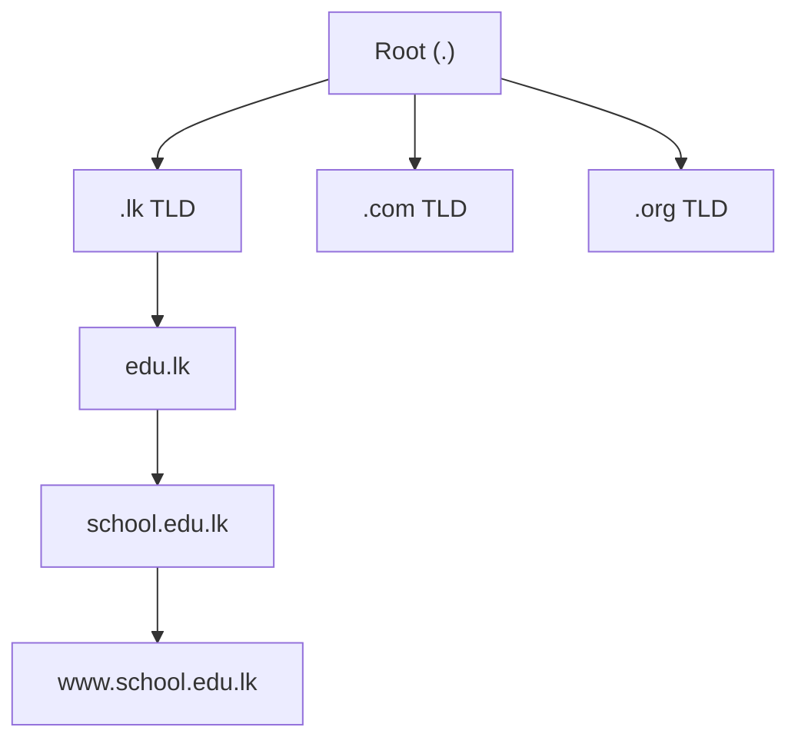
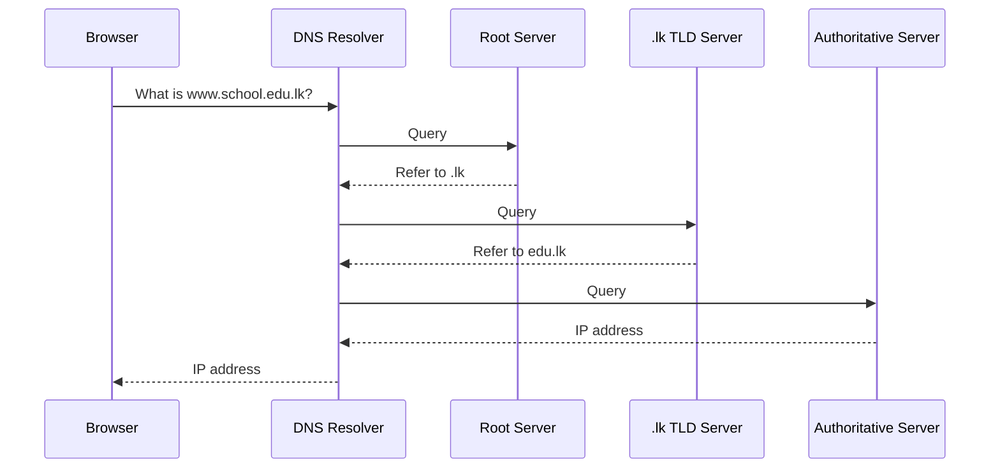
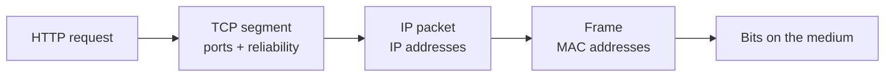

# :LiGlobe2: Subtopic: Network Protocols & Applications

> [!ABSTRACT] Core Focus
> Covers TG **6.6, 6.8 and 6.9**: how devices are addressed and share a LAN medium, how frames carry data, how port numbers deliver data to the correct process, how TCP and UDP differ, and how DNS and HTTP make the web work. The emphasis is on the **exam wording** and the links between the layers.

---

## 1. What is a Protocol?

A **protocol** is an agreement between communicating devices that defines the **order and format** of the data they exchange. It is not just the cable or the software — it is the set of rules that makes communication meaningful.

A protocol must normally define:

| What it defines | Example |
| :--- | :--- |
| **Addressing** | Which device/interface should receive the data? |
| **Data format** | Where is the header, payload and trailer? |
| **Order and timing** | Who sends first? When may a device transmit? |
| **Error handling** | What happens if data is lost, corrupted or duplicated? |

Protocols are **layered**. Each layer provides a service to the layer above it and adds its own control information (a header) to the data. This is why the same web request uses HTTP, TCP, IP and Ethernet at the same time.

> [!NOTE] Exam wording
> The TG defines a network protocol as defining the **order and format** of data exchanged between two networking devices. A **MAC protocol** is a protocol that controls **orderly access to a shared medium**.

---

## 2. LAN and MAC Addressing (6.6)

### 2.1 Local Area Network

A **Local Area Network (LAN)** connects computers and devices within a **limited area** such as a home, school, laboratory, office or university campus. A LAN is usually owned by one person or organisation.

### 2.2 Why devices need addresses

If several devices share a network, the sender must identify the intended receiver. Otherwise every device would receive every message and would not know whether the message is for it.

A **MAC address** (Media Access Control address) is a unique address assigned to each **network interface** (NIC) of a communicating device.

| Property | MAC address |
| :--- | :--- |
| Length | **48 bits** = 6 bytes |
| Written as | Six 8-bit blocks, separated by colons |
| Each block | Two hexadecimal digits |
| Example | `4A:8F:3C:4F:9E:3D` |
| Scope | **Local link** — used inside the LAN / on the link between adjacent nodes |
| Routable across the Internet? | **No** — routers use IP addresses, not MAC addresses, to route between networks |

> [!TIP] Reading a MAC address
> A MAC address is **flat**, not hierarchical. It identifies an interface, not the network it is currently connected to. This is why a laptop keeps the same MAC address when it moves to another Wi-Fi network, but receives a different IP address.

> [!NOTE] Supporting detail
> The first 24 bits of a MAC address are the **OUI (Organizationally Unique Identifier)**, assigned to the manufacturer. The remaining 24 bits identify the interface. The OUI is useful background, but the TG only requires the 48-bit structure and the addressing role.

### 2.3 Unicast, broadcast and multicast

| Type | Meaning | Example |
| :--- | :--- | :--- |
| **Unicast** | One sender → **one** specific receiver | Sending a file to one PC |
| **Broadcast** | One sender → **all devices** on the local network | ARP request; DHCP Discover |
| **Multicast** | One sender → a **group** of subscribed receivers | IPTV, some routing protocols |

A broadcast Ethernet frame uses the special destination MAC address **`FF:FF:FF:FF:FF:FF`**. A switch floods a broadcast frame out of all ports except the one it arrived on. A unicast frame is forwarded only to the port associated with the destination MAC address once the switch has learned it; an unknown unicast is flooded until the address is learned.

> [!WARNING] MAC address is not an IP address
> A MAC address is a **link-layer** address. An IP address is a **network-layer** logical address. A packet travelling across the Internet keeps its source and destination IP addresses, but its MAC addresses change at every link.

---

## 3. Frames: The Unit of the Data Link Layer (6.6)

At the **Data Link layer**, data is encapsulated into a **frame**. The frame is the unit of transmission on a link.

A typical Ethernet frame contains:

| Field | Purpose |
| :--- | :--- |
| **Destination MAC** | MAC address of the next device on this link |
| **Source MAC** | MAC address of the sending interface |
| **Type / Length** | Identifies the upper-layer protocol (e.g. IPv4) |
| **Payload** | The network-layer packet (usually an IP packet) |
| **FCS / Trailer** | Frame Check Sequence used to detect transmission errors |

> [!IMPORTANT] The frame is link-by-link
> The source and destination MAC addresses in a frame belong to the **current link**, not necessarily the original sender and final receiver. When a router receives a frame, it removes the old frame, examines the IP packet, and builds a **new frame** with new MAC addresses for the next link.

### 3.1 Frame vs packet vs segment

| PDU | Layer | Main address | Typical protocol |
| :--- | :--- | :--- | :--- |
| **Segment** | Transport | Port numbers | TCP / UDP |
| **Packet** | Network | IP addresses | IP |
| **Frame** | Data Link | MAC addresses | Ethernet / Wi-Fi |
| **Bits** | Physical | None | Electrical/optical/radio signals |

This table is a common exam trap: a **packet** is not a **frame**. The packet is carried *inside* the frame.

---

## 4. Orderly Access to a Shared Medium (6.6)

On a **bus** or other shared medium, several devices may want to transmit at the same time. If two transmit together, their signals overlap and become corrupted. This is a **collision**. A **MAC protocol** is needed to ensure that the medium is accessed in an orderly manner.

### 4.1 ALOHA and Slotted ALOHA

| Protocol | How it works | Strength / weakness |
| :--- | :--- | :--- |
| **Pure ALOHA** | A station transmits whenever it has data, without checking whether the medium is free. If no acknowledgement arrives, it waits a random time and retransmits. | Very simple, but collisions are frequent. Supporting figure: maximum throughput is about **18.4%**. |
| **Slotted ALOHA** | Time is divided into discrete **slots**. A station may transmit only at the beginning of a slot. | Collisions are reduced because frames cannot start at arbitrary times. Supporting figure: maximum throughput is about **36.8%**. Requires synchronisation. |

### 4.2 From ALOHA to Ethernet

The evolution is:

**Pure ALOHA → Slotted ALOHA → CSMA → CSMA/CD (Ethernet)**

- **CSMA (Carrier Sense Multiple Access)**: listen to the medium before transmitting. If it is busy, wait. This reduces collisions because a station avoids transmitting while another is already using the medium.
- **CSMA/CD (Collision Detection)**: used in **wired Ethernet**. The station listens, transmits when the medium is free, and continues to monitor the medium. If a collision is detected, it stops transmitting, sends a jam signal, waits a random back-off time, and retries.
- **CSMA/CA (Collision Avoidance)**: used in **Wi-Fi (IEEE 802.11)**. Wireless stations cannot reliably detect collisions while transmitting, so they try to avoid them using waiting times and acknowledgements.

> [!NOTE] Supporting detail
> Classic Ethernet (IEEE 802.3) used CSMA/CD on a shared half-duplex medium. Modern switched Ethernet gives each device a dedicated full-duplex link, so collisions are largely eliminated and CSMA/CD is usually not needed. Wi-Fi still uses CSMA/CA.

### 4.3 Broadcast and unicast messages

- **Broadcast**: one message is sent to a larger set of recipients on the local network.
- **Unicast**: data is sent from one computer to another by including the unique address of the receiver.

A switch learns which MAC address is reachable through which port. It forwards a **unicast** frame only to the correct port, but it **floods** a broadcast frame to all other ports.

---

## 5. Transport Protocols: Process-to-Process Delivery (6.8)

### 5.1 Why an IP address is not enough

An IP address identifies a **host** (a network interface), but a computer runs many applications at the same time: a browser, an email client, a game, a DNS resolver, and so on. If data arrived at the host, the operating system would still need to know **which application process** should receive it.

The Transport layer solves this by using **port numbers**.

- A **port** is a logical endpoint used by a process.
- A **port number** is a 16-bit number (0–65535) that identifies a process or service on a host.
- A **socket** is the combination of an **IP address + port number**, for example `192.168.1.10:49152`.

> [!IMPORTANT] Key sentence
> IP delivers data from **host to host**; TCP/UDP deliver data from **process to process** using port numbers.

### 5.2 Multiplexing and demultiplexing

- **Multiplexing** at the sender: multiple application processes share one IP address and one network connection. Their data is tagged with different port numbers.
- **Demultiplexing** at the receiver: the transport layer reads the destination port number and delivers each piece of data to the correct process.

### 5.3 Port ranges

| Range | Name | Use |
| :--- | :--- | :--- |
| `0–1023` | Well-known ports | Standard services (HTTP, DNS, SMTP) |
| `1024–49151` | Registered ports | Registered applications and services |
| `49152–65535` | Dynamic / ephemeral ports | Temporarily chosen by a client for a connection |

> [!NOTE] Supporting detail
> The port ranges are useful background and are often examined in practical networking questions. The TG’s core requirement is that port numbers identify the correct process and enable multiplexing.

### 5.4 Common port numbers

| Service | Port | Transport |
| :--- | :--- | :--- |
| HTTP | **80** | TCP |
| HTTPS | **443** | TCP |
| DNS | **53** | UDP (TCP for large responses/zone transfers) |
| SMTP | **25** | TCP |
| FTP | **20/21** | TCP |
| SSH | **22** | TCP |
| DHCP | **67/68** | UDP |

### 5.5 UDP and TCP

| Feature | UDP | TCP |
| :--- | :--- | :--- |
| Connection | **Connectionless** — no connection is established first | **Connection-oriented** — connection is established first |
| Reliability | No acknowledgement or retransmission | Reliable: acknowledgements and retransmission |
| Ordering | Does not guarantee order | Delivers data in order |
| Congestion control | **No** congestion control | Uses flow and congestion control |
| Overhead | Low header, low delay | Larger header, more overhead |
| Speed | Fast, but no guarantees | Slower but reliable |
| Typical applications | DNS queries, SNMP, streaming, VoIP, DHCP, TFTP | Web (HTTP/HTTPS), email (SMTP/IMAP/POP3), FTP, SSH |

**UDP** is the “no-frills” transport protocol. It is suitable for **query-based** communication and for applications that prefer speed over perfect reliability. **TCP** provides a reliable, in-order byte stream and is used by applications that cannot tolerate missing or out-of-order data.

> [!NOTE] Supporting detail
> TCP establishes a connection using a **three-way handshake**: SYN → SYN-ACK → ACK. It uses sequence numbers, acknowledgements and retransmission. UDP simply sends datagrams without a handshake.

---

## 6. DNS: Translating Names to IP Addresses (6.9)

### 6.1 Why DNS is needed

People find names such as `www.school.edu.lk` easy to remember, but routers need IP addresses. **DNS (Domain Name System)** is a distributed directory service that translates a **human-friendly domain name** into an **IP address**.

DNS is not a single central file. It is a **hierarchical, distributed database**: different organisations are responsible for managing different parts of the namespace.

### 6.2 The DNS hierarchy



| Level | Example | Meaning |
| :--- | :--- | :--- |
| **Root** | `.` | The top of the DNS namespace |
| **Top-Level Domain (TLD)** | `.lk`, `.com`, `.org` | Country-code or generic domain |
| **Second-Level Domain** | `edu.lk`, `example.com` | Registered domain under a TLD |
| **Subdomain / host** | `www.school.edu.lk` | A name inside a domain |

Each domain is responsible for managing the names **under it**. The root delegates `.lk` to the `.lk` registry, which delegates `edu.lk` to the relevant authority, and so on. This is what “hierarchical and distributed” means.

### 6.3 DNS resolution

A simplified resolution:

1. The browser checks its **cache** for the name.
2. If not found, it asks a **DNS resolver** (usually provided by the ISP or a public DNS service).
3. The resolver asks a **root server**, which refers it to the relevant **TLD server**.
4. The TLD server refers it to the domain’s **authoritative DNS server**.
5. The authoritative server returns the IP address (for example, an **A** record for IPv4 or **AAAA** record for IPv6).
6. The resolver caches the answer for a limited time (**TTL**) and returns it to the browser.



> [!NOTE] Supporting detail
> Normal DNS queries use **UDP port 53** because they are small and fast. DNS uses **TCP port 53** for large responses and zone transfers. DNS servers also cache answers to reduce delay and traffic.

---

## 7. HTTP and the Client–Server Model (6.9)

### 7.1 What HTTP is

**HTTP (Hypertext Transfer Protocol)** is an **application-layer** request–response protocol used to transfer web pages and other resources on the World Wide Web.

- The **client** (usually a browser) sends a request.
- The **server** receives the request, processes it, and sends a response.
- HTTP is **stateless**: each request is independent; the server does not automatically remember previous requests. Cookies and sessions are used to add state.

### 7.2 A simple GET request

```http
GET /index.html HTTP/1.1
Host: www.school.edu.lk
User-Agent: Mozilla/5.0
Accept: text/html
```

The request line contains:

- **Method**: `GET` — retrieve a resource.
- **Path**: `/index.html`.
- **HTTP version**: `HTTP/1.1`.
- **Headers**: extra information such as the host name and accepted content type.

### 7.3 A simple response

```http
HTTP/1.1 200 OK
Content-Type: text/html

<!DOCTYPE html>
<html>
  <body>Hello</body>
</html>
```

The status line contains the **HTTP version**, a **status code**, and a **reason phrase**. Common codes:

| Code | Meaning |
| :--- | :--- |
| **200** | OK — request succeeded |
| **301 / 302** | Redirect |
| **400** | Bad request |
| **403** | Forbidden |
| **404** | Not found |
| **500** | Internal server error |

### 7.4 Client–server model

The **client–server model** is a distributed application structure in which:

- **Clients** request services or resources.
- **Servers** provide those services or resources and can handle multiple clients.

For a web page, the sequence is:

1. The browser parses the URL and uses **DNS** to find the server’s IP address.
2. The browser opens a **TCP** connection to the server (port 80 for HTTP, 443 for HTTPS).
3. The browser sends an **HTTP request**.
4. The server sends an **HTTP response**.
5. The browser renders the page. It may then request images, CSS, JavaScript and other resources.

> [!IMPORTANT] HTTP vs HTTPS
> HTTP by itself does **not** encrypt data. **HTTPS** is HTTP carried over **TLS**, which provides encryption, integrity and server authentication. HTTPS normally uses TCP port **443**.

> [!NOTE] Supporting detail
> HTTP methods include `GET`, `POST`, `PUT`, `DELETE`, `HEAD` and `PATCH`. The TG focuses on a simple **GET** request and its response. `GET` should retrieve data without changing the server state; `POST` is commonly used to submit data.

---

## 8. Putting the Layers Together

For a request to `https://www.school.edu.lk/index.html`, the layers work like this:

| Layer | What happens | Address / unit |
| :--- | :--- | :--- |
| **Application** | HTTP creates a GET request | URL, HTTP headers |
| **Transport** | TCP adds source/destination ports; establishes reliability | TCP segment |
| **Network** | IP adds source/destination IP addresses | IP packet |
| **Data Link** | Ethernet/Wi-Fi adds MAC addresses for the current link | Frame |
| **Physical** | Bits are transmitted as electrical, optical or radio signals | Bits |



> [!IMPORTANT] What stays the same?
> Across the Internet, the **IP addresses** normally stay the same from source to destination. The **MAC addresses** change at every link because each frame is rebuilt by the next router or switch. NAT is an exception that can change IP addresses and ports.

---

## 9. Exam Traps

| Trap | Correct idea |
| :--- | :--- |
| “MAC address and IP address are the same.” | MAC is a **local link** address; IP is a **logical network** address used for routing. |
| “A packet and a frame are the same.” | A packet is the **Network-layer** PDU; a frame is the **Data Link-layer** PDU that carries the packet. |
| “A port number identifies a computer.” | A port identifies a **process/service** on a host; the IP address identifies the host. |
| “TCP is always better than UDP.” | TCP is reliable but has more overhead. UDP is better for DNS queries, streaming and real-time traffic. |
| “DNS transfers the web page.” | DNS only **resolves names to IP addresses**; HTTP transfers the page. |
| “Broadcast and unicast are the same.” | Broadcast goes to all devices on the local network; unicast goes to one specific receiver. |
| “A switch routes between networks.” | A switch forwards frames using **MAC addresses inside a LAN**; a router forwards packets using **IP addresses between networks**. |
| “ALOHA and Ethernet are the same.” | ALOHA is a simple early MAC protocol; Ethernet evolved to use **CSMA/CD**. |
| “HTTP is secure.” | HTTP is plain text; **HTTPS = HTTP over TLS**. |
| “The server remembers every request.” | HTTP is **stateless**; cookies/sessions add state. |

---

## :LiRocket: Flashcards (Spaced Repetition)

#flashcards

What is a network protocol? :: An agreement that defines the order and format of data exchanged between communicating devices, including addressing, timing and error handling.

What is a LAN? :: A network that connects devices within a limited area such as a home, school, office or campus, usually owned by one person or organisation.

How long is a MAC address and how is it written? :: 48 bits (6 bytes), written as six 8-bit blocks in hexadecimal separated by colons, e.g. 4A:8F:3C:4F:9E:3D.

What is the difference between a MAC address and an IP address? :: A MAC address is a flat link-layer address identifying an interface on the local link; an IP address is a logical network-layer address used by routers to route between networks.

What is a frame? :: The Data Link layer PDU that encapsulates a network-layer packet and adds link-layer control information, including source and destination MAC addresses.

Which MAC addresses are placed in a frame header? :: The MAC address of the sending interface and the MAC address of the next device on the current link.

What happens to a frame when it reaches a router? :: The router removes the incoming frame, examines the IP packet, and creates a new frame with new MAC addresses for the next link.

Why is a MAC protocol needed? :: To ensure orderly access to a shared medium so that multiple devices can transmit without continuously colliding.

How does pure ALOHA work? :: A station transmits whenever it has data without checking the medium; collisions occur frequently and it retransmits after a random delay.

How does slotted ALOHA improve on pure ALOHA? :: Time is divided into slots and stations may transmit only at slot boundaries, reducing collisions and roughly doubling maximum throughput.

What is CSMA/CD? :: Carrier Sense Multiple Access with Collision Detection: listen before transmitting, detect collisions, stop, send a jam signal, wait a random back-off time and retry.

Where is CSMA/CD used? :: In classic wired Ethernet on a shared half-duplex medium.

What is CSMA/CA and where is it used? :: Collision Avoidance: stations try to avoid collisions using waiting times and acknowledgements; used in Wi-Fi.

What is the difference between broadcast and unicast? :: Broadcast sends one message to all devices on the local network; unicast sends data to one specific receiver.

What destination MAC address is used for an Ethernet broadcast? :: FF:FF:FF:FF:FF:FF.

Why is an IP address alone not enough to deliver data to an application? :: Many processes run on one host, so a port number is also needed to identify the correct application process.

What is a port number? :: A 16-bit number that identifies a process or service on a host, used with an IP address to deliver data to the correct application.

What is a socket? :: The combination of an IP address and a port number, e.g. 192.168.1.10:49152.

What is multiplexing in the Transport layer? :: Multiple application processes share one IP address, and their data is distinguished by different port numbers.

What are the key properties of UDP? :: Connectionless, no acknowledgements or retransmission, no guaranteed ordering, no congestion control, low overhead and low delay.

What are the key properties of TCP? :: Connection-oriented, reliable, in-order delivery using sequence numbers, acknowledgements and retransmission, with flow and congestion control.

Why is DNS needed? :: Humans prefer names, but routers need IP addresses; DNS translates human-friendly domain names into IP addresses.

Describe the DNS hierarchy. :: Root → top-level domain (e.g. .lk) → second-level domain (e.g. edu.lk) → subdomain/host (e.g. www.school.edu.lk).

How is the DNS namespace managed? :: It is hierarchical and distributed: each domain is responsible for managing the names under it, with parent domains delegating authority.

What are the main steps of DNS resolution? :: Check cache, ask a resolver, query root and TLD servers for referrals, query the authoritative server, receive the IP address and cache it.

Which transport protocol and port does DNS normally use? :: UDP port 53 for normal queries; TCP port 53 for large responses and zone transfers.

What is HTTP? :: An application-layer request–response protocol used by clients and servers to transfer web pages and other resources.

What does a simple HTTP GET request contain? :: A request line with the method, path and HTTP version, followed by headers such as Host and Accept.

What do HTTP status codes 200 and 404 mean? :: 200 means OK; 404 means the requested resource was not found.

Why is HTTP called stateless? :: Each request is independent and the server does not automatically remember previous requests; cookies and sessions add state.

What is HTTPS? :: HTTP carried over TLS, providing encryption, integrity and server authentication; it normally uses TCP port 443.

What is the client–server model? :: A distributed model in which clients request services or resources and servers provide them, often to many clients at once.

In what order does a web request pass through the layers? :: HTTP → TCP (ports) → IP (IP addresses) → Ethernet/Wi-Fi frame (MAC addresses) → bits on the medium.

What is the difference between a switch and a router? :: A switch forwards frames using MAC addresses within a LAN; a router forwards packets using IP addresses between networks.
