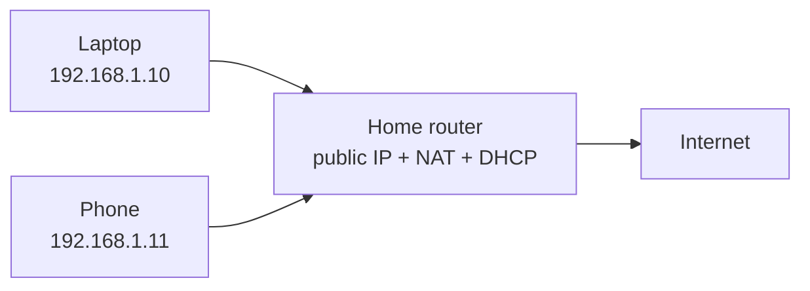
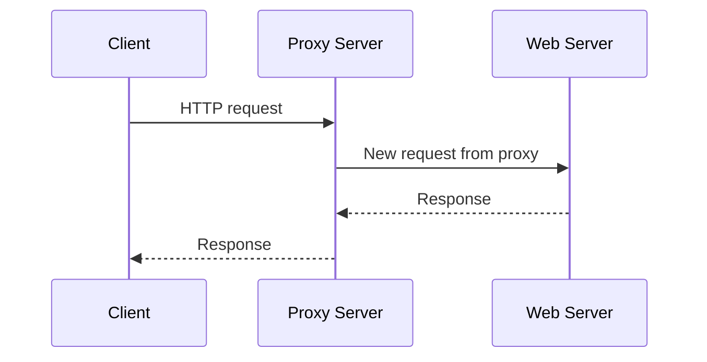
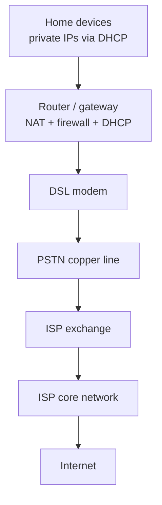

# :LiGlobe2: Subtopic: PSTN, ISPs & Home Internet

> [!ABSTRACT] Core Focus
> Covers TG **6.4 and 6.12**: how the Public Switched Telephone Network (PSTN) provides a circuit between two points, how modems and dial-up connections work, what an ISP does, the advantages of DSL/ADSL, and how a home LAN uses private IP addresses with **NAT** and **proxy servers**.

---

## 1. The Public Switched Telephone Network (6.4)

### 1.1 What is the PSTN?

The **Public Switched Telephone Network (PSTN)** is the traditional worldwide telephone network. It was designed to carry **analog voice** between two telephone subscribers.

For the exam, the key idea is:

> The PSTN provides a **circuit between two points** that can carry an **analog voice** signal.

The PSTN is not the Internet. It is a separate telephone network that can be used as an access path to an ISP.

### 1.2 Circuit switching

The PSTN is a **circuit-switched** network. Before communication begins, a dedicated path (circuit) is established between the two endpoints. The circuit is reserved for the whole conversation and is released when the call ends.

| Stage | What happens |
| :--- | :--- |
| **1. Setup** | The caller dials a number; the exchanges establish a path to the receiver. |
| **2. Transfer** | Voice signals travel continuously along the reserved circuit. |
| **3. Teardown** | When the call ends, the circuit is released and its capacity becomes available again. |

Because the circuit is reserved, it gives **guaranteed capacity and low delay** for voice. But it is inefficient for **bursty** computer data: the circuit is wasted whenever nobody is speaking or sending data.

> [!IMPORTANT] Exam distinction
> **Circuit switching** reserves a dedicated path for the whole session. **Packet switching** (used by the Internet) breaks data into packets that share links and are forwarded independently.

### 1.3 The local loop and the telephone exchange

- The **local loop** is the pair of copper wires between a subscriber’s telephone and the local telephone exchange.
- The **exchange** connects the caller to the destination exchange or to the ISP.
- Trunks carry many calls between exchanges.

The local loop was traditionally **analog**. This is why a dial-up modem had to convert digital computer data into an analog signal that could travel over the telephone line.

---

## 2. Modems and Dial-Up Connections (6.4)

### 2.1 What a modem does

A **modem** is a **modulator–demodulator**.

- **Modulation**: converts digital data from a computer into an analog signal suitable for the telephone line.
- **Demodulation**: converts the received analog signal back into digital data for the computer.

A modem is needed because the computer produces digital signals, while the PSTN local loop was designed to carry analog voice signals.

### 2.2 Dial-up connection

A **dial-up** connection uses a modem and an ordinary telephone line to **dial into a service provider’s node**.

For two remote computers connected through the PSTN:

1. Each computer is connected to a modem.
2. Each modem is connected to a telephone line.
3. The caller’s modem dials the receiver’s number (or the ISP’s number).
4. The called modem answers and the two modems **negotiate** a connection.
5. Data is modulated at the sender, carried as an analog signal over the PSTN, and demodulated at the receiver.

### 2.3 Dial-up to an ISP

A home dial-up connection works like this:

1. The user starts a dial-up connection on the computer.
2. The modem dials the **ISP’s telephone number**.
3. The ISP’s modem answers and establishes a connection.
4. The user authenticates with a username and password.
5. The ISP assigns an IP address (usually dynamically).
6. Data travels between the home computer and the ISP over the telephone network.
7. The ISP routes the data to the Internet.

### 2.4 Limitations of dial-up

| Limitation | Explanation |
| :--- | :--- |
| **Low speed** | Classic dial-up is limited to about **56 kbps** downstream. |
| **Phone line occupied** | The telephone line is busy while connected; voice calls and Internet usually cannot share the same line. |
| **Per-minute charges** | Traditional dial-up was often charged by connection time. |
| **Slow setup** | Dialling and modem negotiation take time. |
| **Noise-sensitive** | The analog telephone line is susceptible to noise and interference. |

> [!NOTE] Supporting detail
> Dial-up modems use modulation schemes such as **QAM** to represent multiple bits per symbol. **PCM (Pulse Code Modulation)** is used to digitise analog voice in digital telephone networks; it is not the same thing as a dial-up modem’s modulation. Keep the two ideas separate.

---

## 3. Internet Service Providers (6.12)

### 3.1 Role of an ISP

An **Internet Service Provider (ISP)** is an organisation that provides individuals and organisations with **access to the Internet**.

An ISP typically:

- Provides a physical or wireless **connection** to its network.
- Assigns **public IP addresses** to customers (often dynamically).
- **Routes** customer traffic to and from the Internet.
- Provides **DNS resolvers** so customers can resolve domain names.
- May provide email, web hosting, security filtering and technical support.

> [!NOTE] Supporting detail
> The Internet is a network of networks. An ISP is one network that connects its customers to other ISPs and to the global Internet. ISPs exchange traffic at **peering points** and **Internet exchange points (IXPs)**.

### 3.2 Types of ISP connection

| Type | Medium | Typical speed | Notes |
| :--- | :--- | :--- | :--- |
| **Dial-up** | Analog telephone line | Up to about 56 kbps | Uses a modem; line is occupied; obsolete for most users |
| **DSL / ADSL** | Existing copper telephone line | Several Mbps to hundreds of Mbps | Always-on; distance-sensitive; uses a DSL modem |
| **Cable** | Coaxial cable / hybrid fibre-coax | High | Shared among subscribers in a neighbourhood |
| **Fibre (FTTH/FTTP)** | Optical fibre | Very high | Fastest and most future-proof; expensive to install |
| **Fixed wireless / mobile** | Radio / cellular | Variable | Useful where cables are difficult; affected by signal quality |
| **Satellite** | Radio via satellite | Variable, often high latency | Covers remote areas; weather and latency are limitations |

> [!NOTE] Exam focus
> The TG focuses on **dial-up**, **DSL/ADSL**, and the home LAN with **NAT/proxies**. The other connection types are useful background, not core 6.12 content.

### 3.3 The home connection path

The home router often combines several functions in one box: **router, switch, wireless access point, DHCP server, NAT device and firewall**.

---

## 4. DSL and ADSL

### 4.1 DSL

**DSL (Digital Subscriber Line)** is a family of broadband technologies that send digital data over the **existing copper telephone line**.

Key properties:

- It uses **frequency division multiplexing (FDM)** to separate **voice** and **data** signals.
- Voice and Internet can be used **at the same time**.
- It is usually **always-on**; no dialling is required.
- Performance depends on the **distance** between the customer and the ISP’s exchange/central office.
- It requires a **DSL modem**; filters/splitters may be used to separate voice and data.

> [!IMPORTANT] DSL is not the same as dial-up
> Dial-up uses the telephone line as an analog modem connection and occupies the line. DSL uses higher frequencies on the same copper line, allowing simultaneous voice and data, and is always-on.

### 4.2 ADSL

**ADSL (Asymmetric Digital Subscriber Line)** is a type of DSL in which the **downstream** capacity is greater than the **upstream** capacity.

- **Downstream**: from the ISP to the home — used for web pages, video and downloads.
- **Upstream**: from the home to the ISP — used for requests, uploads and email.

This asymmetry matches typical home usage: most users download much more than they upload.

### 4.3 Advantages of DSL/ADSL

| Advantage | Explanation |
| :--- | :--- |
| **Independent services** | A problem with the high-speed data service does not necessarily stop the telephone service, because voice and data are separated. |
| **Security/isolation** | Each subscriber can be configured separately; unlike a shared cable segment, other users are not automatically on the same local network. |
| **Integration** | DSL can integrate with other WAN technologies and supports telecommuting. |
| **Cheaper** | ADSL is often cost-effective compared with dedicated leased lines. |
| **High-speed access** | Much faster than dial-up; suitable for web browsing, streaming and downloads. |
| **Always-on** | No dialling; the connection is normally available continuously. |
| **Configurable** | ADSL links can be managed and adjusted for WAN/VPN requirements. |

### 4.4 Limitations of DSL/ADSL

- **Distance-sensitive**: signal quality falls as the line length from the exchange increases.
- **Upstream is slower** in ADSL because the service is asymmetric.
- **Availability** depends on the quality and reach of the copper network.
- **Interference** on the copper line can reduce speed.

> [!NOTE] Supporting detail
> **VDSL** is a faster DSL variant for shorter distances. **SDSL** provides symmetric upstream and downstream speeds and is used by businesses. The TG only requires the general DSL/ADSL idea and the advantages of ADSL.

---

## 5. Home LAN with Private IP Addresses

### 5.1 Public and private IP addresses

A **public IP address** is globally routable on the Internet. A **private IP address** is used inside a private network and is **not directly reachable** from the Internet.

| Address type | Scope | Example |
| :--- | :--- | :--- |
| **Public** | Globally unique and routable | Assigned by an ISP |
| **Private** | Local network only | `192.168.1.10`, `10.0.0.5`, `172.16.0.20` |

Private ranges:

- `10.0.0.0/8`
- `172.16.0.0/12`
- `192.168.0.0/16`

### 5.2 How a home LAN is addressed

1. The ISP gives the home router a **public IP address** (often dynamically).
2. The router runs a **DHCP server** and assigns **private IP addresses** to the computers, phones and tablets in the home.
3. Devices use private IPs inside the LAN.
4. When a device sends traffic to the Internet, the router performs **NAT** so that the traffic appears to come from the router’s public IP address.

> [!IMPORTANT] DHCP is not NAT
> **DHCP** assigns IP addresses to devices. **NAT** translates private addresses to a public address for Internet traffic. They usually run on the same home router, but they do different jobs.

---

## 6. Network Address Translation (NAT)

### 6.1 What NAT does

**NAT (Network Address Translation)** remaps one IP address space into another by modifying IP address information in packet headers while the packet is in transit.

In a typical home network, NAT allows **many private devices to share one public IP address**.

### 6.2 How NAT works

Suppose a laptop `192.168.1.10:50000` sends a request to a web server `203.0.113.10:80`.

| Step | Source address | Destination address | What happens |
| :--- | :--- | :--- | :--- |
| 1 | `192.168.1.10:50000` | `203.0.113.10:80` | Laptop sends the packet to the router. |
| 2 | `198.51.100.7:60000` | `203.0.113.10:80` | Router replaces the private source address/port with its public address and a new port. |
| 3 | `203.0.113.10:80` | `198.51.100.7:60000` | Server replies to the public address. |
| 4 | `203.0.113.10:80` | `192.168.1.10:50000` | Router uses its NAT table to translate the reply back to the laptop. |

The router keeps a **NAT table** mapping the internal `IP:port` to the external `IP:port` for the duration of the connection.

> [!NOTE] Supporting detail
> The form of NAT used by home routers is often called **PAT (Port Address Translation)** or **NAPT (Network Address Port Translation)** because it also translates port numbers. Basic NAT may translate only IP addresses.

### 6.3 Advantages and limitations of NAT

| Advantages | Limitations |
| :--- | :--- |
| Conserves public IPv4 addresses | Can complicate inbound connections and some peer-to-peer applications |
| Hides internal private addresses from direct outside access | Not a substitute for a firewall or proper security |
| Reduces the cost of public IP addresses | Can interfere with protocols that embed IP addresses in the payload |
| Simplifies internal addressing changes | Makes end-to-end IP connectivity less transparent |

> [!WARNING] NAT is not a firewall
> NAT hides private addresses and blocks unsolicited inbound connections in many home setups, but it is **not designed as a security mechanism**. Use a firewall and other security controls as well.

---

## 7. Proxy Servers

### 7.1 What a proxy server is

A **proxy server** is an intermediary between client devices and the Internet. Instead of connecting directly to a website, the client sends its request to the proxy. The proxy processes the request, connects to the destination on the client’s behalf, and returns the response.

### 7.2 Functions of a proxy

- **Caching**: store frequently requested content to reduce bandwidth and improve response time.
- **Content filtering**: block or allow websites according to policy.
- **Logging and monitoring**: record which sites and services users access.
- **Authentication and access control**: require users to authenticate before accessing the Internet.
- **Address sharing**: many internal clients can share the proxy’s public IP address.
- **Privacy/anonymity**: the destination sees the proxy’s address rather than the client’s address.

### 7.3 NAT vs proxy

| Feature | NAT | Proxy |
| :--- | :--- | :--- |
| OSI layer | **Layer 3** (network) | **Layer 7** (application) |
| Connection termination | Does not terminate the connection | **Terminates** the client connection and opens a new one to the destination |
| Protocol awareness | None — works with IP packets | Full — understands HTTP, FTP, etc. |
| Encryption | No | Optional (e.g. HTTPS interception is possible but complex) |
| Scope | Usually all IP traffic | Often per application or per configured client |
| Main use | **IP address conservation** | **Filtering, caching, logging, access control** |

> [!IMPORTANT] NAT and proxy can work together
> A home router may use NAT to share a public IP address, while a school or company may also use a proxy for filtering and caching. They are complementary, not alternatives.

### 7.4 Forward and reverse proxies

- **Forward proxy**: sits between internal clients and the Internet; clients are configured to use it.
- **Reverse proxy**: sits in front of web servers; external clients connect to it and it forwards requests to the appropriate backend server. It can provide load balancing, caching and TLS termination.

> [!NOTE] Supporting detail
> The TG focuses on proxies in a LAN that uses private IPs, especially their role as an intermediary and their ability to share Internet access. Forward/reverse proxy terminology is useful background.

---

## 8. Putting the Home Network Together

A typical sequence:

1. The ISP assigns a public IP address to the home router.
2. The router’s DHCP server assigns private IP addresses to home devices.
3. A device sends a request to a website using the router as its **default gateway**.
4. The router performs **NAT** and forwards the packet to the ISP.
5. The ISP routes the packet across the Internet.
6. The response returns to the router, which uses its NAT table to forward it to the correct device.

---

## 9. Exam Traps

| Trap | Correct idea |
| :--- | :--- |
| “PSTN is the Internet.” | PSTN is the traditional telephone network; it can be used as an access path to an ISP, but it is not the Internet. |
| “Circuit switching and packet switching are the same.” | Circuit switching reserves a dedicated path; packet switching forwards independent packets over shared links. |
| “A modem converts analog to digital only.” | A modem **modulates** digital data to analog and **demodulates** analog back to digital. |
| “DSL is the same as dial-up.” | DSL is always-on broadband over copper; dial-up is a slow, dialled, line-occupying connection. |
| “ADSL is symmetric.” | ADSL is **asymmetric**: downstream is faster than upstream. |
| “NAT is a firewall.” | NAT translates addresses; it is not a substitute for a firewall. |
| “A proxy and NAT are the same.” | NAT works at Layer 3 and translates addresses; a proxy works at Layer 7 and acts as an intermediary. |
| “A proxy is only for hiding your IP.” | A proxy can also cache, filter, log, authenticate and control access. |
| “The router’s public IP is the IP of every home device.” | Devices have private IPs; NAT translates them to the router’s public IP. |
| “DHCP assigns public IPs to all home devices.” | The ISP assigns the router’s public IP; the router’s DHCP assigns private IPs inside the home. |

---

## :LiRocket: Flashcards (Spaced Repetition)

#flashcards

What is the PSTN? :: The traditional public switched telephone network, designed to provide a circuit between two points that can carry analog voice.

What is circuit switching? :: A switching method that establishes and reserves a dedicated path between sender and receiver for the whole communication session.

What are the three stages of a circuit-switched call? :: Circuit setup, data/voice transfer, and circuit teardown.

Why is circuit switching inefficient for computer data? :: The dedicated circuit is reserved even when no data is being sent, wasting capacity on bursty traffic.

What is a modem? :: A modulator–demodulator that converts digital data to an analog signal for transmission and converts received analog signals back to digital data.

What is modulation in a modem? :: Converting digital data from a computer into an analog signal suitable for transmission over a telephone line.

What is demodulation in a modem? :: Converting a received analog signal back into digital data for the computer.

How does a dial-up connection work? :: A modem dials the ISP’s telephone number over a PSTN line, establishes a connection, authenticates, and sends data as analog signals.

Give three limitations of dial-up. :: Low speed (about 56 kbps), the telephone line is occupied, and it is slow/noisy and often charged by time.

What is an ISP? :: An Internet Service Provider — an organisation that provides individuals and organisations with access to the Internet.

What are three roles of an ISP? :: Provide Internet access, assign public IP addresses, and route customer traffic; they may also provide DNS and email services.

What is DSL? :: Digital Subscriber Line — a broadband technology that sends digital data over existing copper telephone lines, usually with simultaneous voice and data.

How does DSL separate voice and data? :: It uses frequency division multiplexing (FDM) to place voice and data in different frequency bands on the same copper line.

What is ADSL? :: Asymmetric Digital Subscriber Line — a DSL type in which downstream capacity is greater than upstream capacity.

Why is ADSL suitable for homes? :: Home users usually download much more than they upload, so greater downstream capacity matches typical usage.

Give two advantages of DSL/ADSL. :: Independent voice and data services, and higher speed than dial-up; also always-on and cost-effective.

Why is DSL distance-sensitive? :: Signal quality decreases as the copper line length between the customer and the ISP exchange increases.

What is a public IP address? :: A globally routable IP address assigned by an ISP that can be reached over the Internet.

What is a private IP address? :: An address used inside a private network that is not directly routable on the public Internet.

What does NAT do? :: Network Address Translation remaps private IP addresses/ports to a public address/port so many devices can share one public IP.

What is stored in a NAT table? :: Mappings between internal private IP:port pairs and external public IP:port pairs, used to translate replies back to the correct device.

Why is NAT important for IPv4? :: It conserves the limited supply of public IPv4 addresses by allowing many private devices to share one public address.

Is NAT a firewall? :: No — NAT translates addresses and may hide internal hosts, but it is not designed as a security mechanism.

What is a proxy server? :: An intermediary between clients and the Internet that receives client requests, forwards them to the destination, and returns the response.

Give three functions of a proxy server. :: Caching, content filtering, logging/monitoring; it can also authenticate users and share a public IP.

What is the main difference between NAT and a proxy? :: NAT operates at Layer 3 and translates addresses; a proxy operates at Layer 7 and terminates/relays application-level connections.

What is a forward proxy? :: A proxy placed between internal clients and the Internet; clients are configured to send their requests through it.

What is a reverse proxy? :: A proxy placed in front of web servers; external clients connect to it and it forwards requests to backend servers.

What is the path of a typical home Internet request? :: Device → home router (NAT/DHCP) → DSL modem → PSTN/ISP access line → ISP core → Internet.
