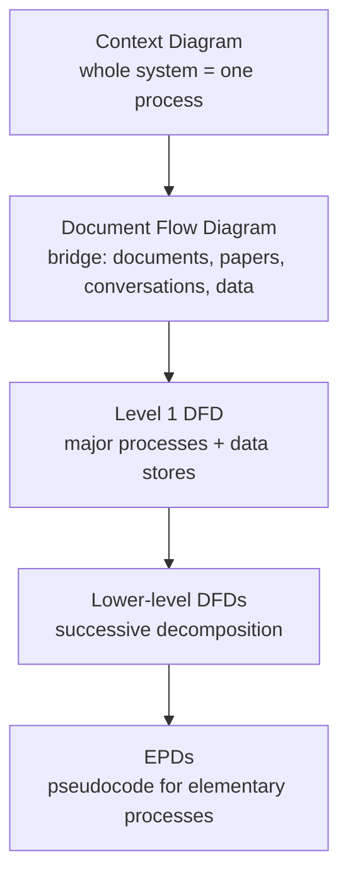
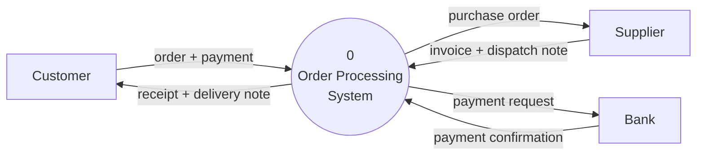

# :LiAreaChart: Subtopic: DFD & ER Diagram Modeling Guide

> [!ABSTRACT] Core Focus
> SSADM **Data Flow Modelling (DFM)** as specified in the NIE Teacher's Guide (7.6–7.7): DFD components, levels, rules, physical vs logical DFDs and EPDs. Then ER modelling: symbols, cardinality, participation, and conversion of an ERD to a relational schema.

> [!WARNING] What the syllabus actually prescribes
> The NIE Teacher's Guide specifies DFD **components, properties, levels and rules**. It does **not** name Gane & Sarson, Yourdon or DeMarco, and the 2020 paper only says *"using standard symbols"*. The shapes in §3 are **conventions** — pick one set and use it consistently. The rules in §4 are the examinable part.

> [!INFO] Used In
> The DFM material supports [[Lesson 07 - System Analysis & Design|Lesson 07]]; the ER modelling material supports [[Lesson 08 - Database Management Systems#4. ER Modeling (8.2)|Lesson 08 §4]] and ERD-to-schema mapping supports [[Lesson 08 - Database Management Systems#5. Mapping ER Diagrams to Relational Schema (8.4)|§5]].

---

## 1. What Data Flow Modelling Is

**DFM** models the **data processing** of a system: where data comes from, how it is transformed, and where it is stored. It is a set of **DFDs plus textual descriptions** (EPDs).

| Use | What it shows |
|---|---|
| **Physical DFM** | How data is **actually** processed and stored in the **current** system |
| **Logical DFM** | How data **should** be processed and stored in the **proposed** system |

DFM is part of **SSADM** and is used in:
- **7.6 Analysis** — model the current system.
- **7.7 Design** — build the logical DFDs of the proposed system.

---

## 2. Components of a DFD (TG 7.6)

| Component | Definition | Required properties |
|---|---|---|
| **External entity** | A person, organisation or other system **outside** the system boundary; acts as a **source or recipient** of data | Name must identify a **generic type**, not an instance (e.g. `Customer`, not `Nimal`) |
| **Data flow** | Data moving **to, from or within** the system; links the other components | One-way or two-way; labelled with a **noun/noun phrase** |
| **Process** | A **business activity** that transforms input data into output data | **ID, Name, Location**; name is a **verb phrase** (e.g. `1.0 Calculate Bill`) |
| **Data store** | Data held **at rest within** the system | **ID, Type, Name**; types **M / D / T / T(M)** |

### 2.1 Data store types (SSADM)

| Type | Meaning |
|---|---|
| **M** | Manual store (paper file, filing cabinet) |
| **D** | Direct / computerised store (database file) |
| **T** | Temporary store (held only during processing) |
| **T(M)** | Manual temporary store |

> [!IMPORTANT] Do not confuse
> **External entity ≠ data store.** An external entity is *outside* the boundary and is a source/recipient of data; a data store is *inside* the system and holds data at rest.
> **Process ≠ program.** A process is a business activity; one process may be implemented by several programs, or by a person.

### 2.2 Elementary process

A process that does **not need further decomposition** is an **elementary process**. It is described by an **EPD (Elementary Process Description)** in plain text or **pseudocode** — detailed enough for program specification.

---

## 3. DFD Symbols: Two Common Conventions

The TG does not prescribe shapes. These are the two most common sets; use **one** consistently.

| Component | Yourdon / DeMarco | Gane & Sarson |
|---|---|---|
| **External entity** | Rectangle | Square / rectangle |
| **Process** | Circle or oval | Rounded rectangle |
| **Data store** | Two parallel lines (open-ended) | Open-ended rectangle |
| **Data flow** | Labelled arrow | Labelled arrow |

> [!TIP] What matters for marks
> The **components, labels, direction and level consistency** carry the marks. Do not mix a circle process with a rounded-rectangle process in the same answer, and never leave a flow unlabelled.

---

## 4. Rules for DFDs

> [!CAUTION] Rules for valid DFDs (TG rules + standard conventions)
> 1. **External entity → external entity:** the TG allows it only as a **dashed arrow**, representing data passing **outside** the system boundary. It is **not** a system process flow; a solid entity-to-entity flow is wrong.
> 2. **External entity ↔ data store:** must go **through a process**. No direct connection.
> 3. **Data store ↔ data store:** must go **through a process**.
> 4. **Every process** must have **at least one input flow AND at least one output flow**.
>    - Input only → **black hole** (invalid; standard DFD term).
>    - Output only → **miracle** (invalid; standard DFD term).
> 5. **Process-to-process** flows are allowed (data handed from one activity to the next).
> 6. **Avoid crossing flow lines** where possible (TG explicitly says intersections should be avoided).
> 7. **Names:** process = verb phrase + ID; data flow = noun phrase; data store = noun; external entity = generic type.
> 8. A DFD shows **data flow, not control flow** — no sequence, timing, decisions or loops. Those belong to flowcharts.

---

## 5. DFD Levels

| Diagram | Content | Rule |
|---|---|---|
| **Context diagram** | The entire system as **one process** + **external entities** + boundary flows | **No data stores, no internal processes**. Highest abstraction. |
| **Document flow diagram** | How **documents (papers, conversations, data passed among computers)** move through the system | **Bridge** between the context diagram and Level 1; the TG does not number it as a decomposition level |
| **Level 1 DFD** | Major processes, data stores and flows | Must be **consistent with the context** (same boundary flows) |
| **Lower-level DFDs** | Detailed decomposition of one process at a time | Top-down; must be **consistent with the parent** |
| **EPD** | Text/pseudocode for each elementary process | Enough detail for program specification |

> [!WARNING] Context-diagram trap (2020 MCQ 25)
> *"All data stores must be shown in the context diagram"* is **incorrect**. Context diagrams show **no data stores** — only the single system process and external entities. The other 2020 options were true: context = highest abstraction; flows link components; elementary processes are not decomposed; external entities are sources/recipients.

### 5.1 Balancing (consistency)

A child DFD must **conserve the parent's flows**: every input and output of the parent process must appear on the child diagram, with the same external source/destination. Adding a new external flow at a lower level is an error.

---

## 6. Physical vs Logical DFD

| | **Physical DFD** | **Logical DFD** |
|---|---|---|
| System | Current (as-is) | Proposed (to-be) |
| Shows | How data **is actually** processed and stored | How data **should** be processed and stored |
| Contains | Physical constraints such as process locations, manual stores and temporary stores; how work is actually done | Logical processes, logical data stores and external entities; physical constraints removed |
| Stage | 7.6 analysis | 7.7 design |

**Converting physical → logical (TG 7.7):**

1. Start from the **elementary processes**.
2. **Remove the Location** of every process — location is a physical constraint.
3. **Transform that location into an external entity** — the person who actually performed the process in the physical DFM now feeds inputs to the corresponding logical process.
4. **Remove purely human activities** and replace them with **external entities**.
5. **Add new processes** required by new functionality.
6. **Regroup** the process hierarchy by **function**, rebuilding upward to the context diagram.
7. Write the **EPD** for each elementary process in pseudocode.

---

## 7. Worked Context Diagram (illustrative)

A mail-order system: customers place orders, suppliers send invoices and dispatch notes, and the bank confirms payment.

- **One process only** (`0`), **three external entities**, **no data stores** — this is a valid context diagram.
- The circle is the **Yourdon/DeMarco** process shape; with Gane & Sarson, draw it as a rounded rectangle.
- At **Level 1**, process `0` would decompose into e.g. `1.0 Validate order`, `2.0 Process payment`, `3.0 Dispatch order`, and data stores such as `D1 Orders`, `D2 Stock` would appear.

---

## 8. Entity-Relationship (ER) Diagrams

### 8.1 Symbols (Chen notation)

| Symbol | Meaning |
|---|---|
| **Rectangle** | Entity — a real-world object/concept (`Student`, `Course`) |
| **Diamond** | Relationship — association between entities (`Enrolls`) |
| **Oval** | Attribute — property of an entity |
| **Underlined attribute** | Key attribute (primary key) |
| **Double oval** | Multivalued attribute (`Phone_Number`) |
| **Branching ovals** | Composite attribute (`Name` → `First_Name`, `Last_Name`) |
| **Dashed oval** | Derived attribute (`Age` from `DOB`) |

### 8.2 Cardinality and participation

- **Degree / cardinality** — how many occurrences of each entity participate: **1:1**, **1:N**, **M:N**.
- **Participation / optionality** — whether **every** occurrence of an entity must take part:
  - **Total (mandatory)** — double line; every occurrence must participate.
  - **Partial (optional)** — single line; some occurrences may not participate.

> [!NOTE] LDS vs ERD
> In SSADM the data model is called the **Logical Data Structure (LDS)**. It uses the same ideas — entities, attributes, relationships, degree and optionality — plus an **entity matrix** to check every pair of entities once. "ERD" is the general name for the same kind of model.

---

## 9. Converting ERD → Relational Schema

| ER construct | Relational result |
|---|---|
| **Strong entity** | A **table**; key attribute becomes **primary key** |
| **1:1 relationship** | Put the PK of one entity as a **foreign key** in the other (prefer the side with **total/mandatory participation**, to avoid nulls) |
| **1:N relationship** | Put the PK of the **"1" side** as a **foreign key in the "N" side** table |
| **M:N relationship** | Create a **junction table**; its PK is the **combination of both PKs**, plus any relationship attributes |
| **Multivalued attribute** | A **separate table** (entity + attribute + FK back to the entity) |

After mapping: **normalise to 3NF**, then write **table specifications** (fields, types, sizes, keys) and **record specifications**.

---

## 10. Exam Traps

| Wrong idea | Correct idea |
|---|---|
| "Context diagrams show all data stores." | Context shows **no data stores** — one process + external entities. (2020 Q25) |
| "Entity → entity flows are always forbidden." | A **dashed** entity-to-entity flow is allowed (outside the boundary); a **solid** one is wrong. |
| "Document flow diagram is Level 0.5 / a decomposition level." | The TG describes it as a **bridge** between context and Level 1; it is not one of the numbered decomposition levels. |
| "A process may have only inputs." | Every process needs **at least one input and one output**; otherwise black hole/miracle. |
| "DFDs show the order of processing." | DFDs show **data flow only** — no sequence, timing or decisions. |
| "A data store is always a database." | It can be **manual (M), computerised (D), temporary (T) or manual temporary T(M)**. |
| "External entity and data store are the same." | Entity is **outside** the boundary; store is **inside** the system. |
| "Process Location stays in the logical DFD." | Location is a **physical constraint** and is removed in the logical model. |
| "Gane & Sarson is the syllabus-mandated notation." | The TG **does not name any notation**; it names components and rules. |
| "Level 1 may introduce new external flows." | A child DFD must **balance** with its parent — no new external flows. |

---

## :LiRocket: Flashcards (Spaced Repetition)

#flashcards

What is Data Flow Modelling (DFM)? :: Modelling how data moves, is processed and is stored in a system, using a set of DFDs plus textual descriptions (EPDs).

What are the four components of a DFD? :: External entities, data flows, processes and data stores.

What are the properties of a DFD process? :: ID, Name and Location; the name should be a verb phrase.

What are the properties and types of a data store? :: ID, Type and Name; types M (manual), D (computerised), T (temporary), T(M) (manual temporary).

What is an external entity in a DFD? :: A person, organisation or other system outside the system boundary that supplies or receives data.

What is an elementary process? :: A process that does not need further decomposition, described by an EPD in plain text or pseudocode.

How are data flows between two external entities drawn, and why? :: As dashed arrows, because the data passes outside the system boundary and is not processed by a system process.

What must every DFD process have? :: At least one input flow and at least one output flow; input-only is a black hole, output-only is a miracle.

Can two data stores be connected directly? :: No — data must pass through a process.

Can an external entity write directly to a data store? :: No — the flow must go through a process.

What does a context diagram contain? :: The entire system as one process, its external entities and the boundary data flows; no data stores and no internal processes.

What is the highest level of abstraction in a DFD? :: The context diagram (Level 0).

What is the role of the document flow diagram? :: It is the bridge between the context diagram and the Level 1 DFD, showing how documents and data pass through the system.

What must a Level 1 DFD be consistent with? :: The context diagram — the same external flows and boundary.

What is balancing in DFDs? :: A child DFD must conserve all the parent process's inputs and outputs; no new external flows may appear.

What is the difference between a physical and a logical DFD? :: Physical shows how data is actually processed/stored in the current system; logical shows how it should be processed/stored in the proposed system.

How is a physical DFD converted to a logical DFD? :: Remove process locations, transform each process location into an external entity, remove purely human activities, add new processes, regroup by function and write EPDs.

Does the NIE syllabus mandate Gane & Sarson notation? :: No — the TG specifies components, properties and rules but does not name a notation; the paper says "standard symbols".

Name the two common DFD notation sets. :: Yourdon/DeMarco (circle process) and Gane & Sarson (rounded-rectangle process).

What does a DFD deliberately NOT show? :: Sequence, timing, decisions and control flow — it shows data flow only.

In an ERD, what does a diamond represent? :: A relationship between entities.

What does a double oval represent in an ERD? :: A multivalued attribute.

What does a dashed oval represent in an ERD? :: A derived attribute.

What is cardinality in an ERD? :: The number of occurrences of each entity that participate in a relationship — 1:1, 1:N or M:N.

What is total vs partial participation? :: Total (mandatory) means every occurrence must participate; partial (optional) means some may not.

How is a 1:N relationship converted to tables? :: Put the primary key of the "1" side as a foreign key in the "N" side table.

How is an M:N relationship converted to tables? :: Create a junction table whose primary key is the combination of both entities' primary keys.

How is a multivalued attribute converted to tables? :: Create a separate table containing the attribute and a foreign key back to the entity.

---

## :LiBooks: See Also

- [[Lesson 07 - System Analysis & Design]] — parent lesson: SDLC, SSADM stages, analysis and design
- [[Extended & Enhanced ER (EER) Modeling]] — specialization, generalization and inheritance
