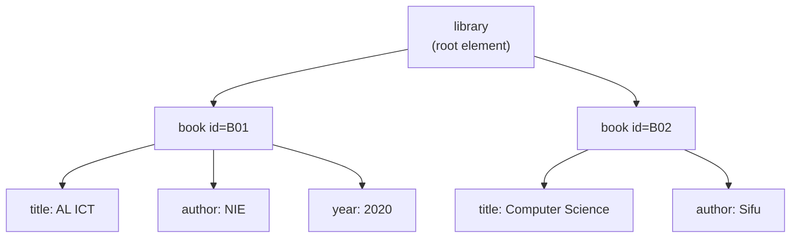

# :LiCode: Subtopic: XML Basics — What It Is & Its Rules

> [!ABSTRACT] Core Focus
> What **XML** is, how it differs from HTML, the syntax rules that make a document **well-formed**, the difference between **well-formed** and **valid** (DTD/XSD), elements vs attributes, namespaces, and where XML is used — enough to answer a past-paper MCQ.

---

## 1. What is XML?

**XML = eXtensible Markup Language.** It is a **markup language** (not a programming language) standardised by the **W3C** in 1998, derived from SGML.

- It **stores and transports data** in a structured, self-describing way.
- The tags are **not predefined** — you invent them, which is why it is called *extensible*.
- It is **plain text**, so any platform, language or program can read it.
- It has **strict syntax**, so a parser can always tell whether a document is correct.

> [!IMPORTANT] One-line definition
> XML is a **text-based, self-describing format for storing and exchanging structured data**, using user-defined tags that must follow strict syntax rules.

---

## 2. XML vs HTML

| | **XML** | **HTML** |
|---|---|---|
| Purpose | **Describe / store / transport data** | **Display** content in a browser |
| Tags | **User-defined** (`<book>`, `<price>`) | **Predefined** (`<p>`, `<h1>`, ``) |
| Meaning of tags | Decided by the author | Fixed by the HTML standard |
| Case sensitivity | **Case-sensitive** | Case-insensitive |
| Closing tags | **Compulsory** for every element | Some may be omitted (`<br>`, `<li>`) |
| Root element | **Exactly one** | `<html>` (one, but browsers forgive) |
| Errors | Parser **rejects** the document | Browser **tries to render anyway** |
| Display | Needs CSS / XSLT | Rendered directly |

> [!TIP] XHTML
> XHTML is HTML rewritten to obey XML rules (all tags closed, lowercase, quoted attributes). It is the bridge between the two.

---

## 3. A Minimal XML Document

```xml
<?xml version="1.0" encoding="UTF-8"?>
<library>
  <book id="B01">
    <title>AL ICT</title>
    <author>NIE</author>
    <year>2020</year>
  </book>
  <book id="B02">
    <title>Computer Science</title>
    <author>Sifu</author>
  </book>
</library>
```



- `<library>` is the **root element** — everything else is nested inside it.
- `id="B01"` is an **attribute** (metadata about the element).
- `<title>AL ICT</title>` is an **element** with **text content**.
- The document is a **tree**: one root, branches of child elements, leaves of text.

---

## 4. Rules for Well-Formed XML

A document that follows **all** of these rules is **well-formed** and will parse without error.

| # | Rule | Correct | Wrong |
| :---: | :--- | :--- | :--- |
| 1 | **Exactly one root element** | one `<library>…</library>` | two top-level elements |
| 2 | **Every element must be closed** | `<year>2020</year>` or `` | `<year>2020` |
| 3 | **Tags are case-sensitive** | `<Title>…</Title>` | `<Title>…</title>` |
| 4 | **Proper nesting** (no overlap) | `<b><i>x</i></b>` | `<b><i>x</b></i>` |
| 5 | **Attribute values must be quoted** | `id="B01"` | `id=B01` |
| 6 | **One value per attribute name** | `id="B01"` | `id="B01" id="B02"` |
| 7 | **Legal element/attribute names** | `student_name` | `student name`, `1st` |
| 8 | **Escape `<` and `&`** (and quotes inside attributes) | `&lt;`, `&amp;` | a raw `<` in text |
| 9 | **Comments cannot contain `--`** | `<!-- note -->` | `<!-- a -- b -->` |
| 10 | **XML declaration first, if present** | `<?xml version="1.0"?>` on line 1 | declaration after an element |

### 4.1 The five predefined entities

| Character | Entity |
| :---: | :---: |
| `<` | `&lt;` |
| `>` | `&gt;` |
| `&` | `&amp;` |
| `"` | `&quot;` |
| `'` | `&apos;` |

Large blocks of text containing `<` or `&` can instead be wrapped in **CDATA**: `<![CDATA[ a < b && c > d ]]>`.

### 4.2 The XML declaration

```xml
<?xml version="1.0" encoding="UTF-8" standalone="yes"?>
```

- `version` — required if the declaration is used (currently `1.0` or `1.1`).
- `encoding` — character set, e.g. `UTF-8`.
- `standalone` — `yes` if the document needs no external DTD.
- If present, it must be the **very first thing** in the file (no blank line before it).

---

## 5. Well-Formed vs Valid

| | **Well-formed** | **Valid** |
|---|---|---|
| Meaning | Obeys the **syntax rules** of XML | Well-formed **and** obeys a **grammar** (DTD or XSD) |
| Checked by | Any XML parser | A **validating** parser |
| Guarantees | The document can be parsed into a tree | The document has the agreed structure and allowed elements |
| Relationship | Necessary for validity | **Not** required for well-formedness |

- **DTD (Document Type Definition)** — older, simple grammar: allowed elements, order, attributes.
- **XSD (XML Schema Definition)** — newer, written in XML itself; supports **data types** (integer, date), far more precise.

> [!WARNING] The classic exam line
> **All valid documents are well-formed, but not all well-formed documents are valid.** Well-formedness is about *syntax*; validity is about *grammar*.

---

## 6. Elements vs Attributes

| Use an **element** when… | Use an **attribute** when… |
|---|---|
| The value is data the user sees | The value describes the element (metadata) |
| The value may repeat or contain children | The value is a single, simple token (ID, type, unit) |
| Order matters | The value is not displayed |

```xml
<book id="B01" language="en">
  <title>AL ICT</title>
</book>
```

> [!NOTE] Attributes cannot contain child elements
> An attribute holds **one text value only**. If data has structure, it must be an element.

---

## 7. Namespaces (one paragraph)

Two vocabularies can use the same tag name (`<title>` for a book vs a web page). **Namespaces** give tags a unique prefix:

```xml
<bk:title xmlns:bk="http://example.org/book">AL ICT</bk:title>
```

- `xmlns:bk="…"` declares the prefix and its URI.
- `xmlns="…"` sets the **default namespace** for the element and its children.
- The URI is only an identifier — it does not have to be fetched.

---

## 8. Where XML Is Used

- **Data exchange** between systems (SOAP web services, APIs)
- **Configuration files** (`.xml` settings, Maven, Android layouts)
- **RSS / Atom** feeds and **sitemaps**
- **SVG** vector graphics
- **Office Open XML** — `.docx`, `.xlsx`, `.pptx` are ZIP archives of XML files
- **XHTML**

**Parsing:** **DOM** loads the whole tree into memory (can read *and* modify; heavy); **SAX** is event-based streaming (low memory, read-only, fast for large files).

---

## 9. Exam Traps

| Wrong idea | Correct idea |
|---|---|
| "XML is a programming language." | It is a **markup** language — no logic, loops or computation. |
| "XML has predefined tags." | Tags are **user-defined**; HTML's are predefined. |
| "XML displays data in a browser." | XML only **describes** data; CSS/XSLT is needed to display it. |
| "XML tags are case-insensitive." | XML is **case-sensitive**; HTML is not. |
| "Attribute values need no quotes." | Quotes are **compulsory**. |
| "A document may have several roots." | **Exactly one** root element. |
| "Well-formed means valid." | Well-formed = syntax only; valid = syntax **+** DTD/XSD grammar. |
| "A missing end tag is tolerated." | The document is **not well-formed** and parsing fails. |
| "Comments may contain `--`." | `--` is **not allowed** inside a comment. |
| "XML replaces HTML." | Different jobs: XML stores/transports data, HTML displays it. |

---

## :LiRocket: Flashcards (Spaced Repetition)

#flashcards

What does XML stand for? :: eXtensible Markup Language.

What is XML used for? :: Storing and transporting structured data in plain text using self-describing, user-defined tags.

Is XML a programming language? :: No — it is a markup language with no logic or computation.

How do XML tags differ from HTML tags? :: XML tags are user-defined and describe data; HTML tags are predefined and describe presentation.

Is XML case-sensitive? :: Yes — `<Title>` and `<title>` are different elements, and opening/closing tags must match exactly.

How many root elements must an XML document have? :: Exactly one.

What makes an XML document "well-formed"? :: It follows all XML syntax rules: one root, all tags closed, correct nesting, case-matched tags, quoted attributes, escaped special characters.

What is the difference between well-formed and valid XML? :: Well-formed = correct syntax; valid = well-formed AND conforms to a DTD or XSD grammar.

Must every XML element have a closing tag? :: Yes — either `<tag>…</tag>` or the self-closing `<tag/>`.

How must attribute values be written? :: In quotes, e.g. `id="B01"`.

How do you include a literal `<` or `&` in XML text? :: Escape it as `&lt;` / `&amp;`, or wrap the block in CDATA.

What are the five predefined XML entities? :: `&lt;` (<), `&gt;` (>), `&amp;` (&), `&quot;` ("), `&apos;` (').

Where must the XML declaration appear? :: As the very first line of the document, if it is used at all.

What is a DTD? :: Document Type Definition — a grammar defining the allowed elements, order and attributes of an XML document.

What is XSD? :: XML Schema Definition — a newer, XML-written grammar that also defines data types; more powerful than DTD.

Difference between an element and an attribute? :: An element holds data/structure and can have children; an attribute holds a single metadata value and cannot have children.

What is an XML namespace? :: A prefix bound to a URI that makes tag names unique and prevents clashes between vocabularies.

What is the difference between DOM and SAX parsing? :: DOM builds the whole tree in memory (read/modify); SAX streams events without storing the tree (low memory, read-only).

Name three real uses of XML. :: Configuration files, data exchange/web services (SOAP), RSS feeds, SVG, or Office `.docx`/`.xlsx` files.

---

## :LiBook: See Also

- [[Lesson 10 - Web Development (HTML, CSS, PHP)]] — HTML, CSS and web page structure
