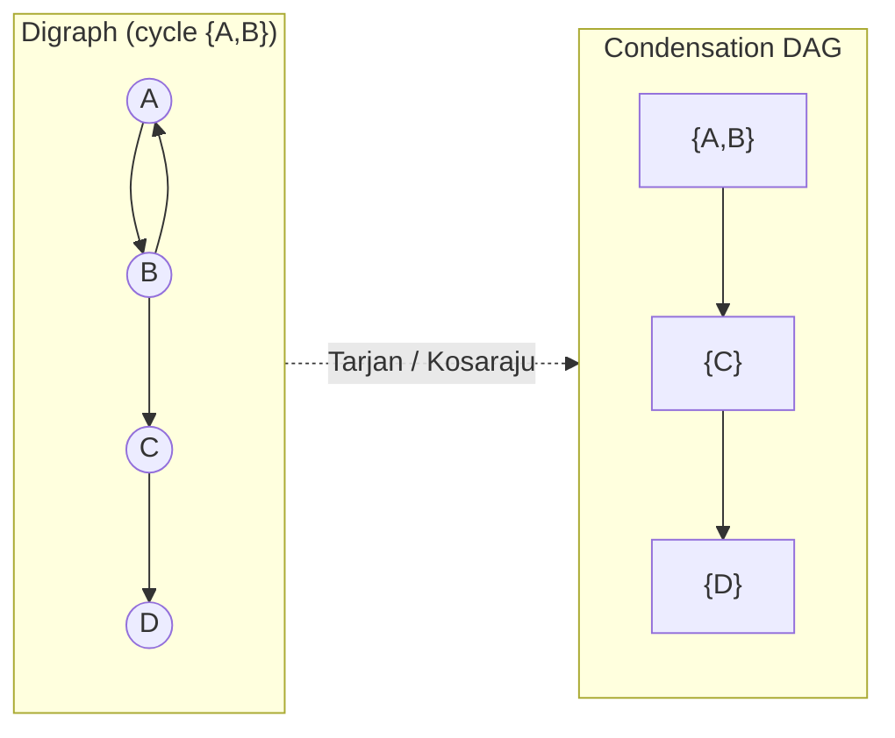

# :LiBook: Lesson 11: Graph Algorithms

> [!ABSTRACT] Scope
> Master foundational graph algorithms: BFS, Dijkstra's Shortest Path, Disjoint Set Union (DSU), Kruskal's MST, Kahn's Topological Sort, plus all-pairs reachability (bitset transitive closure, SCC condensation, DSU/tree shortcuts).

---
## 1. Dijkstra's Algorithm (Non-Negative Weighted Graphs)

Find shortest distance from source to all vertices in $O((V + E) \log V)$ time.

```cpp
#include <iostream>
#include <vector>
#include <queue>
using namespace std;

const long long INF = 1e18;

vector<long long> dijkstra(int n, int src, const vector<vector<pair<int, int>>>& adj) {
    vector<long long> dist(n, INF);
    // Min-Heap priority queue storing {distance, vertex}
    priority_queue<pair<long long, int>, vector<pair<long long, int>>, greater<pair<long long, int>>> pq;

    dist[src] = 0;
    pq.push({0, src});

    while (!pq.empty()) {
        auto [d, u] = pq.top(); pq.pop();
        if (d > dist[u]) continue; // Skip stale heap entry

        for (auto [v, weight] : adj[u]) {
            if (dist[u] + weight < dist[v]) {
                dist[v] = dist[u] + weight;
                pq.push({dist[v], v});
            }
        }
    }
    return dist;
}
```

---
## 2. Disjoint Set Union (DSU) & Kruskal's MST

```cpp
struct DSU {
    vector<int> parent, sz;
    DSU(int n) : parent(n), sz(n, 1) {
        for (int i = 0; i < n; i++) parent[i] = i;
    }

    int find(int i) {
        if (parent[i] == i) return i;
        return parent[i] = find(parent[i]); // Path compression
    }

    bool unite(int i, int j) {
        int root_i = find(i), root_j = find(j);
        if (root_i != root_j) {
            if (sz[root_i] < sz[root_j]) swap(root_i, root_j);
            parent[root_j] = root_i;
            sz[root_i] += sz[root_j];
            return true;
        }
        return false;
    }
};

struct Edge {
    int u, v, w;
    bool operator<(const Edge& other) const { return w < other.w; }
};

long long kruskalMST(int n, vector<Edge>& edges) {
    sort(edges.begin(), edges.end());
    DSU dsu(n);
    long long mst_cost = 0;
    int edges_count = 0;

    for (const auto& e : edges) {
        if (dsu.unite(e.u, e.v)) {
            mst_cost += e.w;
            edges_count++;
        }
    }
    return (edges_count == n - 1) ? mst_cost : -1;
}
```

---
## 3. Topological Sort (Kahn's BFS Algorithm)

Sort vertices in a Directed Acyclic Graph (DAG) such that for every directed edge $u \to v$, $u$ comes before $v$.

```cpp
vector<int> topoSort(int n, const vector<vector<int>>& adj, vector<int>& indegree) {
    queue<int> q;
    for (int i = 0; i < n; i++) {
        if (indegree[i] == 0) q.push(i);
    }

    vector<int> topo_order;
    while (!q.empty()) {
        int u = q.front(); q.pop();
        topo_order.push_back(u);

        for (int v : adj[u]) {
            indegree[v]--;
            if (indegree[v] == 0) q.push(v);
        }
    }
    return (topo_order.size() == n) ? topo_order : vector<int>(); // Empty if graph has cycle!
}
```

---
## 4. Reachability & Transitive Closure

Question: *"Is there a path from $u$ to $v$?"* Reaching one target is trivial (DFS/BFS in $O(V+E)$). The interesting problem is answering it for **all pairs at once**: the **transitive closure** (a.k.a. reachability matrix) — boolean $R[u][v] = \text{true}$ iff some directed path $u \to \cdots \to v$ exists.

> Conventions differ: the matrix usually assumes $R[u][u] = \text{true}$ (empty path). A BFS/DFS sweep does **not** mark $u$ as reaching itself unless you seed `visited[u]` — stay consistent.

Pick the tool by graph shape:

| Situation | Method | Cost |
|:---|:---|:---|
| Sparse graph, few queries | BFS/DFS per source | $O(V+E)$ each |
| Any digraph, dense, $n \lesssim 5000$ | Bitset Floyd–Warshall | $O(V^3/64)$ |
| DAG, all pairs | Reverse-topo bitset DP | $O(V \cdot E / 64)$ |
| General digraph, all pairs | SCC → condensation → DAG sweep | $O(V+E)$ + DAG sweep |
| Undirected | DSU (section 2) | ~$O(1)$ amortized |
| Tree | Euler tour interval check | $O(1)$ after $O(V)$ |

### 4.1 Bitset Floyd–Warshall (reachability matrix)

```cpp
const int N = 5000;              // max vertices (adjust per problem)
bitset<N> R[N];                  // R[u] = bitset of every vertex u can reach

void closure(int n, const vector<vector<int>>& adj) {
    for (int u = 0; u < n; u++) {
        R[u].set(u);                        // trivial self-path
        for (int v : adj[u]) R[u].set(v);   // seed with direct edges
    }
    for (int k = 0; k < n; k++)             // k MUST be the outer loop
        for (int u = 0; u < n; u++)
            if (R[u][k]) R[u] |= R[k];
}
// Query: R[u][v] is true iff v is reachable from u
```

- Same recurrence as weighted Floyd–Warshall, but `+`/`min` becomes **OR** (it is exactly Warshall's `R[u][v] = R[u][v] || (R[u][k] && R[k][v])`, evaluated for all `v` in one word-parallel OR).
- **Why `k` outermost:** the invariant is that after pass $k$, `R[u]` contains every destination reachable using only intermediates $< k$ — inner loops would propagate rows before they are settled.
- Cost: $n = 2000$ is instant; $n = 5000 \approx 5000^3/64 \approx 2\cdot10^9$ word ops (borderline TL) and 3.1 MB — comfortable to $n \approx 3000$.

### 4.2 DAG: one sweep in reverse topological order

On a DAG the $k$-loop is unnecessary: finish the sinks first, then pull reachability upward.

```cpp
// topo = Kahn's output from Section 3 (empty ⇒ not actually a DAG ⇒ use 4.1/4.3)
vector<bitset<N>> reachD(n);
for (int i = n - 1; i >= 0; i--) {
    int u = topo[i];                   // reverse topo ⇒ all successors are final
    reachD[u].set(u);
    for (int v : adj[u]) reachD[u] |= reachD[v];
}
```

Each edge ORs one bitset into its source exactly once ⇒ $O(V \cdot E / 64)$. Usually beats even bitset-FW on DAGs.

### 4.3 General digraph: SCC condensation

An SCC is a maximal set of vertices that *mutually* reach each other. **Key fact: $u$ reaches $v$ iff $\mathrm{comp}[u]$ reaches $\mathrm{comp}[v]$ in the condensation DAG** — so collapse the cycles and fall back to 4.2.



```cpp
// Tarjan SCC, 0-indexed; DFS-based (use an explicit stack for very deep graphs)
vector<int> tarjanSCC(int n, const vector<vector<int>>& adj) {
    int t = 0, cnt = 0;
    vector<int> num(n, 0), low(n), comp(n, -1), sk;
    vector<bool> inStack(n, false);
    function<void(int)> dfs = [&](int u) {
        num[u] = low[u] = ++t;
        sk.push_back(u); inStack[u] = true;
        for (int v : adj[u]) {
            if (!num[v]) { dfs(v); low[u] = min(low[u], low[v]); }
            else if (inStack[v]) low[u] = min(low[u], num[v]);
        }
        if (low[u] == num[u]) {            // u closes one SCC
            while (true) {
                int v = sk.back(); sk.pop_back();
                inStack[v] = false; comp[v] = cnt;
                if (v == u) break;
            }
            ++cnt;                          // comp ids arrive in REVERSE topo order
        }
    };
    for (int s = 0; s < n; s++) if (!num[s]) dfs(s);
    return comp;
}

// Condensation closure (cnt, comp from tarjanSCC above); descending comp id = sinks first, so no extra sort
vector<vector<int>> cadj(cnt);
for (int u = 0; u < n; u++)
    for (int v : adj[u])
        if (comp[u] != comp[v]) cadj[comp[u]].push_back(comp[v]);

vector<bitset<N>> creach(cnt);
for (int c = cnt - 1; c >= 0; c--) {
    creach[c].set(c);
    for (int d : cadj[c]) creach[c] |= creach[d];
}
// Query: v reachable from u  ⇔  creach[comp[u]][comp[v]]
```

- $u, v$ in the same SCC ⇒ mutually reachable (self bit covers it).
- **Kosaraju** alternative: two DFS passes (forward, reversed graph by finish time), same $O(V+E)$, extra reverse pass but easier to recall.

### 4.4 Undirected & tree shortcuts (already in your toolbox)

- **Undirected**: reachability = same connected component ⇒ `dsu.find(u) == dsu.find(v)` (section 2). Offline variant: sort edges (and queries) by weight, union as edges arrive — answers "smallest threshold making $u$ reach $v$".
- **Tree**: the path is unique, so $u$ reaches $v$ iff $v$ lies in $u$'s subtree — Euler tour: $\mathrm{tin}_u \le \mathrm{tin}_v < \mathrm{tout}_u$. See [[02 - Core Data Structures & Strings/Lesson 10 - Trees|Lesson 10 - Trees]].

> [!TIP] Memory & container economy
> Prefer `bitset<N>` or a raw `bool` array over `vector<vector<bool>>` — bit-proxy iterators make vector-of-bools slow and cache-unfriendly. At $n = 5000$ the closure is ~3 MB (fits 64 MB limits); beyond ~$5000$ all-pairs closure no longer fits — fall back to per-query BFS/DFS or offline tricks.

---
## :LiRocket: Flashcards (Spaced Repetition)

#flashcards

When is Dijkstra's algorithm valid? :: When all edge weights in the graph are non-negative.

What does Kahn's algorithm use to perform Topological Sorting? :: A queue tracking vertices with an indegree of 0.

What is the time complexity of Kruskal's Minimum Spanning Tree algorithm? :: $O(E \log E)$ time for sorting edges.
<!--SR:!2026-09-26,1,230-->

What is the transitive closure of a directed graph? :: Boolean reachability matrix $R$ where R[u][v] = true iff a directed path u→v exists; convention includes self-paths (R[u][u] = true).

Why must `k` be the outer loop in bitset Floyd–Warshall closure? :: Invariant: after pass k, R[u] contains every destination reachable using only intermediates < k; a settled row is required before ORing it onward.

All-pairs reachability on a DAG in one sweep? :: Reverse topological order: R[u].set(u); for each edge u→v, R[u] |= R[v] — successors are already final. Cost O(V·E/64).

Why does SCC condensation solve reachability in any digraph? :: u reaches v iff comp[u] reaches comp[v] in the condensation DAG; Tarjan assigns comp ids in reverse topo order, so the DAG sweep applies directly.

What is the O(1) reachability check in (a) an undirected graph, (b) a tree? :: (a) DSU: find(u) == find(v); (b) Euler tour: tin[u] ≤ tin[v] < tout[u] (v lies in u's subtree).
