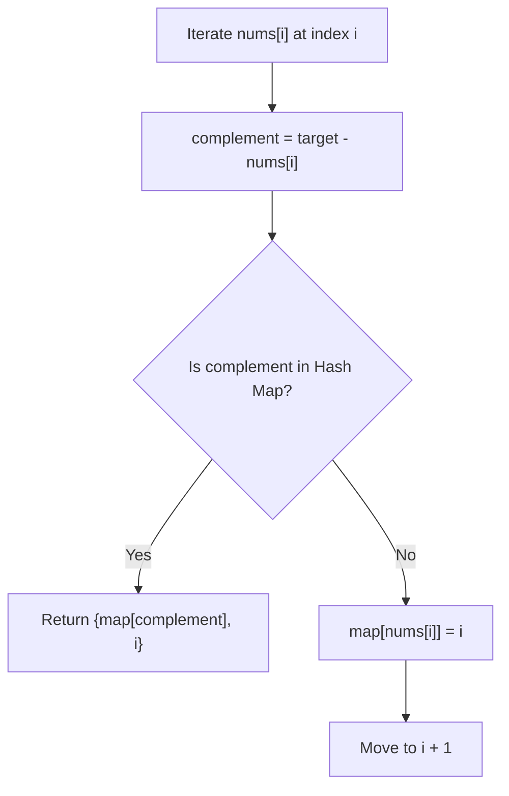

# :LiCode: LC-0001: Two Sum

> [!ABSTRACT] Problem Summary
> - **Source Link**: [LeetCode 1 - Two Sum](https://leetcode.com/problems/two-sum/)
> - **Constraints**:
>   - $2 \le \text{nums.length} \le 10^4$
>   - $-10^9 \le \text{nums}[i] \le 10^9$
>   - $-10^9 \le \text{target} \le 10^9$
>   - Exactly one valid answer exists.
>   - Cannot use the same element twice.
> - **Goal**: Return indices of the two numbers such that they add up to `target`.

---

## 1. Initial Thought & First Attempt (Brute Force)

### Thought Process:
- Check every distinct pair of indices $(i, j)$ where $j > i$.
- For each pair, check if the required complement $(target - \text{nums}[i])$ matches $\text{nums}[j]$.
- If matched, push both indices into `answer` and return.

### Code:
```cpp
class Solution {
public:
    vector<int> twoSum(vector<int>& nums, int target) {
        vector<int> answer;
        for (int i{0}; i < nums.size(); ++i) {
            for (int j{i + 1}; j < nums.size(); ++j) {
                if (target - nums[i] == nums[j]) {
                    answer.push_back(i);
                    answer.push_back(j);
                }
            }
        }
        return answer;
    }
};
```

### Complexity & Limitations:
- **Time Complexity:** $O(N^2)$
  - Outer loop runs $N$ times, inner loop runs $(N - 1) + (N - 2) + \dots + 1 = \frac{N(N-1)}{2}$ times.
  - For $N = 10^4$, total operations $\approx \frac{(10^4)^2}{2} = 5 \times 10^7$, which just fits inside LeetCode's 1-second limit (~$10^8$ ops).
  - If $N$ were $10^5$, operations would reach $5 \times 10^9 \implies$ **Time Limit Exceeded (TLE)**.
- **Space Complexity:** $O(1)$ auxiliary space (ignoring the output vector).

---

## 2. Key Insight / "Aha!" Moment

> [!TIP] The Optimization: Trade Space for Time
> In the brute force approach, for every element $\text{nums}[i]$, we spend $O(N)$ time scanning through the rest of the array just to ask: *"Does $(target - \text{nums}[i])$ exist in the array, and what is its index?"*
> 
> Can we answer that question in **$O(1)$ average time** instead of $O(N)$?
> **Yes, by using a Hash Table (`unordered_map` in C++)!**
> 
> As we iterate through the array:
> 1. Calculate `complement = target - nums[i]`.
> 2. Check if `complement` is already stored in our hash map.
> 3. If yes: we found our pair! Return `{seen[complement], i}`.
> 4. If no: store current number and its index `seen[nums[i]] = i` and continue.



---

## 3. Optimal Solution (One-Pass Hash Map)

```cpp
#include <vector>
#include <unordered_map>

class Solution {
public:
    std::vector<int> twoSum(std::vector<int>& nums, int target) {
        // Hash map storing: {value -> index}
        std::unordered_map<int, int> seen;
        
        for (int i = 0; i < static_cast<int>(nums.size()); ++i) {
            int complement = target - nums[i];
            
            // Look up complement in O(1) average time
            auto it = seen.find(complement);
            if (it != seen.end()) {
                return {it->second, i};
            }
            
            // Record current value and index for future elements
            seen[nums[i]] = i;
        }
        
        return {}; // Fallback (problem guarantees one solution)
    }
};
```

### Complexity Analysis:
- **Time Complexity:** $O(N)$ on average.
  - We traverse the array of length $N$ only once.
  - Each `find()` and insertion in `std::unordered_map` runs in $O(1)$ expected time.
  - For $N = 10^4$ or $N = 10^5$, this runs in just a few milliseconds!
- **Space Complexity:** $O(N)$
  - In the worst case, the hash map stores up to $N - 1$ elements.

---

## 4. Edge Cases & Traps
1. **Self-pairing Trap:** If you insert all numbers into the hash map *before* searching, a number might pair with itself (e.g. `nums = [3, 2, 4], target = 6` might match `nums[0] = 3` with itself!). The one-pass approach guarantees we only match with *previously seen* distinct elements.
2. **Duplicate values:** What if `nums = [3, 3], target = 6`? In the one-pass approach, when we are at the second `3`, the first `3` is already in the map at index `0`. We find it and return `{0, 1}` correctly without key collisions causing problems.

---

## 5. Connected Theory & Vault Notes
- [[04 - Computer Science/02 - Core Data Structures & Strings/Lesson 16 - Hash Tables & Hash Maps|Lesson 16 - Hash Tables & Hash Maps]] — Deep dive into hash functions, collision resolution, and `std::unordered_map` vs `std::map`.
- [[04 - Computer Science/01 - C++ Foundations & Algorithmic Paradigms/Lesson 02 - Complexity, Correctness & Debugging|Lesson 02 - Complexity, Correctness & Debugging]] — Time complexity bounds ($O(N^2)$ vs $O(N)$ operations per second).
- [[04 - Computer Science/00 - C++ Reference/Complete C++ Reference for Competitive Programming|Complete C++ Reference for CP]] — Section 3.2 on STL associative containers.

---

## :LiRocket: Flashcards (Spaced Repetition)

#flashcards

Why does the brute force Two Sum solution pass for $N = 10^4$ but fail for $N = 10^5$? :: $O(N^2)$ takes $\approx 5 \times 10^7$ ops for $N=10^4$ (under 1 sec), but $\approx 5 \times 10^9$ ops for $N=10^5$ (exceeds the $\approx 10^8$ ops/sec limit, causing TLE).

What data structure optimizes Two Sum from $O(N^2)$ to $O(N)$ time, and why? :: An `unordered_map` (hash table), because checking if the complement $(target - \text{nums}[i])$ exists takes $O(1)$ average time instead of scanning in $O(N)$.

In Two Sum, why is a one-pass hash map safer than inserting all elements before checking? :: It prevents an element from matching with itself when $target = 2 \times \text{nums}[i]$, and handles identical duplicates naturally.
